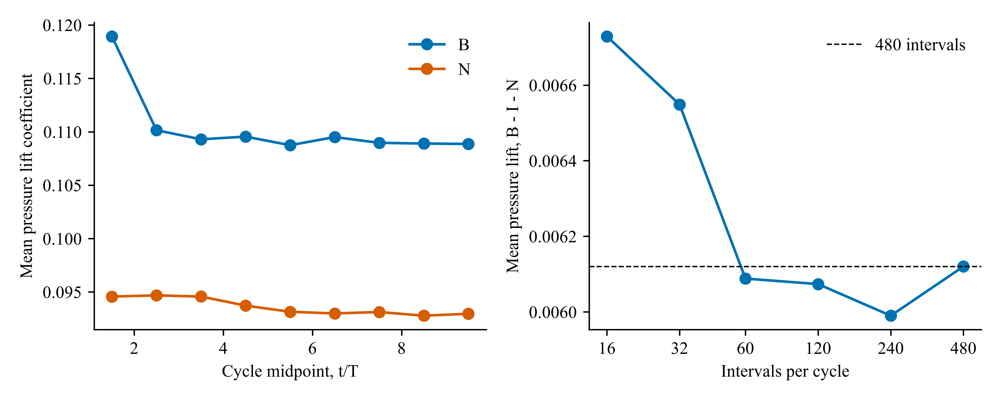

# v17：增升的周期稳定性与发表证据边界

日期：2026-10-23。性质：已有模拟的探索性复核；没有新增 CFD 求解。

**增升在现有末期力记录中稳定为正；完整的因果机制和数值收敛尚未建立。不能将本报告表述为已经完成发表验证。**

## 统一论证

1. **现象成立。** B（身体与鳍）、I（孤立鳍）、N（无鳍身体）的闭合系统原生力记录给出 B−I−N 的总平均增升 0.00589876，压力项 0.00612014，黏性项 −0.00022124。采用实际记录时间积分；与 v14 的归一化相位积分相差约 2.2×10⁻⁸，不改变结论。
2. **不是只选一个周期才得到正值。** 每个算例最后三个完整周期的全部 27 种均值组合，总增升范围 0.00573243–0.00619176，压力增量范围 0.00595274–0.00641464。时间记录彼此相关，这只是末期周期选择敏感性包络，不能称为独立重复、置信区间或统计显著性检验。仍不能据此宣称流场严格周期稳定。
3. **局部载荷具有运动关联。** v15 在同一材料配对面上，运动算例压差载荷增量 0.00613943，冻结整体运动后为 0.00143994，下降 76.55%。几何冻结同时改变身体和鳍的运动，因此这是运动相关证据，尚不能单独归因于身体运动。压力与面积投影的协方差仅占该增量约 0.018%，反对“仅由投影变化造成平均增升”。
4. **压力来源具有局部流动支持。** v16 在共同覆盖的解析层中，正 Lamb 增量主要来自涡量差项，进一步涉及法向剪切与法向速度的切向梯度。上侧贡献占主导；NoFin 在相同流体位置的压力变化不支持简单的身体压力被动叠加。这里比较的是同一算例内部压差及有明确参考的压力，适用于当前 Neumann 压力条件。
5. **因果桥梁尚未全部闭合。** 局部层、配对鳍面和整个 B−I−N 系统是不同积分范围。局部预算仍有相位残差，近壁无效区、压力分区未分配项和身体载荷变化均不能用相关性填补。因此现有结果支持“运动相关的局部相对压力增强”，尚不支持“某一条涡独自造成全部增升”。

## 本次实际计算

读取 B、I、N 及两个静态算例的全部力记录，逐一检查时间单调、步号连续和每完整周期 481 条记录。首周期缺少 t=0，未补零。保存每周期压力、黏性及总升力均值，以及相邻周期波形差的 RMS；源文件 SHA256 与完整数值见 [cycle_evidence.json](cycle_evidence.json)。

保持同一条密集力记录，仅改变积分采样间隔，结果如下。它检验后处理采样，**不等同于求解时间步收敛**。

| 每周期区间数 | 压力增升均值 |
|---:|---:|
| 16（17 个含端点快照） | 0.00672894 |
| 32 | 0.00654869 |
| 60 | 0.00608815 |
| 120 | 0.00607356 |
| 240 | 0.00598996 |
| 480 | 0.00612014 |

17 快照均值比密集记录高约 9.95%；误差并非随区间数单调减小。另用半开周期循环延拓检查所有采样相位，16 区间的均值范围为 0.00505824–0.00730127。此循环延拓分析只衡量采样相位敏感性，不制造额外周期或流场；半开周期均值与含端点梯形积分略有不同。不能将该误差直接移用于局部压力预算，但它证明当前快照数不足以自行保证精确的贡献百分比。

图左 B 为身体与鳍、N 为无鳍身体；图右固定 B 的 9–10、I 的 3–4、N 的 9–10 周期。完整 I 与静态记录在 JSON 中。

## 补算来源核查

本地 Result 下递归查找 restart、input、slurm、out、log 名称，没有找到这批输出对应的运行归档。已有 2026-10-01 试跑包为六种运动配置，说明明确标注尚未提交 CFD；其两周期设置不是当前结果的可验证来源。

旧 step 3840 重启记录来自 oldResults/Sweep35。既有记录审计确认其网格与当前网格逐字节一致，但旧重启头为 385×193×193、参数值 11881.19；现存 Sweep_35/input.dat 的主网格配置为 385×129×129、Re=41379.3，且 no_tsteps=3840 小于 ndump_start=4320。两者不构成当前实际运行配置的证明，不能把旧重启直接替换进当前周期。这里没有认定哪个参数才是当前运行真值。

## 需要补上的实验与验收量

先核实实际运行目录、可执行文件、网格、运动、参数及对应重启的身份，再做以下计算。不能用角度不同的算例冒充网格收敛，也不能将插值快照冒充新增求解结果。

| 检验 | 固定条件与改变项 | 要记录的结果 |
|---|---|---|
| 输出采样 | 同一求解设置，仅更密集输出完整末期周期 | 原生载荷、同一材料配对压差、局部动量项随输出密度的变化 |
| 求解时间步 | 同一网格与连续运动规律，减小时间步并正确重采样运动输入 | 平均增升、相位波形、近壁预算；不能仅修改 dt 而沿用不匹配的 fort.41 |
| 空间分辨率 | 同一物理问题，至少三层有明确细化关系的网格 | 系统与局部观测量、实际细化率和收敛趋势；只有满足条件才估计外推误差 |
| 因果区分 | 身体运动与鳍运动分别控制，保持相同参考几何 | 区分身体运动、鳍运动及其交互作用，而非仅比较整体动/静态 |
| 原生预算 | 导出实际界面掩膜、所有权、原生压力/速度时间层 | 近壁残差及区域载荷与全系统载荷的闭合 |

这些是本项目尚缺的具体计算，不是宣称任何期刊统一规定的验收清单。补算前需要实际集群路径与连接；本轮没有提交作业，也没有生成冒充可运行配置的模板。现有未闭合项保留，发表结论继续受它们约束。

复现：在本地科学 Python 环境执行 `code/run__cycleEvidence.py`；路径与参考尺度集中在 main()。图像包含 600 dpi PNG、带可编辑文字的 PDF/SVG。原始模拟数据不上传。

[v16 局部梯度证据](../2026-10-23-rotation-origin/README.md) · [v15 四算例对照](../2026-10-23-lift-cause-controls/README.md) · [v14 范围与预算](../2026-10-23-integrated-chain/README.md)
