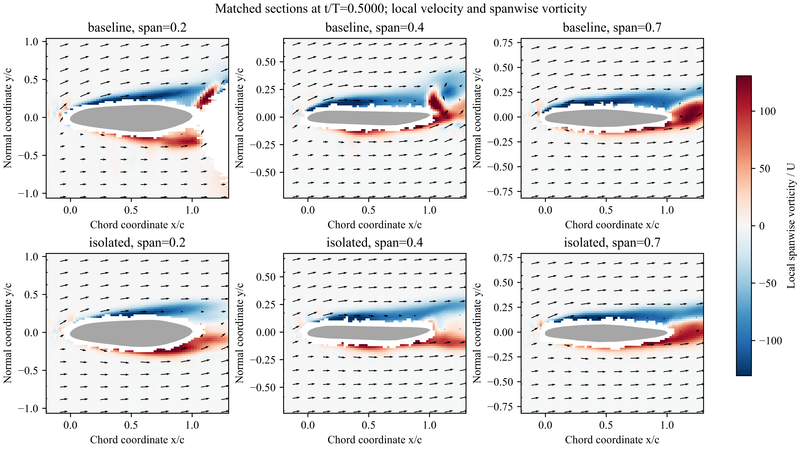
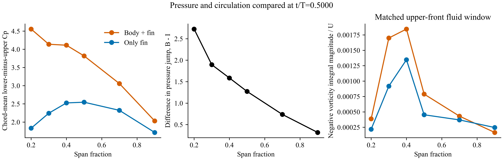

# v19：按 Dong 组的相位—涡量—展向流—压差路线分析 Orca

2026-10-23。固定用户确认的稳定周期。主线改为具体流动结构与载荷的空间、相位对应，不把动量预算分项当作完整机制解释。

## 对照的原文方法

本轮重新读取 [Wang et al. (2019), DOI 10.1088/1748-3190/ab2208](https://doi.org/10.1088/1748-3190/ab2208) 本地原文 PDF 页序 7–12，覆盖结果 3.1–3.3 和 Figs. 5–10 的正文及图注。并非重新完整审阅所有论文原图。

该文先比较翼、身体和整体的力时序，再选增升相位比较三维涡结构。随后在同一组展向切面比较涡量、速度与环量，最后用上下表面压差及其沿展向的分布，把流动差异连接回载荷。Orca 应照此组织证据，不能直接移植蜂鸟的涡名、增强比例或因果结论。

## 本轮实际执行

从同一材料配对的两鳍压力增量时序，分别取两个半周期内保存相位的最大值：t/T=0 和 0.5。另检查前后相邻保存帧，跨周期相邻帧按周期相位连接。共读取 12 份三维流场派生切面缓存，分析六个相位、每相位六个展向位置、两个算例。

切面沿局部四分之一弦线构造，使用同一局部坐标和相同几何；涡量来自原三维梯度。重新从切面表面压力计算 5%–95% 弦长范围的下侧减上侧 Cp，并通过独立压力平移不变性核验。绘图显示局部切面内的速度箭头、展向涡量、压差与共同窗口积分。所有源缓存 SHA256 与逐位置数值见 [dong_comparison.json](dong_comparison.json)。

## 已得到的空间对应

在增升峰值 t/T=0.5：

| 鳍展位置 | B−I 弦向平均压差增量 | 上侧前部负涡量积分幅值 B/I | 展向速度幅值 B/U、I/U |
|---:|---:|---:|---:|
| 0.2 | 2.7253 | 1.7685 | 0.5288、0.4532 |
| 0.3 | 1.8953 | 1.8522 | 0.5118、0.4470 |
| 0.4 | 1.5862 | 1.3699 | 0.4870、0.4275 |
| 0.5 | 1.2720 | 1.7416 | 0.4478、0.3966 |
| 0.7 | 0.7365 | 1.1651 | 0.3700、0.3395 |
| 0.9 | 0.3169 | 0.6744 | 0.3013、0.2768 |

B 为身体与鳍，I 为孤立鳍。两个算例中此处平均展向速度均为负，表中列幅值；没有把它直接命名为涡核轴向速度。前部窗口为 0≤x/c≤0.5、距上表面 0.012–0.04L，逐点取两算例共同有效流体，表中全部窗口有效覆盖 100%。积分是该窗口负展向涡量的面积积分，不是完整 LEV 环量。

**这一相位支持的解释是：身体存在时，鳍根附近伴随更强展向流及上侧前部旋转/剪切层响应；同一内侧区域的上下压差增强最明显，从而增加向上压力载荷。** 在 0.9 展向处，压差仍增强而该窗口负涡量减少，说明不能把这种解释推广为所有位置的一一比例关系。

另一个峰值 t/T=0 也表现出压差增量从根部 2.7742 降至外侧 0.2914；0.2、0.3 位置窗口负涡量幅值分别增加约 26.6%、57.1%，但 0.4 位置略减约 2.0%。展向流幅值在全部六个位置均增加。此处同样保留不符合简单“涡量处处增强”的位置。

## 对应图

上排 B、下排 I；三列鳍展位置 0.2、0.4、0.7。箭头是局部切面内速度，颜色是局部展向涡量/U；白色近壁缺口为未解析有效值，不填零。灰色为鳍截面。涡量色阶和速度箭头尺度在同一图中一致。

左图上下压差，中图 B−I 压差增量，右图共同上侧前部窗口负涡量积分幅值。最强压差增量位于内侧；流动强度差也主要出现在内侧，但两者不是单调比例关系。

另一峰值：[流场](18_sections_phase_00.png) · [压差和涡量积分](19_pressure_circulation_phase_00.png)。PDF/SVG 同名版本保留可编辑文字。

## 当前结论与下一条实质问题

这组结果把“鳍根附近流动改变”和“鳍根压差增强”放到了相同相位、相同空间位置上，是 Dong 组路线需要的具体证据。它支持身体—鳍相互作用伴随内侧鳍的压力载荷增强；尚未区分展向流是增强的原因还是共同响应，也未证明涡量由身体剪切层输运而来。

原有上侧前部涡量连通轮廓会触及无效近壁点或采样边缘，部分还延伸到剪切层。其 5%、10%、20% 轮廓积分及不闭合标记完整保留在 JSON；不能当作已提取的完整 LEV 环量。因此主图采用统一窗口而不把变化中的连通域直接比较为 LEV 强度。后续沿已有相邻相位和三维涡线追踪鳍根流动来源，检验身体剪切层是否与这片上侧流动相连；无需重新验证周期稳定性。

复现：`code/run__dongComparison.py`。本轮没有新增 CFD，不以新增模拟为完成上述分析的前提。
