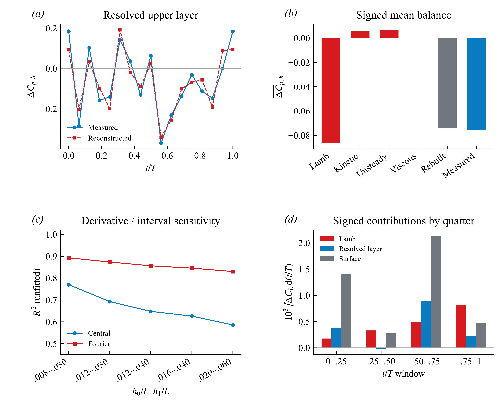
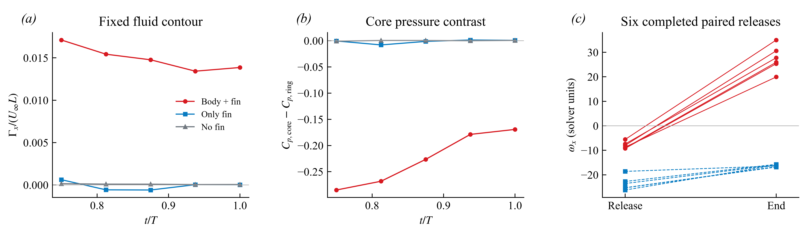
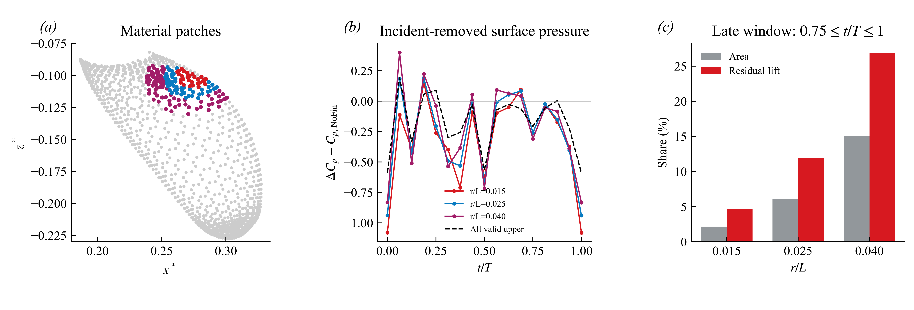
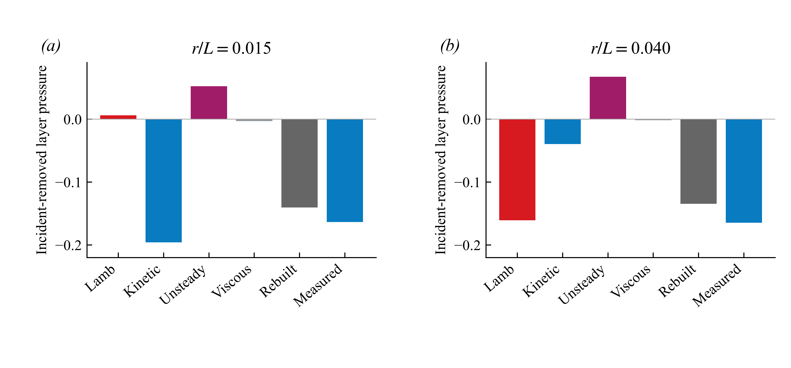

> v13 修正：按用户确认的 Neumann 压力边界，跨算例单侧压力残差的绝对值不能直接解释为额外吸力；以 [零点无关的上下表面压差分析](../2026-10-23-pressure-gauge/README.md) 为准。旧版开放面片载荷与残差比例不构成独立力归因。

# Orca 研究进度与新增证据：从涡结构走向压力机制

2026-10-23，America/New_York。任务 ORCA-EVIDENCE-011。状态：本轮整理、复核和局部压力分析完成；项目研究继续。本文为内部研究报告，不是投稿定稿。

## 现在到哪一步

目前已有：工况对照、表面压力与升力核对、近鳍动量预算、RV⁺ 形成路径、主要涡结构分类。最新的历史图谱是 v10。本轮 v11 不再增加涡名，而是复核这些证据能否共同支撑机制，并新算了 RV⁺ 附近的材料面片压力预算。

论文最有希望的主线是：**在当前起伏运动 Orca 构型中，体鳍耦合同时改变鳍旁涡量组织与上表面吸力；这种变化具有空间结构，不能用单个涡强度或统一放大系数概括。**

这里有工况内的新发现候选：耦合依赖的正向流向分支及鳍旁流体的流向分量反号。尚未证明全球首次、Orca 独有、身体越大越强，或 RV⁺ 单独贡献了多少升力。为涡另取一个名字，不构成创新本身。

## 本轮新算了什么

### 1. 平均闭合与瞬时闭合必须分开

独立读取已保存的逐相位量，复算一个周期的梯形积分，并检查端点与压力账目。

| 量：上表面 h/L=0.012–0.040 | 结果 | 能说明什么 |
| --- | ---: | --- |
| 实测平均层间压力增量 B−I | −0.075883 | 指定流体层的平均吸力差 |
| 速度场重建均值 | −0.074159 | 平均相对误差 2.271% |
| 瞬时误差 RMS / 实测波动 RMS | 37.94% | 不能把 2.3% 写成所有相位的误差 |
| Lamb 项与实测层间压力的相位相关 | 0.1073 | 单个 Lamb 信号不能解释整个瞬时波形 |
| 中心差分 / Fourier 重建的未拟合 R² | 0.6478 / 0.8561 | 时间导数处理显著影响相位重建 |

原报告的周期平均方法是正确的；本轮没有发现重复端点计权错误。若误把含两个同相端点的 17 帧作普通算术平均，层间压力均值会变为 −0.060577；这只是错误方法对照，不能替换正确结果。一个周期的相位点也不是 17 个独立重复实验。

**图 1.** (a) 同一材料面片、同一流体层的实测与重建差值。(b) 有符号的周期均值。(c) 既有五组积分区间的导数敏感性；第一组只覆盖约 21.9% 上表面，其他约 97.5–97.9%，跨区间比较同时改变路径及有效面片，不是网格收敛证明。(d) 各四分之一周期对周期平均的有符号积分，四段相加回到全周期均值。PNG 600 dpi；[PDF](01_pressure_evidence.pdf)；[SVG](01_pressure_evidence.svg)。

在覆盖约 97%以上表面的四个区间中，层间压力对应的上表面升力份额为 26.25–34.48%，Lamb 项份额为 18.85–42.22%。这些是不同路径的压力账目，不是同一物理量的置信区间，也不是单涡受力比例。

### 2. RV⁺ 的结构证据复核成立，但不能代替受力归因

复核同点释放记录：7 对候选中有 6 对完整轨迹，6 对均在 Body + fin 中由负 ωx 变正，Only fin 中仍为负；停止的 1 对不计入完整轨迹结论。它们是同一模拟的邻近采样，不是独立实验。

**图 2.** 前两图沿用已选 C473 邻域的相同全流体闭合圆周，r/L=0.008，U∞=0.29，L=1；第三图仅连接释放与终点，不表示中间涡量线性变化。分量反号不等于整根涡管反转或重联。[PDF](02_branch_evidence.pdf)；[SVG](02_branch_evidence.svg)。

本轮新拆分发现：t/T=0.75–1 的有符号积分占全周期上表面 Lamb 升力增量的约 45.14%，但仅占上表面净增升约 11.01%。因此，即使该时段 RV⁺ 明显存在，也不能把全部增升归给它。其余压力项和外侧压力会抵消或重分配局部收益。

### 3. 新增空间桥接：RV⁺ 邻近鳍面确有更集中的额外吸力

这是本轮新做的探索性检验。以 t/T=0.75 已有的 C473 核位置为依据，在上表面选最近材料面片，再按该相位面片中心的欧氏距离划定三个嵌套邻域；之后整个周期保持材料索引固定。未按压力结果挑选面片。

定义 R=Cp(B+F)−Cp(F)−Cp(B)。它是扣除 NoFin 同位置入射压力的诊断残差，不是唯一物理分解。所有动量项均使用同一有效面片；参考上表面共 1154 片，在锚定相位覆盖约 97.88% 原始上表面。下表面积份额以此有效上表面为分母，升力份额以其同一晚期窗口 R 对应的有符号升力积分为分母。

| 邻域半径 r/L | 面片数 | 有效上表面面积份额 | 晚期残差升力积分份额 | 晚期面均 R |
| --- | ---: | ---: | ---: | ---: |
| 0.015 | 28 | 2.178% | 4.680% | −0.309993 |
| 0.025 | 78 | 6.090% | 11.934% | −0.293589 |
| 0.040 | 160 | 15.089% | 26.893% | −0.274053 |
| 全部有效上表面 | 1154 | 100% | 100% | −0.168299 |

这支持“已识别分支附近存在额外吸力集中的鳍面区域”，但**不能将 4.68%、11.93% 或 26.89% 称为 RV⁺ 贡献率**。邻域也包含其他流动效应；分支选取来自既有观察，属于事后探索。

**图 3.** (a) 固定材料邻域，坐标按 (x−10,y−6,z−6)/L；(b) 入射压力扣除后的面均压力；(c) 晚期窗口 t/T=0.75–1 的面积份额与残差升力份额。原始数据保持不变。[PDF](03_local_pressure_bridge.pdf)；[SVG](03_local_pressure_bridge.svg)。

### 4. 新发现的限制：紧邻涡核的局部预算不能照搬全表面结论

对上述同一面片，进一步独立重建 B−I−NoFin 的动量各项。最小邻域 r/L=0.015 在晚期的实测层间残差压力为 −0.163445；Lamb 项为 **+0.006158**，动能梯度项为 **−0.195659**，非定常项为 +0.052260，黏性项约 −0.003088，重建为 −0.140328，未闭合余量为 −0.023118。中心差分重建为 −0.142683，同样不支持“局部 Lamb 主导此小邻域压降”。

扩大到 r/L=0.040 后，Lamb 项为 −0.160611，动能梯度项为 −0.039489。**预算项的空间分布发生明显变化。** 动能梯度与涡量在流体力学上耦合，不能将这个结果解读为“涡对附近压力没有作用”。它否定的是“有涡的地方，其下方局部法向 Lamb 项必然主导吸力”这个过强解释。

**图 4.** 同一参考坐标系，h/L=0.012–0.040，t/T=0.75–1，先逐工况计算再作 B−I−NoFin。两图使用相同纵轴。保留未闭合余量，不作拟合。Lamb 与动能梯度分拆依赖表达形式及参考系，不应视为独立干预的因果份额。[PDF](04_local_momentum_terms.pdf)；[SVG](04_local_momentum_terms.svg)。

## 公式如何连接这条研究主线

不可压、常密度、牛顿流体在当前参考系中满足

$$\nabla p=-\rho\,\partial_t\mathbf u-\rho\nabla(|\mathbf u|^2/2)+\rho\,\mathbf u\times\boldsymbol\omega+\mu\nabla^2\mathbf u.$$

沿由鳍面指向流体的法向 n，在 h0 到 h1 积分，得到

$$p(h_0)-p(h_1)=\rho\int_{h_0}^{h_1}[\partial_t\mathbf u+\nabla(|\mathbf u|^2/2)-\mathbf u\times\boldsymbol\omega-\nu\nabla^2\mathbf u]\cdot\mathbf n\,dh.$$

移动采样点速度为 v_probe 时，用 ∂t u = d u(x_probe(t),t)/dt − (v_probe·∇)u 修正；不能直接把沿移动采样路径的导数当作欧拉导数。代码使用原项目的 U=0.29、L=1、T=1、ν=1/41379.3 与保存的面元法向及力投影权重。

表面压力另有可核对的恒等式：R_surface=R(h1)+[R(h0)−R(h1)]+[R_surface−R(h0)]。这三项依次是外侧压力、已解析层、未解析近壁段；外侧不等于纯身体压力，近壁不等于纯涡压力。升力最终来自同一面元的压力法向投影积分。Q 或环量不能直接替代这个积分。

## 文献究竟帮助了什么

| 来源与本轮核对范围 | 用于本项目的具体动作 | 不能照搬的结论 |
| --- | --- | --- |
| [Wang 等 2019](https://doi.org/10.1088/1748-3190/ab2208)，本地全文 §3.1–3.2、图5–7重读 | Body / fin / combined 对照；把涡核、压力和受力一起检查 | 蜂鸟的头部剪切层供给不能直接解释 Orca RV⁺ |
| [Liu 等 2017](https://doi.org/10.1017/jfm.2017.533)，本地全文 §4.3.2、图13–15重读 | 区分身体原有涡、鳍涡、当前与前半周期结构；用有符号涡量与环量比较 | 尾鳍捕获后体涡不自动等同于胸鳍附近的分量反号 |
| [He 与 Breuer 2026 预印本](https://arxiv.org/html/2604.21054v1)，网页实验设置及载荷/流动段落 | 提醒同步比较载荷与结构，并把运动参数变化作为未来检验 | 二维刚板和刚壁结果不能证明本三维 Orca 的首次性 |

本轮是针对机制的定向复核，不是系统综述。历史文献清单的“可用全文”或“曾筛查”不等于本轮逐篇重读。文献原文不上传这个仓库。

## 下一步：当前已有数据能做什么

1. **先做空间对照，而非继续取新涡名。** 围绕当前锚点加预先指定的上游、下游与展向偏移对照，保持相近面积和相同有效面片规则；检验吸力集中是否特异于 RV⁺ 邻近区域，还是普遍的根部压力梯度。将所有对照一起报告。
2. **把预算画到同一材料面。** 将动能梯度、Lamb、外侧压力、近壁未解析段及闭合残差映射到相同面片；检查小邻域与大邻域主导项变化是否来自空间投影。保持中央/Fourier 双方法对照。
3. **补真正的数值验证。** 当前存储为 T/16，子步积分更细不能补回原始时间信息。更密快照、多周期及网格研究需要原始算例支持；尚未运行，不写成通过。

预期论文六幅主图：构型与控制工况；升力/压力差；有符号涡结构图谱；同点释放与转向；空间压力预算；敏感性与剩余问题。已有图不必全塞主文，历史报告作为补充依据。英文结果草稿见 [MANUSCRIPT_DRAFT.md](MANUSCRIPT_DRAFT.md)，下一轮验收标准见 [NEXT.md](NEXT.md)。

## 验证与可复现性

运行 `python code/run__evidenceAudit.py` 和 `python code/run__localPressureBridge.py`。路径与绘图设置在各 runner 的 main() 中；依赖 Python 3.12、NumPy 2.5.3、Matplotlib 3.11.2。前者读取研究目录中的五项保存结果；后者读取既有 51 个逐相位 profile 文件及 geometry。原始 profile 数据保留本地，仓库不是全数据自包含运行包。

已通过：17帧相位网格、压力/升力加和恒等式、原均值复算、四分之一周期积分加和、6组完整同点释放的符号检查；局部分析的压力三段恒等式与嵌套面片检查；独立动量实现重现原全上表面8个 B−I−NoFin 均值，最大差约 1.4×10⁻¹⁷。最初局部断言错误地包含无效近壁采样，已改为在全周期共同有限值面片上检查；未填补或伪造缺失值。

四幅新图已目视检查；SVG 中科学数据为嵌入图片，文字保留 text 元素，坐标与注释可编辑。PNG 为600 dpi，PDF/SVG为混合导出。没有运行新 CFD 求解、硬件实验或独立重复统计检验。报告数字来自新代码执行，输入 SHA-256 见 [audit_metrics.json](audit_metrics.json) 与 [local_pressure_bridge.json](local_pressure_bridge.json)。

代码在本轮工作树上执行，上传前基线提交为 602824d；包含本报告的新提交编号以 GitHub 提交记录为准，不预填未来 SHA。

## 报告合集与研究方法工具

[23 份去重历史报告/草稿/片段目录](../history/README.md)。其中 R19 是旧版本，原路径有两张缺失配图，已明确标记；当前 v10 和本轮图未缺失。合集保留历史错误和修正脉络，不把旧版叙述冒充当前结论。

本轮安装并采用英文 scientific-critical-thinking、hypothesis-generation、scientific-writing 的证据与替代解释流程。未调用外部付费模型或向其发送研究数据；本仓库上传范围遵循用户明确授权。方法工具引用：Kassis, Agarwal, He, Patel & Brueckner (2026), [Scientific Agent Skills: A Library of Procedural Knowledge for Research Agents](https://arxiv.org/abs/2609.00065)，本轮核对元数据为 v2。它们帮助组织推理，不构成物理结论的验证。
