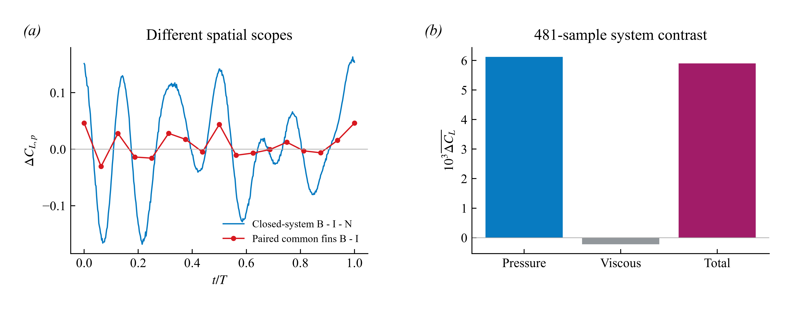
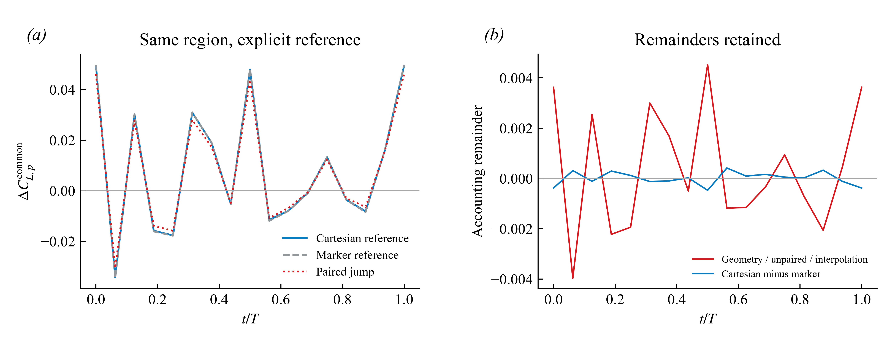
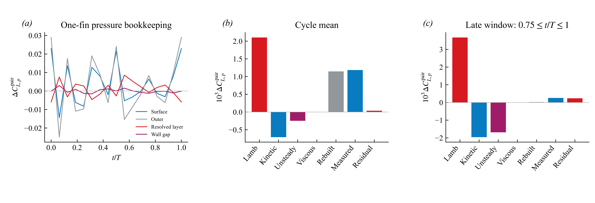

# Orca v14：从压力差到载荷、再到机制的完整核验

**本轮结论：已有数据支持“体鳍组合改变上下表面压差，并产生正的系统载荷对照差”；还不支持“RV+ 单独造成全部增益”或“已定量证明涡量反转的来源”。流程已执行，不把物理预算未闭合掩盖为代码通过。**

数据范围是已存储的单个周期：B（Sweep35）9–10，I（Sweep35_OnlyFin）3–4，N（NoFin）9–10。三个算例各有 481 个载荷样本，压力/速度场预算采用 17 个相位。这不是多周期统计，也不是网格或时间收敛证明。

## 1. 先确定可比较的物理量

在当前 Neumann 压力设置下，每个算例允许独立的空间常数偏移 p_k(x,t)→p_k(x,t)+c_k(t)。所以采用 J_k=Cp_lower,k−Cp_upper,k，再计算 ΔJ=J_B−J_I。下表面在共同材料坐标的 x–z 图上做三角插值，不外推；最大边长 0.02L，固定配对随材料点运动。它是明确的几何配对定义，不冒充唯一的法向厚度配对。

共同区域是开口区域，直接积分其绝对压力仍然依赖零点。这里每个算例以共同下表面的面积加权平均压力 p_ref,k 作参考，并同时保留其区域面积向量。代码对场和参考一起施加独立、随相位变化的常数偏移，核验区域积分不变。闭合整体压力积分本身不受常数偏移影响；导出网格/接口的离散闭合误差仍需核验。

本报告使用向内的三角面积向量 A，以及 Cp=2p/U²、U=0.29、S_ref=0.548382。求解器力文件已经带两倍物理力的写出约定，故原始力列除以 U²S_ref，不能再多乘或少乘 2。这里的 p 是求解器运动学压力。

## 2. 效果：完整系统的对照差确实为正

定义 D_sys=C_L(B)−C_L(N)−C_L(I)，全部取闭合物体的载荷。

| 481 点周期平均 | D_sys |
|---|---:|
| 压力 | +0.006120117 |
| 黏性 | -0.000221242 |
| 文件中的总力 | +0.005898733 |

压力正增量大于黏性负增量，因此该周期总的对照差为正。文件分别四舍五入压力、黏性和总力，三者不要求逐点机器精度相加；最大差为 1.78e-05。

17 相位的压力平均值为 0.006728936，比 481 点值高 9.95%。后文 17 相位局部预算不能冒充高时间分辨率的全周期结论。

B/N 的共享顶点运动也重新读取了原始标记面：以 5×10⁻⁶L 的初始匹配容差匹配到 9706/25202 个顶点，匹配部分全周期最大位置差 5.84e-06L。未匹配顶点可能来自不同剖分或不同几何；这一检查没有证明全体表面运动完全相同。因此 D_sys 是这三个已存储算例的组合对照差，对“仅改变体鳍耦合”的因果解释仍以完整运动/几何控制核验为条件。

## 3. 桥梁：上下压差确实能解释同一区域的载荷变化

定义 F_pair=Σ ΔJ·(−A_y,upper)/S_ref。两个鳍共 2169 个上表面查询三角面。该量是配对压差的薄面载荷代理，有限厚度、未配对部分及几何插值不能悄悄略去。

| 共同区域、同一参考下的周期平均变化 | 数值 |
|---|---:|
| 配对压差积分 F_pair | +0.006139429 |
| 三角标记面的参考压力积分 | +0.006310201 |
| 原始笛卡尔接口的参考压力积分 | +0.006343655 |
| 几何、未配对与插值余项 | +0.000170773 |
| 笛卡尔接口减标记面积分 | +0.000033454 |

逐相位核验：接口参考力=配对压差积分+几何/未配对/插值余项+离散化差。配对积分相对接口参考力的 RMS 误差为其波动标准差的 8.96%；标记面积分相对接口仅为 1.03%。这是有用的压力—载荷桥梁，但它仍然是指定参考下的开口区域载荷。

重新读取的 B/I 全部 34 个原始压力接口，映射后与已存储缓存逐项一致。该一致性验证读取和映射复现，不是独立验证求解器内部边界处理。完整接口重建相对实际求解器压力力的波动归一化 RMS 误差分别为 0.176% 和 0.056%；内部六向边界掩码、物体归属和双精度几何量未全部导出。

**不能跨越的推论：** F_pair 的平均值接近 D_sys 的平均值，不代表它解释了全部系统力。两者在同样 17 相位上相关系数为 0.9926，但 RMS 差达到系统波动标准差的 75.1%。区域范围不同、身体响应及未配对部分仍在其中；这个差不是单一数值误差，也不能直接命名为 RV 力。

## 4. 压差从何而来：保留外层、解析层和壁面间隙

负 z 一侧的鳍有 1081 个共同有效配对点，覆盖原共同上表面面积的 96.24%。对上下表面分别沿外法向采样，再做配对相减。逐面、逐相位成立：

J_surface = J_outer(h₁) + [J(h₀)−J(h₁)] + [J_surface−J(h₀)]，其中 h₀=0.012L，h₁=0.040L。

| 单鳍配对载荷变化 | 周期均值 | 后四分之一周期均值 |
|---|---:|---:|
| 表面总压差 | +0.003095379 | +0.004572232 |
| 外层配对压力 | +0.001871075 | +0.004813186 |
| h₀–h₁ 解析层压差 | +0.001184123 | +0.000256866 |
| 壁面–h₀ 间隙 | +0.000040182 | -0.000497820 |

这是压力的空间记账恒等式，不是三个独立因果贡献。尤其不能把外层压力称为“没有涡的背景”；外层压力同样由整个流场决定。

不可压常黏度动量方程给出 −∇p=∂u/∂t+∇(|u|²/2)−u×ω−ν∇²u。沿两侧法向分别积分、再配对相减，得到解析层的 Lamb、动能梯度、非定常和黏性项。移动采样射线的时间导数已经减去 (∇u)·v_ray；未进行拟合、幅值缩放或以余项校准各项。

| 解析层预算 | 周期均值 | 后四分之一周期均值 |
|---|---:|---:|
| Lamb | +0.002103374 | +0.003674193 |
| 动能梯度 | -0.000707674 | -0.001957660 |
| 非定常 | -0.000246150 | -0.001688015 |
| 黏性 | -0.000003052 | -0.000005876 |
| 四项合计 | +0.001146498 | +0.000022642 |
| 实测解析层 | +0.001184123 | +0.000256866 |
| 实测减重建 | +0.000037624 | +0.000234224 |

正 Lamb 项被动能和非定常负项显著抵消，后四分之一周期尤其明显。因此不能用 Lamb 项大小直接代表净压差或某个涡的升力。周期平均误差为实测层均值的 3.18%，但瞬态 RMS 误差仍为波动标准差的 39.2%。换用中心时间差分后该误差为 61.2%，提示当前 17 相位导数敏感；两种方法的差异不是时间收敛证据。ν 来自现有输入文件，运行副本身份尚未独立归档。

## 5. 涡结构证据能走到哪一步

前轮六条完整的配对轨迹支持 B 中 ω_x 由负转正、I 中仍为负；这些相关轨迹不构成六个独立重复样本，也不证明整个涡管翻转。RV+ 的环量与核–环压力差支持局部旋转及相对低压的共同出现。但前轮 Neumann 一致的空间对照显示，上游等面积区域的后期压差增量 0.59573，高于 RV+ 邻域的 0.45163。因此 RV+ 邻域不是唯一增强位置，当前证据更符合分布式压力重分配，而非独占的局部吸力来源。该判断是对现有空间对照的解释，未建立唯一因果机制。

本轮不是只说“需要力分解”：已经重新审计 102 个保存的辅助势结果。势求解最大相对残差 1.99e-09，目标记账误差 2.08e-17，但宽域、去两层近壁单元方案仍有未分配均值 -0.001634515，相当于其原区域目标的 -55.6%。其中约 93.35% 是定义上的近壁余项。原目标为单鳍区域、旧参考约定，不能把这些比例移植到本轮闭合系统 D_sys。数值方程解得准不等于物理归因闭合。

涡量来源的 98 个已算窗口中，仅 44 个全部项采样有效；即使只看有效窗口，绝对余项/|Δω_x| 的中位数仍为 47.7%。所以暂不能认定拉伸、倾斜或黏性中的哪一项已经定量解释反号。

## 6. 论文应使用的逻辑，以及下一项真正要解决的问题

可写的主线是：**三算例的闭合载荷对照 → Neumann 不变的上下压差 → 同一区域的压力积分载荷 → 外层/解析层/壁面间隙 → 解析层内部相互抵消的动量项 → 涡结构的空间与时间证据 → 明确未闭合的来源与单涡归因。** 这条链已经有结果、公式、三张新图、输入哈希和一键运行代码；最后两步不能用一张涡图补齐。

文献的作用已经落实到分析设计：[组内及方法文献矩阵](../2026-10-23-mechanism-logic/LITERATURE_MATRIX.md) 中 L01 对应三模型对照，L05 对应“效果→相位→结构→压力→力”的英文组织，L08 对应同时核验均值和波形，L07 对应保留应变和边界项的力分解。本轮没有新增全文阅读，不把先前选定段落阅读夸大为全部文献已审查。

优先后续工作是将压力与速度导数预算改为求解器原生时间差分/更密相位输出，并导出近壁边界掩码与运动信息；同一流程直接检验余项是否下降。现有三种辅助势区域已经算过，继续画同类 Q 图无法消除近壁余项。正式单涡归因之前，还要将区域目标转换为一致参考或闭合控制面，并做域、近壁剔除和时空分辨率收敛。现有结果没有证明新的高分辨率计算已经执行。

## 运行与交付

运行 `python code/run__researchPipeline.py`，依次执行 34 相位原始接口重读、481 点载荷对照、压差载荷桥梁、配对动量预算、几何检查、102 个既有势解与涡量窗口审计、PNG/PDF/SVG 出图和本报告生成。配置路径位于两个被调用运行脚本的 main()。依赖 numpy/scipy/matplotlib/pyvista，以及本地 Picar_Post 的 TecIO 读取器和 DLL；原始数据留在本地，不上传 GitHub。`chain_signals.npz` 是本轮导出的少量报告曲线，不是原始 CFD 数据。

结果：[完整指标](integrated_chain.json)、[原始接口核验](raw_interface_audit.json)、[流程执行记录](pipeline_run.json)、[英文结果段落](MANUSCRIPT_DRAFT.md)、[已执行清单](TODO.md)。v12 单侧绝对压力的“19.3% 更强吸力”继续撤回，不能引用。
