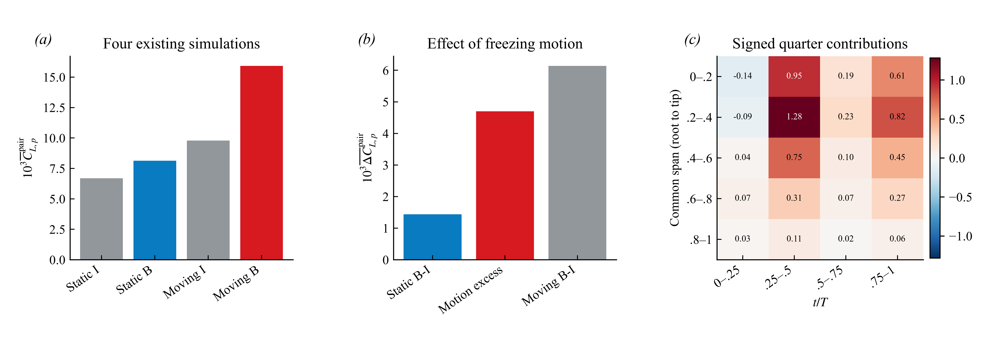
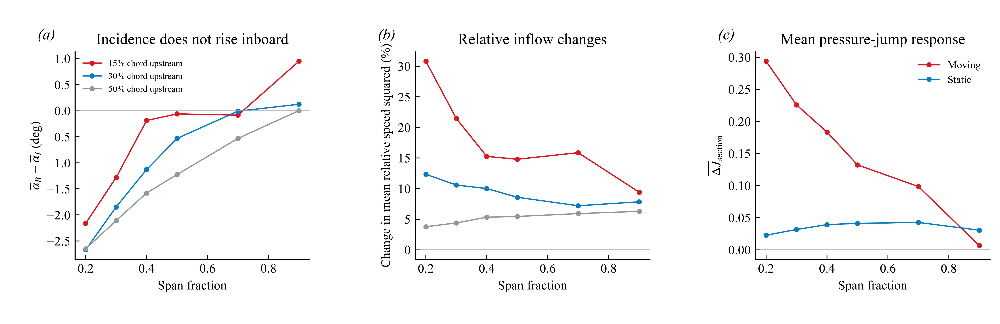

# Orca v15：为什么胸鳍的平均压力载荷增大？

**现有算例支持的解释是：身体改变了运动胸鳍的三维流动与压力响应，使增益集中出现在鳍根到内侧区域，并形成更大的周期平均上下压差。该效应大部分在冻结运动后消失；直接加速度项不能解释平均增益，而已解析的旋转相关压力源项提供了稳定的正贡献。**

这次不是把旧结果重新排列。新增分析把已有四个算例用于区分原因，重新计算 Neumann 不变的压差载荷、静止/运动交互对照、空间和相位贡献、压力与几何投影的协方差，并重新积分原有辅助势各项。下文解释的是**共同胸鳍区域的压力载荷增量**，不会把该区域的份额转写为整个系统的升力份额。

## 从“有增益”到“什么造成增益”

研究量为 J=Cp_lower−Cp_upper；在同一材料配对上，F_pair=Σ J(−A_y,upper)/S_ref，其中 A 是向内的三角面积向量。B 为体鳍组合，I 为孤立鳍。两者的共同鳍面位置与面积向量在全部相位一致，所以比较的不是两套不同鳍运动。每个算例独立加入随时间变化的压力常数，J 和 F_pair 均保持不变。

首先检验“仅有身体的静态几何就能解释增益”这一解释。我们实际使用四个已有算例，而不是从运动流场中截取一帧冒充静止流场：

| 算例 | 共同配对鳍面平均压力载荷代理 |
|---|---:|
| 静止孤立鳍 | 0.00668719 |
| 静止体鳍 | 0.00812713 |
| 运动孤立鳍 | 0.00978378 |
| 运动体鳍 | 0.01592320 |

静止时的身体效应为 0.00143994，运动时为 0.00613943；二者相差 0.00469948。换言之，**把运动冻结在平均姿态后，身体带来的这一压差载荷增量下降了 76.55%**。静止几何确实提供正增益，但不能解释运动情况下的大部分增益。

这个对照成立的关键不是算例名称含有 Static。我们核对了材料面编号和共同区域；静止几何与运动几何的周期平均位置最大差约 5.4×10⁻⁷L，静止算例的表面确实不动。四算例统一使用 2169 个材料配对点。另用静止几何独立重建配对图，静止增量为 0.00142080，结论保持。这里冻结的是整个几何运动，因此 76.55% 是这组“运动/冻结”比较的差额比例，不能称作身体运动、胸鳍运动、某个涡或惯性各自的唯一份额。

图 12：左图为四算例的共同鳍面载荷代理；中图将运动算例 B−I 对照分成静止 B−I 与剩余差额；右图为各共同展向带和四分之一周期对平均增益的有符号积分，色标及格内数值均为积分值乘 10³。颜色不表示显著性。

## 运动带来的是平均压差改变，不只是表面朝向改变

接着区分两个不同解释：一是同样压力因鳍面转向而投影出更多垂直力，二是流动本身形成了更大的上下压差。用严格恒等式

mean(ΔJ·w)=mean(ΔJ)·mean(w)+mean[(ΔJ−mean(ΔJ))(w−mean(w))]，w=−A_y/S_ref，

逐个材料配对点计算并求和，得到平均压差作用于平均投影的贡献 0.00613832，而压力与投影变化的协方差仅为 0.00000111，即总增量的约 0.018%。因此在这一定义和周期内，**增益主要体现为平均上下压差的改变，不能用压力与表面投影的相位配合来解释。** 这个恒等式不否认几何会通过流场间接改变压力，也不是附加质量/涡力分解。

空间上，共同展向内侧 60% 区域贡献了平均增量的 84.73%。这里的展向坐标以共同材料区域的根部和尖端归一化，与截面图采用的原始鳍展向坐标略有区别。时间上，0.25–0.50T 和 0.75–1.00T 分别贡献 55.53% 和 36.10%；第一个四分之一周期略为负贡献。**平均增升来自特定阶段、以内侧为主的压力偏置，不是所有相位、所有位置都同比例增升。** 这些比例来自当前 17 相位积分，不是时间收敛后的精确份额。

## 来流确实改变，但“平均迎角增大”不是答案

在前缘上游 0.15c、0.30c、0.50c 三处，使用流体速度减局部鳍面运动速度，检查相对速度和有效迎角。最强增益所在的内侧截面，有身体时平均相对速度平方上升，但平均迎角下降。例如原始展向 0.2 处、上游 0.30c：相对速度平方上升 12.34%，平均迎角下降 2.67°，上下压差增量却为正。

因此不能用“身体增加了平均迎角”解释这里的增升。还计算了瞬时相对速度平方乘 sin(2α) 的简单准定常代理，再做周期平均；在 0.2、0.3、0.4 展向处，其 B−I 增量分别为 −0.0543、−0.0337、−0.0131，与实测正压差增量的方向相反。这仅反驳这一个简单代理，不能替代校准过的三维非定常模型，也不等于排除所有来流速度作用。

这里的上游探针仍含胸鳍自诱导流动，不能把它作为独立施加的入口条件。三个距离给出的速度增幅不同，但内侧平均迎角下降的方向一致。因此支持的是“身体改变了局部相对流动”，而不是“某个探针的速度增加了多少，就造成同百分比升力增加”。

图 13：左、中图显示运动 B/I 的平均迎角差与平均相对速度平方变化；右图显示同一算例内部先作上下压差、再跨算例相减的截面结果。运动截面采用 17 相位，静止截面采用已有的 0、0.5、1 三时刻；四算例表面载荷比较均用 17 相位。240 个截面–时刻的压差均由保存的上下压力剖面重新积分核验，最大差 1.33×10⁻¹⁵。

## 为什么运动相关增益不等于“附加惯性力的平均值更大”

冻结运动会同时改变惯性与旋转流动，因此还需要力学源项区分。对已存储的 102 个辅助势结果重新积分，在 standard、wide 和 enclosed 三种区域中，B−I 的直接加速度项周期均值分别为 −0.00004013、−0.00004649、−0.00004087：都很小且略为负。**这个直接加速度项不能提供所需的正平均增量。** 它可以影响很大的瞬时振荡，但不能因此被认定为正平均增升的来源。此判断不排除运动通过改变涡量与压力场产生间接作用。

同一套辅助势定义下，已解析 Q 压力源项在 standard/wide 两种区域、剔除 1/2/3 层近壁单元的六种组合中，B−I 周期均值均为正（0.003214–0.004706）。其中旋转部分均为正（0.004481–0.005363）；应变部分在五种组合中抵消部分正贡献，一种组合中为小正值。这个符号一致性支持**旋转相关压力响应是正增益的重要来源**，比“涡看起来更强”多了一层带几何权重的力学证据。

需要准确保留的边界是：上述辅助势目标为原来的单侧鳍区域，不是本报告的双鳍配对代理，不能混用百分比。加速度与 Q 源项不依赖压力零点；外边界项及未分配项仍采用其原参考约定。六种组合的未分配项均为负，约 −0.000732 至 −0.002036，尚没有拆成各项物理来源。因此当前能说明正的已解析旋转贡献及其被其他项抵消，不能把整个净增量唯一分给某一条命名涡。

上一轮上下配对的法向动量预算还给出了相容的证据：解析层内 Lamb 项平均为正，但动能梯度和非定常项抵消了一部分。那是另一种空间范围和记账方式，不能与辅助势数值直接相加；两者共同反对“直接加速度项或单个正项就是全部平均升力”的解释。

## 现在可以怎样回答“为什么升力变大”

**身体存在改变了运动胸鳍的三维流动响应；这种变化主要在鳍根到内侧增强了周期平均上下压差，压力积分后形成正的平均鳍载荷增量。冻结运动后，这个增量大幅减弱，说明主体是运动依赖的体鳍相互作用。直接加速度项的平均值不能解释正增量，而已解析的旋转相关压力源项在多种计算区域和近壁剔除设置下均给出正贡献。**

这条解释的顺序是：**四算例干预对照定位“运动依赖的身体效应” → 压差与投影恒等式定位“平均压力响应” → 展向/相位积分定位“内侧及关键时段” → 来流检验排除“平均迎角更大”的简单解释 → 源项积分区分“交变惯性”与“旋转相关平均压力贡献” → 回到压差积分得到载荷。**

RV+ 的角色应在这条主线上检验，而不应先规定它必须是答案。已有上游空间对照也显示压差增强并非 RV+ 邻域独占。现阶段最合适的论文主张是“运动依赖、内侧主导的体鳍压力增益，得到旋转相关压力源项支持”；若进一步写成“某个涡贡献了多少净升力”，则需要将未分配项和一致参考下的单涡目标解决后再量化。

## 复算与证据范围

- 已运行 `python code/run__liftCauseControls.py`：四算例几何/材料索引核对、独立压力常数偏移、静止配对敏感性、投影恒等式、展向求和、240 个压力剖面重积分、102 个辅助势结果积分及图 12–13 全部通过。
- 原始数据没有更改；本轮使用四个既有载荷缓存、截面剖面及辅助势输出，没有宣称重新执行 CFD 或重新求解辅助势。相对来流指标来自现有截面采样表，并核对其生成代码中的定义；本轮没有重读所有原始速度体场。
- [完整数字、敏感性及输入哈希](cause_controls.json)；[英文论证](MANUSCRIPT_DRAFT.md)；[上一轮完整系统与区域载荷核验](../2026-10-23-integrated-chain/README.md)；[此前文献证据矩阵](../2026-10-23-mechanism-logic/LITERATURE_MATRIX.md)。本轮没有新增全文阅读。
- 单周期、17 相位的场数据不足以宣称时空收敛；冻结对照没有单独区分身体与胸鳍各自运动；运行参数副本身份与近壁源项闭合仍需进一步核验。这些限定约束结论强度，不抹掉上述已经执行的对照结果。
