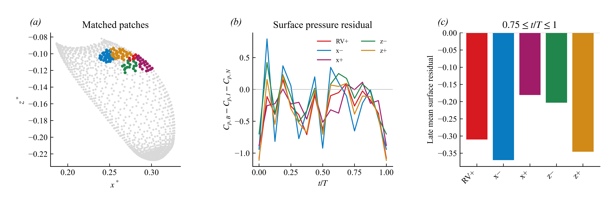
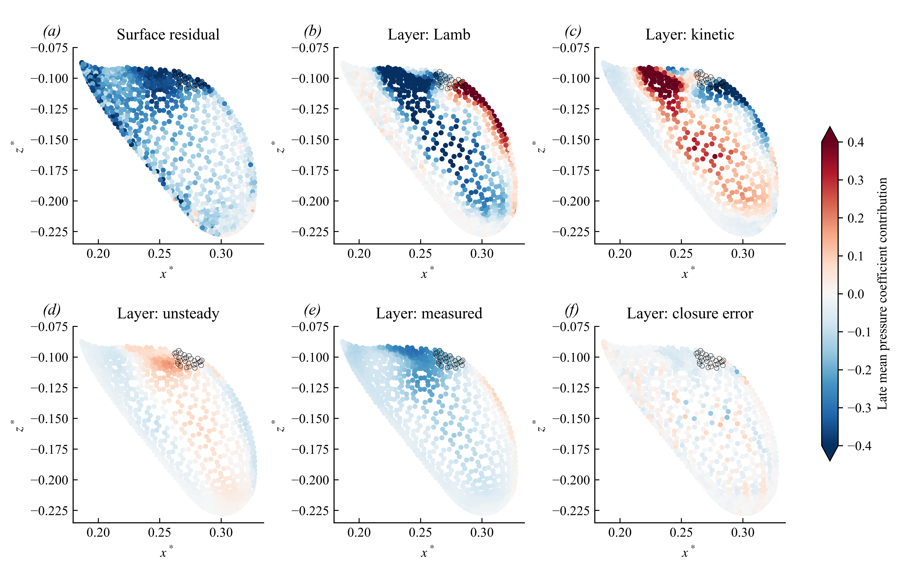
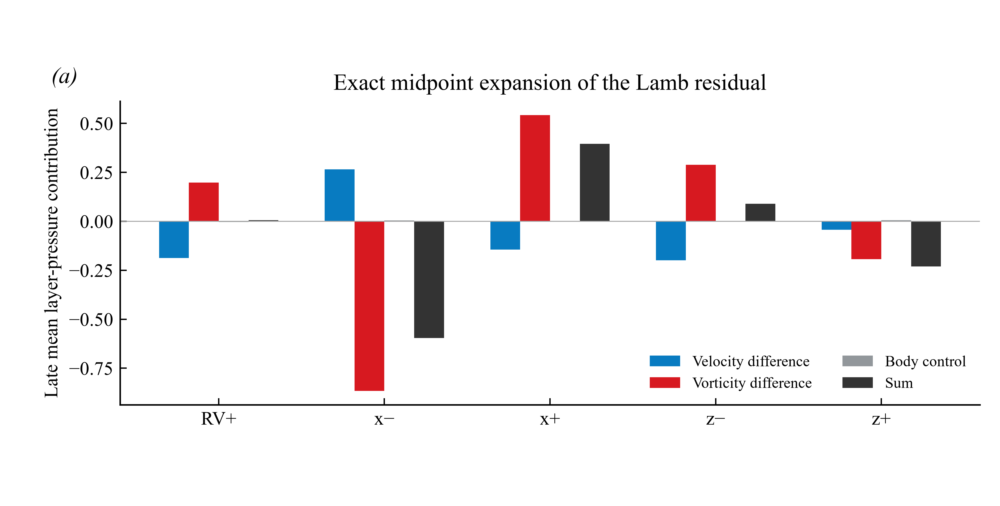

> v13 修正：按用户确认的 Neumann 压力边界，跨算例单侧压力残差的绝对值不能直接解释为额外吸力；以 [零点无关的上下表面压差分析](../2026-10-23-pressure-gauge/README.md) 为准。旧版开放面片载荷与残差比例不构成独立力归因。

# Orca v12：把文献、压力证据和研究问题连成论证

日期：2026-10-23。阶段：探索性机制研究；不是已完成的因果归因，也不是投稿定稿。

**本轮最重要的推进：通过等面积空间对照，发现 RV+ 附近并非唯一或最强的晚期吸力区域。因此，现阶段应研究“体鳍耦合如何重排鳍根压力，以及 RV+ 在其中的作用”，不能把“发现 RV+”直接写成“RV+ 造成主要升力增益”。**

下面是论证流程，不是已证明的物理因果图：

## 1. 现在到了哪一步

已有结果支持：在所检验的运动和几何条件下，体鳍耦合伴随额外的正流向涡量分支；该区域存在低压；相同释放条件的完整配对轨迹中，6 条基准轨迹出现流向涡量分量变号，而孤立鳍对应轨迹没有相同变号。它们是相关轨迹，不是 6 个独立重复实验；分量变号也不等于整根物质涡管反转。

v11 已发现：全上表面解析层的平均压力重构偏差约 2.27%，但时序误差相对信号波动 RMS 约 37.94%。这说明均值较好，不意味着瞬态或局部归因已经可靠。v11 局部分析又显示，RV+ 附近小区域的 Lamb 合量并不占主导。

本轮完成三项实质分析：①用 4 个几何位置定义等面积对照；②画出全有效上表面的压力和动量项分布；③把 Lamb 差分精确展开，检验其小合量是否隐藏大项抵消。8 篇选定原文的证据角色、适用边界和对研究的改变另见 [文献矩阵](LITERATURE_MATRIX.md)。

## 2. 先定义要解释的量

令 B 为体鳍组合，I 为孤立鳍，N 为无鳍身体。比较必须保持参考速度、面积、坐标、相位和压力零点一致。

鳍的压力升力差为

\[
\Delta C_{L,f}^{p}(t)=-\frac{1}{S_{ref}}\int_{S_f}[C_{p,B}-C_{p,I}]n_y\,dS.
\]

这里的法向是物体指向流体的外法向；积分必须包含同一鳍的两面。仅上表面的积分只能称上表面压力贡献，不能称总鳍力，更不能与整个体鳍系统的升力增益混用。若要报告系统相互作用增益，另定义 \(C_{L,sys}(B)-C_{L,f}(I)-C_{L,body}(N)\)，并说明是否包含黏性力。

当前空间诊断使用

\[
R_p=C_{p,B}-C_{p,I}-C_{p,N}.
\]

N 的压力是在相应虚拟鳍位置采样的入射场控制，不是无鳍身体在同一鳍面上的实际载荷。\(R_p\) 是诊断残差，**不是唯一的非线性相互作用力分解**。还需单独审查各算例的压力参考零点；不能用开放表面残差掩盖参考压力差。

当前解析层为 \(h/L\in[0.012,0.040]\)。同一条法向线上有

\[
R_{surface}=R_{outer}+R_{layer}+R_{wall},
\qquad R_{layer}=R_p(h_0)-R_p(h_1).
\]

这里 wall 是表面至 h0 的未解析区间差，不能丢掉后仍声称解释了全部表面压力。动量式给出层压力的重构：

\[
C_p(h_0)-C_p(h_1)=\frac{2}{U^2}\int_{h_0}^{h_1}
\left[\partial_t\mathbf u+\nabla(\tfrac12|\mathbf u|^2)-\mathbf u\times\boldsymbol\omega-\nu\nabla^2\mathbf u\right]\cdot\mathbf n\,dh.
\]

移动采样线上的时间导数先减去采样线运动项，得到 Eulerian 导数；两种时间差分均报告。各动量项属于同一惯性参考系下的表示，不能当作互不相关的独立物理原因。

## 3. 竞争解释与可证伪预测

| 解释 | 应出现的证据 | 当前判断 | 还需要的区分 |
|---|---|---|---|
| H1：所见分支只是普通身体涡搬运到鳍根 | 无鳍身体在对应区域具有相似分支；配对轨迹不应出现特有变号 | 既有配对证据不支持这种简单等同；并未证明涡量的最终生成来源 | 沿轨迹的涡量输运预算、壁面来源与扩散审查 |
| H2：RV+ 是局部额外吸力的特异主因 | 相邻等面积区域明显较弱；在闭合力分解中其区域贡献稳定，干预该结构后相应载荷变化 | 新空间对照不支持“吸力特有地集中在所选 RV+ 小区域” | 三维力分解和控制变量干预；空间相关本身不能确定因果 |
| H3：体鳍耦合重排一片更广的鳍根流动与压力，RV+ 是其中一部分 | 不同位置有吸力；速度/涡量和动量各项的空间组合不同 | 与新结果一致，是当前较稳妥的工作解释 | 需全相位和几何/运动参数变化验证，不能把一致性写成已证明 |
| H4：局部压力解释主要受分辨率、采样或参考压力影响 | 时间/空间加密、参考压力校准后结论明显改变；闭合误差与信号同量级 | 尚未排除；小区域闭合残差不可忽略 | 更密时间输出、网格/法向路径检查、压力零点一致性 |

## 4. 新空间对照：吸力并非 RV+ 小区域独有

在 t/T=0.75 的材料表面上固定半径 0.015L 的 RV+ 参考斑块（28 个面元），随后按材料编号跟踪。以该点 x、z 方向的 ±0.03L 偏移选取最近有效表面中心，按距离累加面元，最后一个面元按面积比例计权，使 4 个对照区在锚定相位面积完全相等。选择过程不读取压力结果。分析窗口沿用 v11 的 0.75≤t/T≤1，故仍属基于既有结果的探索分析，不是预注册检验。

所有区面积为 0.000329096 L²；在整个周期内，相对参考区的面积比偏差最大约 0.1324%。曲面使实际偏移不等于请求偏移，因此 x±/z± 仅是目标方向标签。x− 与参考区无重叠；x+、z−、z+ 的面积重叠分别为 11.16%、7.78%、55.21%。z+ 实际移动很短，不能当成独立展向对照。所有真实位移与重叠均写入结果 JSON，未剔除不利结果。

图表中的 measured 指 CFD 直接采样值，不是实验测量。下表为晚期窗口的面积平均压力系数量；各列不是全周期、全表面或总力百分比。Closure 为 measured layer 减 reconstructed layer，黏性项未列出但计入重构。

| 区域 | Surface residual | Layer measured | Lamb | Kinetic | Unsteady | Closure |
|---|---:|---:|---:|---:|---:|---:|
| RV+ | -0.309993 | -0.163445 | 0.006158 | -0.195659 | 0.052260 | -0.023118 |
| x− | -0.369965 | -0.235810 | -0.596313 | 0.305235 | 0.102927 | -0.045370 |
| x+ | -0.180849 | -0.038886 | 0.395905 | -0.418077 | 0.006667 | -0.021818 |
| z− | -0.203149 | -0.123920 | 0.089338 | -0.252866 | 0.062764 | -0.022341 |
| z+ | -0.345654 | -0.217272 | -0.230801 | -0.027321 | 0.082209 | -0.038667 |

RV+ 区为 −0.310，而完全不重叠的 x− 区为 −0.370。原先所报“幅值高 19.3%”依赖压力零点，现撤回；保留两区域残差之差约 −0.05997 的比较。这否定了当前采样尺度下“参考区是最强吸力区”的表述，但不否定 RV+ 的远场压力影响，也不证明上游区的某个涡就是独立原因。

同一相位上，给所有空间位置加上相同的压力常数不会改变这两个区域的面积平均压力差，因此空间强弱的排序不依赖共同的压力零点平移；绝对残差及开放面载荷的解释仍需参考压力审查。

另做了强制排除参考区面元的敏感性分析：x− 仍为 −0.370，z+ 对照变为 −0.363；x+、z− 分别为 −0.158、−0.209。它们同样不支持参考区具有唯一最强吸力。强制排除改变区域形状，只作为敏感性检查，不替代最初的全部结果。

**图 5.** 灰色为上表面几何，彩色为五个材料区域；目标方向标签与实际位移的关系见 JSON。中图为全周期压力残差，右图为晚期平均。对照并非统计独立样本，不作显著性检验。

**图 6.** 晚期各材料面元的平均量投影在 t/T=0.75 的几何上，不是同一瞬间的场。黑圈标出参考区域。所有图共用色标，超过 ±0.4 的值饱和。Surface 与 layer 的积分范围不同，不能逐图直接相加。动量图显示 Lamb 与 kinetic 在相邻区域具有不同符号组合；压力残差分布比所选参考区更广。

## 5. 为什么“小 Lamb 合量”也不能读成“涡不重要”

从保存的速度与梯度重建 \(\mathbf u\times\boldsymbol\omega\) 后，与原保存的 Lamb 法向场一致。对 B 与 I 使用精确恒等式

\[
\mathbf u_B\times\boldsymbol\omega_B-\mathbf u_I\times\boldsymbol\omega_I
=\Delta\mathbf u\times\overline{\boldsymbol\omega}
+\overline{\mathbf u}\times\Delta\boldsymbol\omega,
\]

其中横线表示 B/I 的算术中点，**不是时间平均**。再减去 N 的 Lamb 场，并沿相同路径投影积分。三项均采用与上面动量式一致的符号，得出下表。

| 区域 | 速度差项 | 涡量差项 | 减去 N 的项 | 合量 |
|---|---:|---:|---:|---:|
| RV+ | -0.187667 | 0.197227 | -0.003402 | 0.006158 |
| x− | 0.265831 | -0.866535 | 0.004391 | -0.596313 |
| x+ | -0.144527 | 0.542805 | -0.002373 | 0.395905 |
| z− | -0.198604 | 0.288267 | -0.000325 | 0.089338 |
| z+ | -0.042619 | -0.193362 | 0.005179 | -0.230801 |

参考区的 −0.188 与 +0.197 抵消，得到约 +0.006 的合量；上游区则是 +0.266 与 −0.867 的不同组合。这使“只看涡量强弱”的解释不充分。此展开是严格代数诊断，不是将流动变化的因果贡献唯一分给速度和涡量；二者由同一个流场决定。它也不同于辅助势力分解。

**图 7.** 同一晚期窗口、同一层内的三项与合量。大项抵消在参考区和上游区呈不同形式。正负号是压力层差贡献，不应直接等同于总升力正负。

## 6. 文献带来的逻辑调整和英文写法

推荐以 Guo et al. (2023) 的 III A 作为最直接的组织模板：先比较力，再确定关键相位，然后看涡量演化、多位置环量，最后检查压力和表面朝向如何形成力。该文也讨论了跨流和压力区保持；因此 Orca 应保留“广域压力重排”这一竞争解释，而不能只围绕一个新涡命名展开。

Liu et al. (2016, 2017) 和 Wang et al. (2019) 表明，身体参与涡动力学并改善载荷已有明确先例。当前潜在贡献必须落到特定几何/运动条件下的分支形成、符号变化及空间压力机制，而不是“首次发现身体有用”。Han et al. (2020) 提醒我们，作用时机和跨流可能与涡强度一样重要。

Lucas et al. (2017) 用独立测力检查压力法的幅值和时序，我们当前只能完成内部数值一致性检查，不能声称获得了实验验证。Menon et al. (2022) 则说明，如果目标是“某个涡贡献多少力”，需要带几何影响权重的闭合归因。其式 (4) 中的 \(-2\rho\int Q\phi_i\,dV\) 是压力力分解的一部分；还需要正确辅助势边界条件、移动边界加速度、黏性和外边界项。只积分 Q>0 或当前近壁 Lamb 项都不够。

按这个逻辑重写的 [英文研究草稿](MANUSCRIPT_DRAFT.md) 将观察、解释和未决问题分开，每个主要数字都回链到此次 JSON 或 v11 报告。它是机制论证草稿，不冒充完整论文，也没有填造尚未完成的方法验证。

## 7. 验证范围与下一项实际工作

本轮代码检查：等面积约束；逐区域 surface=outer+layer+wall；RV+ 区的压力与力在 Fourier/central 两种方法下均重现 v11；原保存 Lamb 场由速度和梯度重建；中点展开逐有效剖面闭合。输入文件哈希已记录，三个图均输出 PNG/PDF/SVG。验证这些恒等式只能证明实现一致性，不证明 CFD 已网格收敛或机制因果成立。

时间差分敏感性：参考区层压力重构为 −0.14033（Fourier）、−0.14268（central），而测量层差为 −0.16345。上游区为 −0.19044、−0.19093，而测量层差为 −0.23581。两种差分相近并未消除闭合残差，因此不能把剩余误差解释成另一种物理机制。

下一项优先工作应是 **补齐压力→积分载荷的桥梁并审查参考压力**：同一相位、同一完整双面鳍网格，计算 B−I 的压力积分与原始载荷差，分别列出上/下表面、未覆盖区域和黏性项；在此基础上再决定辅助势归因所需数据。其次沿现有完整配对轨迹检查涡量输运的各项，辨别变号来自倾转、拉伸或扩散。参数试验应检验这些已明示的预测，不应在看到结果后更换解释。

当前仍缺：足够密的瞬态输出收敛、完整全域力分解、机制干预和独立实验。不存在“多读几篇论文就能补出因果结论”的捷径。读论文的产出应该是上面的定义、对照和可被推翻的预测。

数据：[spatial_controls.json](spatial_controls.json)。阅读证据：[literature_evidence.json](literature_evidence.json)。先前结果：[v11 审核](../2026-10-23-evidence-audit/README.md)。
