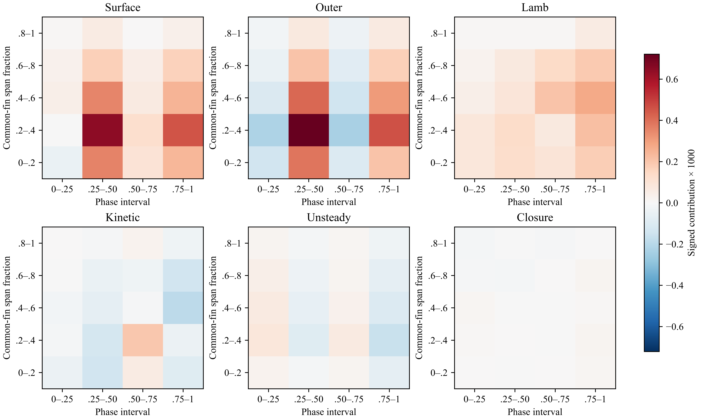

# v18：固定稳定周期，研究增升发生在哪里、由哪些压力项构成

接受用户已确认的周期稳定性。本轮不以周期复核或新增 CFD 为前提，直接分析已有周期中的流场。2026-10-23，探索性分析。

**新的关键发现：主要增升阶段的表面压差增强，并非由所选近表面解析层的正净贡献主导。外层压差提供正贡献，局部 Lamb 项受到其他动量项抵消。只凭周期平均的正 Lamb 项解释主要增升阶段，会遗漏这个区别。**

## 同一范围内逐项核对

负 z 侧鳍、1071 个共同配对面、95.97% 上侧面积覆盖；与 v16 完全相同。将共同鳍展分成五段、周期分成四段，逐格积分。上下相对压力先配对再比较 B−I；不解释单侧绝对压力。以下数字均为季度的有符号积分，不是季度条件均值，也不是两鳍或全系统升力。

| 相位区间 | 表面压差载荷增量 | 外层 h=0.04L | 解析层 h=0.012–0.04L | Lamb 项 | 动能项 | 非定常项 |
|---|---:|---:|---:|---:|---:|---:|
| 0–0.25 | 0.00002912 | −0.00053670 | 0.00040754 | 0.00023769 | −0.00007135 | 0.00023638 |
| 0.25–0.50 | 0.00159024 | 0.00179822 | −0.00019288 | 0.00042774 | −0.00038722 | −0.00021204 |
| 0.50–0.75 | 0.00033274 | −0.00059474 | 0.00090242 | 0.00052052 | 0.00023692 | 0.00014936 |
| 0.75–1 | 0.00114163 | 0.00120068 | 0.00006598 | 0.00091744 | −0.00048917 | −0.00041928 |

表面项 = 外层项 + 解析层项 + 未解析近壁压差。解析层项 = Lamb + 动能 + 非定常 + 黏性 + 残差。完整近壁、黏性和残差值保存在 [phase_mechanism.json](phase_mechanism.json)。所有空间格的和恢复全周期值、两级记账恒等式均通过 1e-12 容差检查。季度内残差相互抵消仍可能存在；本表不取代逐相位预算验证。

第二和第四季度合计约占本范围净增量的 88.3%。两个季度的外层正贡献均超过表面净增量；第二季度解析层为负，第四季度解析层小幅为正。这说明正 Lamb 项并不能单独代表最终的局部压力增量。

第三季度则不同：外层项为负，解析层正增量抵消它，使表面最终保持正值。这一阶段的局部流动贡献更适合用来研究“局部旋转如何支持增升”，不能与第二季度混为同一个机制。

## 把最强区域继续向外追

最大单格位于共同鳍展 20%–40%、相位 0.25–0.50：

| 距离或项 | B−I 配对压差载荷积分 | NoFin 同位置压力投影 |
|---|---:|---:|
| h=0.06L | 0.00077587 | 0.00052805 |
| h=0.04L | 0.00072133 | 0.00041640 |
| 表面位置 | 0.00064464 | 0.00004255 |

B−I 的增强在 0.06L 已经存在，向表面略有减弱。NoFin 同位置值向表面衰减更大；表面 B−I 远大于 NoFin 投影。因此“身体压力原样叠加到鳍面”也不能解释结果。NoFin 的对应位置是流体点，不存在真实鳍面，表中数值不是 NoFin 鳍力。

外层项是压力积分的边界值，不是已经确定的外部致因。压力具有非局部性；尚不能将它直接命名为某一涡的作用。当前更准确的逻辑是：**主要正贡献阶段已经具有外层压差增强 → 向表面的局部动量项决定其保留或削弱 → 第三季度局部层另外抵消负外层压差 → 各阶段累积为正平均载荷。**

## 图与复现

图中各面板采用相同色标，以免把小残差视觉放大为主导项。Surface 为配对表面压差载荷增量；Outer 为 0.04L 的配对相对压力项；Closure 为解析层预算残差。法向距离沿各自上下表面射线，鳍展为共同材料范围归一化距离。

执行 `code/run__phaseMechanism.py`；复用已验证的读取、配对和动量分解函数。原始数据不上传。本轮读取全部既有 17 相位，生成 20 个空间–相位单元、17 个项的积分，未新增 CFD、未做周期稳定性分析。

后续应分别追踪第二季度外层压差的空间来源与第三季度局部层的正贡献，并对照现有身体运动和速度场；不再将周期稳定性作为继续研究的门槛。此前 v17 的补算要求保留为验证记录，不是本轮研究的阻塞条件。
