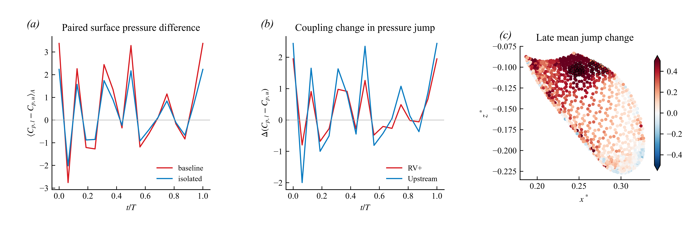

# Orca v13：Neumann 压力边界下，改用上下表面压差

2026-10-23。依据用户确认的 Neumann 压力边界，重新审查 v11–v12 的压力解释。本轮完成压力常数不变性、材料区域上下表面配对及压差比较；完整鳍载荷归因尚未完成。

**结论：可以确认共同材料区域的上下表面压差发生了变化；不能仅从跨算例的单侧压力绝对值，断言额外吸力或某个涡的力贡献。** 本轮的配对压差不受各算例独立压力常数的影响。

## 1. 压力关系应怎样定义

在纯 Neumann 压力问题中，若未另设压力参考，压力可以加上空间均匀的常数而不改变压力梯度。瞬态比较应允许每个时刻、每个算例具有自己的常数：

\[
p_k'(\mathbf x,t)=p_k(\mathbf x,t)+c_k(t),\qquad k=B,I,N.
\]

因此跨算例的单侧压力差 \(p_B-p_I\) 会多出 \(c_B-c_I\)，之前的 \(p_B-p_I-p_N\) 会多出 \(c_B-c_I-c_N\)。无鳍身体压力不是一个自动消除所有常数的基准。求解器可能通过零均值或固定点选择一个数值参考，但这不能替代物理比较量的定义。本轮采用用户确认的边界条件，未重新认证当前结果文件的生成算例输入。

本轮主变量为同一算例中配对两侧的压差：

\[
J_k=\frac{p_{k,l}-p_{k,u}}{\tfrac12\rho U^2},\qquad
\Delta J=J_B-J_I.
\]

缓存压力按单位密度的运动学压力处理，代码中使用分母 \(U^2/2\)。上下两侧同时平移 \(c_k(t)\) 后，\(J_k\) 与 \(\Delta J\) 都不变。也可研究同一算例内 \(p(\mathbf x)-p(\mathbf x_{ref})\)，但必须明确参考位置；当前优先用跨鳍压差。

这不是说表面压力没有信息，而是说它需要以压差、相对压力或压力梯度等不依赖常数的形式解释。

## 2. 上一版哪些保留，哪些必须改正

| 量或表述 | 压力常数影响 | 本次处理 |
|---|---|---|
| 单侧 Cp 的绝对值、不同算例直接相减 | 受影响 | 不再作为额外吸力的独立证据 |
| v12 的 R=Cp,B−Cp,I−Cp,N 的绝对值 | 受影响 | 降为原存储参考下的诊断值；不赋予零点无关的吸力幅值意义 |
| v12 两区域 R 的同相位差、相同时间权重下的平均差 | 常数相消 | 保留其相对高低；不能将两者绝对值之比当成物理增幅 |
| v12“上游吸力幅值高 19.3%” | 比值依赖常数 | 撤回该比例；只保留两区 R 相差约 −0.05997 的相对关系 |
| 同一算例的 Cp(h0)−Cp(h1)、涡核压力减周围环带压力 | 常数相消 | 保留；仍受插值、采样和区域定义限制 |
| 速度/涡量构成的动量项、Lamb 中点展开 | 与压力常数无关 | 保留代数诊断；不升级为独立因果力份额 |
| 开放面片的单独压力力 | 受面片净面积向量影响 | 必须说明参考或闭合方式，不能直接冒充闭合鳍总力 |

## 3. 找到的几何问题：组合算例的鳍分区是开放的

对当前存储的朝内面积向量 \(\mathbf A_f\)，压力升力系数采用

\[
C_L^p=\frac{1}{S_{ref}}\sum_f C_{p,f}A_{f,y},
\qquad
\frac{\partial C_L^p}{\partial C_{p,constant}}
=\frac{\sum_f A_{f,y}}{S_{ref}}.
\]

这里的几何积分与求解器 Cartesian 界面压力通量是不同离散量；本轮没有将二者校准为相同。

| 算例与区域 | 周期内每单位常数 Cp 引起的最大绝对 CL 变化 |
|---|---:|
| 体鳍组合，完整身体表面 | 1.763×10⁻⁸ |
| 体鳍组合，现有胸鳍标签区域 | 0.00665503 |
| 孤立鳍，完整鳍表面 | 0 |
| 两算例的共同表面区域，各自 | 0.00267920 |

组合算例的胸鳍标签区域在根部没有形成闭合面，完整孤立鳍则闭合。完整组合表面的残余敏感性很小，与离散几何的微小闭合误差一致。重要的是：**共同面元相同也不够**。共同区域是开放面，各算例可加不同常数时，两个开放面积分相减仍会改变。

这解释了为什么应先用压差讨论局部机制，再处理根部闭合和分区载荷约定，而不是从某一侧的压力积分直接走到“鳍增升多少”。

## 4. 怎样配对，比较了多大范围

两个算例共有 4,855 个完全对应的材料面元。面元中心在整个保存周期内通过位置一致性检查。按照参考相位的朝内法向区分材料上/下表面；两侧标签随材料保留，不随瞬时方向翻转而交换。

在左右鳍分别建立参考构型的 x–z 投影。以上表面面元中心为查询点，对下表面中心作三角形内线性插值。要求查询点在三角形内，不作外插，并排除投影边长大于 0.02L 的插值三角形。因此这里是**同一参考构型投影位置的材料配对**，不是声称上下两个面元在有限厚度、变形后的曲面上恰好沿瞬时法向对齐。

保留 2,169 个上表面查询面元，覆盖共同区域上表面面积的约 98.73%。该分母是“共同区域上表面”，不是完整鳍的所有表面积。积分采用各时刻实际上表面面积，17 个保存相位作梯形时间积分。

三角形边长阈值改为 0.015L、0.025L 时，面元集合没有变化，结果也相同。这个检查确认阈值没有影响当前选择，**不等价于插值精度或网格收敛检查**。

## 5. 新结果：零点无关的跨鳍压差

共同配对区域、全周期面积平均结果：

| 量 | 周期平均 |
|---|---:|
| 体鳍组合 J | 0.417570 |
| 孤立鳍 J | 0.260297 |
| 耦合变化 ΔJ | +0.157273 |

这里的 J 是下表面减上表面，正值表示下侧压力相对上侧更高。它是压力系数差，不是升力系数或升力增长率；转成力还需要面积向量、完整区域和有限厚度几何。

参考点仍为前版相同的 RV+ 邻近表面中心。半径为 0.015L，上游对照按面积精确匹配，两区域不重叠。但本轮使用完整共同表面的配对有效集，参考区有 36 个查询面元，而 v12 的剖面有效集为 28 个；不能把两版区域数值视为完全相同面元上的替换。

晚期窗口 0.75≤t/T≤1：

| 区域 | 组合 J | 孤立 J | ΔJ |
|---|---:|---:|---:|
| RV+ 邻近区 | 0.636416 | 0.184791 | +0.451626 |
| 上游等面积区 | 0.812832 | 0.217102 | +0.595730 |

两个区域均有正的晚期跨鳍压差增量；上游区比参考区大 0.144105。这个差异不依赖各算例的压力常数。新证据仍不支持“只有 RV+ 邻近区具有明显响应”，但也不能排除 RV+ 的非局部影响或其他同时变化的流动机制。

图 8：左图为整个共同配对区域的面积平均 J；中图为两个材料区域的 ΔJ；右图为晚期平均 ΔJ 投影到 t/T=0.75 的几何，黑圈标记两个区域。色标在 ±0.5 外饱和。时间序列保留原始 17 相位，不通过平滑制造收敛外观。

## 6. 直接验证“加常数不影响结果”

在存储压力系数上分别施加人工偏移

\[
c_B^*(t)=0.7+\sin(2\pi t/T),\qquad
c_I^*(t)=-0.4+0.5\cos(2\pi t/T).
\]

这里星号表示 Cp 单位的测试偏移，不是实际压力误差估计。重算后，每个算例的 J 都不变；ΔJ 的最大变化仅 2.22×10⁻¹⁵。另检查了插值权重和为 1、权重非负、参考平面坐标重构、共同几何一致性。这些验证保证所实现的比较对压力常数不敏感，不代表 CFD 或表面压力插值已获得独立验证。

## 7. 当前研究主线及下一步

应写为：**体鳍耦合改变跨鳍压差，变化在鳍根一片区域内分布；RV+ 是伴随该响应的流动结构之一，其独立载荷作用尚待区分。** 不再用单侧负压绝对值或 NoFin 相减后的零点定义来推动因果结论。

下一步先确定根部截面与闭合约定，区分“实际暴露鳍面所受压力”和“人为闭合后的分区力”，再检查压力差及侧缘/根部项如何对应原始载荷。仍需检验时间分辨率与表面压力提取误差。ORCA-EVIDENCE-013 的压力参考审查已取得结果；完整载荷闭合部分未完成，本报告不将其标为通过。

[数值、输入哈希和敏感性结果](pressure_jump.json) · [修订后的英文论述](MANUSCRIPT_NOTE.md) · [v12 文献矩阵](../2026-10-23-mechanism-logic/LITERATURE_MATRIX.md)
