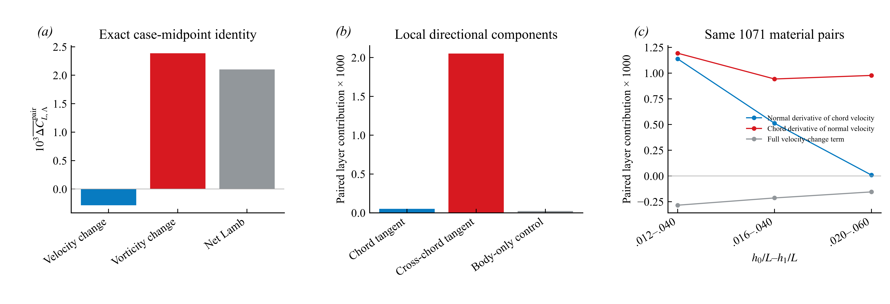
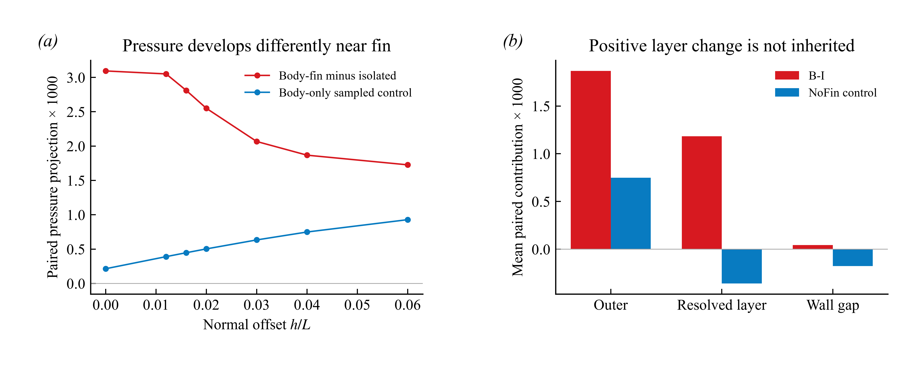

# Orca v16：继续把旋转相关压力增量追到速度梯度

**这一步将 v15 的“运动依赖的体鳍压力增强”进一步落实为可计算的局部流动关系：在同一上下配对层内，正 Lamb 增量来自涡量变化项，速度变化项反而抵消一部分；主要的局部横弦向涡量变化由法向剪切和法向速度的弦向梯度共同构成。身体单独存在时，同位置的压力从外层到近表面的变化方向与组合增量相反，所以组合增量不是已有身体压力场的简单叠加。**

这是继续研究得到的阶段性结论，不是宣布整个项目完成。下列计算严格针对负 z 一侧鳍的上下配对采样层，不能转写成整个系统的力份额。

## 1. 在相同采样面上，先分清速度变化和涡量变化

从已保存的三维速度梯度重新计算 ω=∇×u，并核对 u×ω 的法向投影与原保存量一致。采用逐点精确恒等式：

Δ(u×ω) = Δu×ω_mid + u_mid×Δω，

其中 mid=(B+I)/2 是两个算例的中点，绝非时间平均。分别沿上下表面法向积分，再执行下侧减上侧和相同面积投影。以 0.012–0.040L 层为例：

| 配对层压力载荷代理的周期平均项 | 数值 |
|---|---:|
| Δu×ω_mid：速度变化项 | −0.000284096 |
| u_mid×Δω：涡量变化项 | +0.002387490 |
| 合计 Lamb 增量 | +0.002103394 |
| 同位置 NoFin 的 Lamb 对照 | +0.000023373 |

这在所用惯性系与中点分解下说明：正增量不是由速度变化项提供的，涡量变化项才是正项。NoFin 对照远小于组合增量，反对“同位置原有身体 Lamb 场原样叠加就足够”的简单解释。中点分解不是独立干预，且速度/涡量分项随参考系改变；不能把两项称作唯一因果百分比，也不能据此排除身体涡通过其他路径影响胸鳍。

## 2. 哪个方向的涡量与法向压力联系最强？

先在求解器 XYZ 惯性系中做三分量分解，再转换到每个瞬时表面的局部正交方向：s 为全局 x 投影到表面切平面的方向，n 为外法向，t=n×s。s 近似局部弦向，但不是由真实前后缘重建的解剖弦线；t 也不直接等于某个命名涡的轴。

0.012–0.040L 层中，沿 s 的涡量分量对应 +0.000051944，而沿 t 的分量对应 +0.002051450。法向涡量对 n·(u×ω) 的贡献按向量恒等式为零，代码已核验。主量因此来自局部横弦向切向分量，而不是把全局流向 ω_x 的反号直接解释成主要法向压力增量。

这不证明 RV+ 对总升力不重要：命名涡可以有多个方向分量，还可能改变外层场。它确实说明，仅追踪 ω_x 符号不足以回答本层压力为什么改变。

## 3. 再把该涡量变化追到两个具体速度梯度

在每个点将局部基向量保持固定，令 G_ij=∂u_i/∂x_j，精确得到

Δω_t = s·ΔG·n − n·ΔG·s。

第一项是沿法向的局部弦向速度梯度变化；第二项是法向速度沿局部弦向梯度变化的负值。两项在进入 u_mid×Δω 后，对配对层的贡献如下。表中的符号是最终压力投影贡献，不是说每个点的原始梯度都同号。

| 法向层 h₀–h₁ | 法向剪切变化项 | 法向速度弦向梯度项 | 完整速度变化项 |
|---|---:|---:|---:|
| 0.012–0.040L | +0.001138278 | +0.001193371 | −0.000284096 |
| 0.016–0.040L | +0.000512237 | +0.000942804 | −0.000213530 |
| 0.020–0.060L | +0.000008947 | +0.000977372 | −0.000154903 |

近侧层内，两种梯度变化共同提供正项；远一些的层中，法向速度沿弦向的变化更突出。这个空间变化给出一个具体研究对象，而非笼统“涡增强”：**要追踪的是鳍邻近流动的法向剪切与法向速度在弦向上的变化怎样被身体和运动共同改写。** 后一项可以提示流动转向，但没有直接计算流线曲率，不能将其等同于已验证的曲率机制。

图 14：左图是速度/涡量中点恒等式；中图是局部涡量方向与 NoFin 控制量；右图是在完全相同 1071 个配对面上改变积分层。右图的两种梯度项只分解横弦向的涡量变化贡献，不与完整速度变化项组成一个穷尽全部项的三项预算。

继续分开上下两侧后，主层 Lamb 增量中上侧层贡献 +0.001846270，下侧层贡献 +0.000257124；上侧约占这一个 Lamb 增量的 87.78%，不是总升力的份额。法向速度弦向梯度项尤其不对称：上侧 +0.001297738，下侧 −0.000104367。法向剪切项则上下均为正，分别 +0.000710001 和 +0.000428277。上侧 Lamb 项在四个四分之一周期均提供正积分，最后四分之一周期最大。这些都是有限层内的梯度/动量项，不是分别比较上下侧绝对压力，因此没有重新引入 Neumann 压力零点问题。

## 4. 不能遗漏外层压力：身体背景与组合响应并不相同

在相同移动采样位置，对 NoFin 的压力也先做上下配对，消除其独立压力常数。NoFin 中没有胸鳍，因此这里是流体位置上的压力差控制量，不是 NoFin 的实际鳍载荷。所有数值使用同一套鳍面面积权重作投影，以便同位置比较。

| 0.012–0.040L 主层 | B−I 组合增量 | NoFin 同位置控制 |
|---|---:|---:|
| h=0.040L 外层配对压力投影 | +0.001867462 | +0.000748833 |
| 从 h=0.040L 到 0.012L 的层内变化 | +0.001183060 | −0.000358640 |
| 表面位置的压力投影 | +0.003093744 | +0.000214133 |

**关键不是两个曲线大小不同，而是沿法向接近鳍时的变化相反：组合增量在这一层增强，身体单独存在的配对压力却减弱。** 因此“身体已经具有一个压力场，胸鳍只被动承受它”解释不了当前结果。组合几何和运动改变了局部压力分布，而不仅是把 NoFin 压力加到孤立鳍上。

这并不是 Navier–Stokes 解的线性叠加。B−I−NoFin 只能作为同位置的非加和诊断，不能赋予唯一的“交互力”分解；NoFin 控制也没有排除所有可能的身体来流影响。

图 15：横轴是各自上下表面外法向的相同偏移量，曲线是配对后的压力投影平均值。h=0 在 NoFin 中是原胸鳍所在的流体采样位置。连线仅连接已存储采样层，不表示新增空间分辨率。

## 5. 把这一段接回已经验证的载荷关系

v15 的四算例对照说明，冻结运动会大幅削弱共同鳍面压力增益。v16 则把运动 B/I 的局部压力联系进一步拆开：

**体鳍组合具有不同的局部速度梯度 → 横弦向切向涡量变化提供主要正 Lamb 增量 → 与动能梯度、非定常、黏性项共同决定解析层压差 → 外层、解析层和壁面间隙共同组成表面上下压差 → 表面投影积分得到区域载荷。**

这一链中的向量恒等式和压力记账逐点核验；动量方程仍需保留 v14 的瞬态闭合误差，不能把 Lamb 项直接等同于净表面压差。v16 没有把 0.002103394 宣称为总升力或单涡力，也没有把观察到的梯度变化宣称为已闭合的涡量生成预算。已有辅助势旋转源项与这份局部分析相容，但它们使用不同目标和空间范围，数值不相加。

下一项有明确对象的工作是：以这两个梯度变化显著的内侧位置为对象，检查其时序、上下侧分布和与运动相位的联系，再从现有速度场判断是哪段来流偏转或剪切层演化产生它们。此处的“对象”已经由压力预算选出，不再先选一条命名涡再寻找支持。

## 核验与复算

- 已运行 `python code/run__pairedRotationOrigin.py`，自动计算 JSON、曲线及图 14–15；依赖之前的公共读取与作图模块，原数据仍在本地。
- 速度梯度 curl、原 Lamb 投影、中点分解、XYZ 分量和局部正交分量、横弦涡量的两个梯度分量、压力空间记账均核验通过。另独立扰动 B−I 与 NoFin 的时变压力常数，配对结果保持不变。
- 三个可比较积分层统一使用 1071 个配对面，覆盖共同上表面面积约 95.97%。0.008–0.030L 层在“所有动量项、上下配对、全部相位均有效”的严格条件下只剩 1 个面、约 0.056% 面积，因此明确排除，不能把它作为全区域敏感性结果。
- 本轮重分析现有速度/梯度/压力剖面，并未重跑 CFD；仍是 17 相位、单个周期。多个层区间不是网格或时间收敛试验。本报告不新增文学证据或新颖性声明。
- [全部数值和输入哈希](rotation_origin.json) · [v15 四算例因果对照](../2026-10-23-lift-cause-controls/README.md) · [v14 压力与载荷预算](../2026-10-23-integrated-chain/README.md)。
