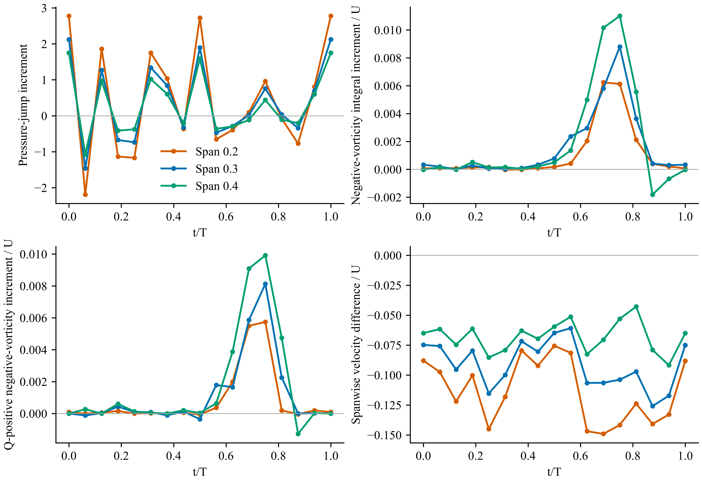
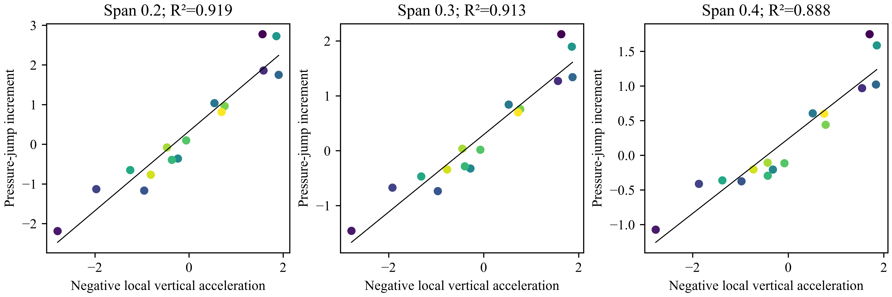
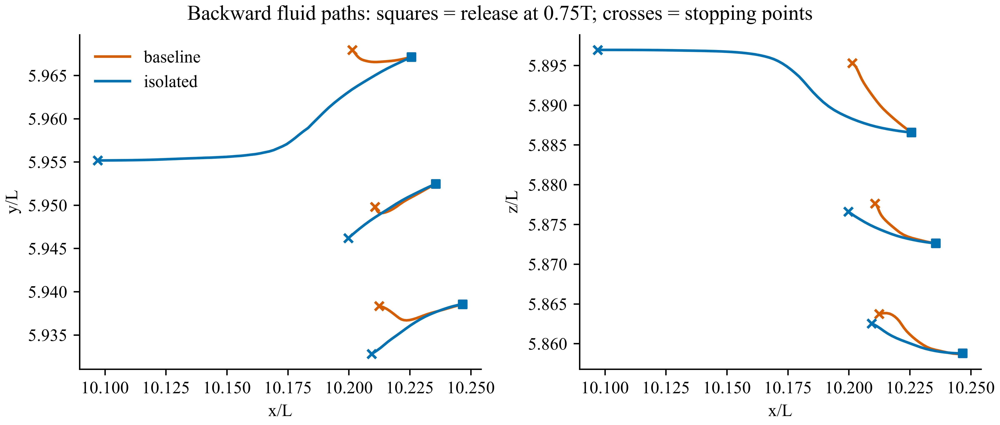

# v20：完成周期内演化与上侧流动回溯，修正峰值图的解释

2026-10-24。固定用户确认的稳定周期，未重复研究周期稳定性。新增计算：17 相位 × 6 个截面 × 3 个窗口的匹配流动与压差；两个算例各 21 个配对释放位置、两种积分步长，共 84 条向后流体轨迹。

**机制研究尚未完成，但本轮已区分两种不能混为一谈的响应：压差的快速起伏与局部加速度高度相关；上侧旋转流动的增强主要发生在后半周期，回溯路径指向鳍近壁区域。上一轮峰值处的空间对应，不能单独升级为“涡增强造成压差峰值”。**

## 一、先把全部相位接起来

复用 v19 的同几何切面、共同有效流体窗口；法向距离主窗口为 0.012–0.04L，弦向前半段。压差为弦长 5%–95% 内下表面减上表面的平均，再取 B−I。原始压力任意常数不参与结论。

| 共同鳍展位置 | 周期平均压差增量 | 负展向涡量积分增量的峰值相位 | 压差与该涡量积分的同期相关系数 |
|---:|---:|---:|---:|
| 0.2 | 0.32911 | 0.6875 | −0.016 |
| 0.3 | 0.29297 | 0.7500 | −0.027 |
| 0.4 | 0.23876 | 0.7500 | −0.135 |

内侧压差最大值位于 t/T=0，另一个主要峰在 0.5；这与涡量增量的峰值不重合。仅保留 Q>0 的旋转占优部分后，三个内侧位置的峰值均在 0.75。三种窗口 0.008–0.03L、0.012–0.04L、0.016–0.04L 的内侧峰值位于 0.6875–0.8125，平均增量都为正，最小有效覆盖 99.73%。因此“增强出现在后半周期”不依赖单一窗口，但幅值明显依赖距离，不能称完整涡环量。

相关系数只描述这一个周期中的同步程度，16 个不重复相位不是独立统计样本。同期相关低不排除非局部或有时滞的涡作用，但反对用该窗口瞬时强度直接解释压差峰值。

## 二、压差峰值更紧密地对应什么？

与既有、由已验证运动输入获得的局部垂向加速度相比，内侧三个位置的压差增量相关系数分别为 −0.958、−0.955、−0.942；与局部垂向速度或俯仰角的同期相关明显较弱。按负加速度做描述性直线拟合，R² 分别为 0.919、0.913、0.888。

这支持存在显著的加速度相关压力起伏，但**不是测得了附加质量，也不能把约 90% 的波动拟合度写成约 90% 的平均升力来源**。该拟合含自由截距，平均增量没有被物理分解；此前 v15 的加速度压力源周期均值很小，也仍然有效。图中的加速度来自邻近相同展向位置的运动测量，并非从压差反推。

## 三、后半周期增强的上侧流体从哪里来？

在 t/T=0.75，从鳍展 0.2、0.3、0.4 的共同上侧前部窗口内选取 B 算例 Q>0 的最强负展向涡量点，各加六个 ±0.0015L 位移。B 和 I 使用完全相同的 21 个释放坐标。用既有三维速度场、线性时间插值和 RK4 向过去积分，检查每个阶段的流体掩膜，遇无效流体或裁剪边界停止；停止点与当时插值后的真实表面计算距离。

| 结果（细积分步长） | 身体＋鳍 B | 孤立鳍 I |
|---|---:|---:|
| 路径数 | 21 | 21 |
| 停止点距鳍小于 0.006L | 21 | 15 |
| 停止点距身体小于 0.006L | 0 | 0 |
| 其他停止点 | 0 | 6 |

0.006L 是此处用于描述停止点邻近区域的阈值，不是判定涡量生成的边界。I 算例没有身体。三个中心 B 路径停止相位约为 0.586、0.589、0.563，距鳍分别为 0.00361、0.00368、0.00453L。两种积分步长分别为 T/512、T/1024，最大停止位置差 B 为 0.000258L、I 为 0.000299L，最大停止时间差均为 T/1024；比较端点时间略有不同，不作为固定时刻积分误差估计。

图显示三个中心释放点；全部偏移路径保存在 [upper_flow_origins.json](upper_flow_origins.json)。方块为释放点，叉为停止点。这是流体路径，不是涡管身份追踪；靠近鳍不能直接证明涡量在鳍面生成。结果没有支持“这片区域的流体直接从身体表面输入”的预设。它也不能排除身体流场的非局部诱导作用。

## 四、目前能写成什么机制判断

1. 平均增升的压力表现仍是内侧鳍上下压差增加，朝鳍尖减弱。
2. 瞬时压差峰值与加速度相关；不能把峰值阶段当作旋转流最强阶段。
3. 后半周期，身体存在时上侧旋转占优流动更强，展向流也改变；所测流体路径更接近鳍近壁来源，而非已证实的身体涡直接捕获。
4. 因而当前应检验的机制是：身体改变鳍附近三维流动，使鳍自身附近的旋转流动发展及压力响应发生变化。其对平均增升的具体作用还需将这一发展阶段的结构、同范围压差和载荷连接，不能用本轮加速度相关或单条路径替代。

这修正了 v19 只看峰值空间对应可能带来的过强解释，不撤回已计算的压差与流速差。按 Dong 组方法推进，应保留与预设不一致的相位，而不是只展示两张增强的涡图。

## 复现与边界

- `code/run__dongEvolution.py`：全周期共同窗口与三种距离范围，压力、涡量、Q>0 部分、展向速度、运动比较及图。
- `code/run__upperFlowOrigins.py`：实际三维回溯、释放点扰动和积分步长检查。复用本地原有 `trace__temporal_source_paths.py` 与 `read_volume.py`，路径在 main() 中；原始体数据留本地。
- [evolution.json](evolution.json)：306 个相位—展向—窗口记录、所有差值与描述性拟合。
- 近壁掩膜、解析窗口与时间插值的适用范围保留；未把拟合当作因果力分解，未新增 CFD，也未要求新模拟才能继续已有周期研究。
