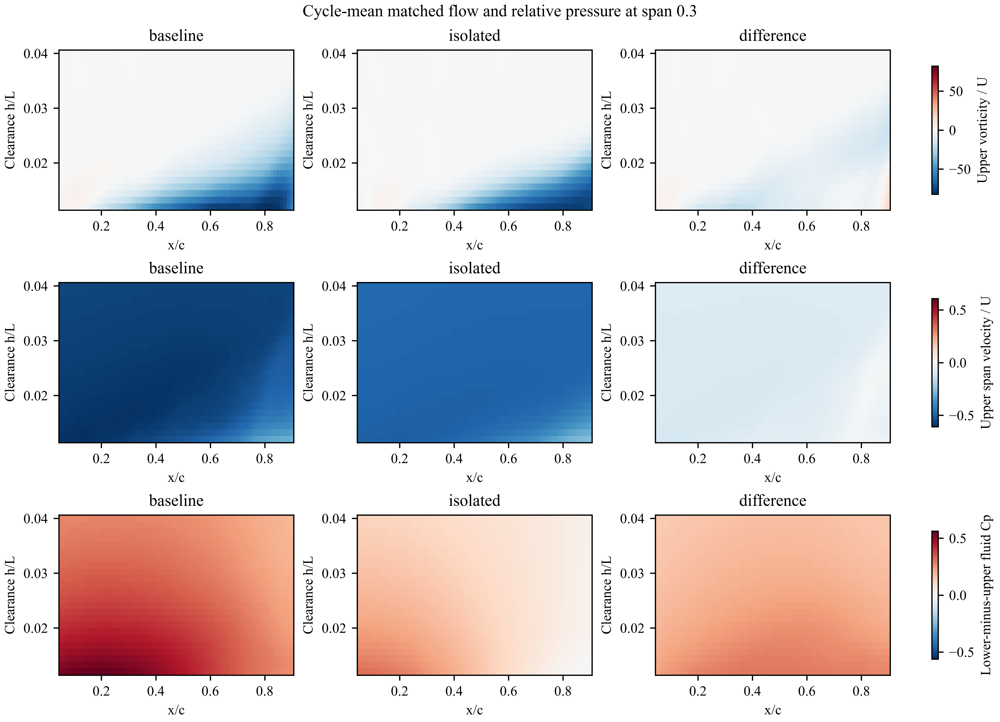

# v21：把平均增升与瞬时压力峰分开，检查平均流动对应

2026-10-24。继续研究已确认稳定的同一个周期；无新 CFD，也未重复周期稳定性检查。

**本轮的新证据：身体存在时，内侧鳍附近的展向流、涡量分布和上下相对压力，不仅在个别相位不同，其沿运动坐标统计的周期平均值也不同。在已核算的局部旋转相关压力项中，正均值主要来自平均速度与平均涡量的乘积，波动之间的乘积反而部分抵消。**

这支持把平均增升的研究重点放在持续的局部平均流动改变，而不是把最强瞬时涡或加速度压力峰当成平均增升的直接来源。这里的“平均”均随鳍运动采样，不能等同于固定空间中的稳态流。

## 1. 同一位置上的平均流动和相对压力

在鳍展 0.3 的局部切面，取 x/c=0.05–0.90、距上下表面相同坐标距离 h=0.012–0.04L。逐相位在两个算例相同位置采样，先求下侧减上侧压力，再取周期平均。全部采样点在两算例、所有相位均有效。

| 图中采样区域的平均量 | 身体＋鳍 B | 孤立鳍 I | B−I |
|---|---:|---:|---:|
| 上侧局部展向涡量/U | −9.7878 | −7.1952 | −2.5926 |
| 上侧局部展向速度/U | −0.55969 | −0.47892 | −0.08076 |
| 下侧减上侧流体 Cp | 0.33283 | 0.12204 | +0.21079 |

这些数值是图中共同采样区域的非加权平均，不是鳍面压力，也不是升力系数。展向速度和涡量同时为负，B 的幅值更大。此前相同展向位置的鳍面弦向平均压差增量为 +0.29297；两者采样范围不同，不能要求数值相等。

左列 B、中列 I、右列 B−I；每行共用一个色标。上侧负涡量增强具有空间差异，并不是所有位置都变强；展向流变化较广泛。上下相对压力在这个窗口内整体提高。图给出了 Dong 组式流动—压差空间比较的周期平均版本，但空间对应本身不是单向因果证明。

## 2. 正的局部旋转压力项是平均流动还是波动贡献？

在与 v16 完全相同的 1071 个配对面、95.97% 上侧面积覆盖和 h=0.012–0.04L 层中，把每条材料射线上的速度和涡量各写成周期平均与偏差，逐相位重新计算四个乘积。保持当时的表面法向与面积权重，再配对上下层积分。

| 对局部配对旋转压力项的贡献 | 周期均值 |
|---|---:|
| 平均速度 × 平均涡量 | +0.00223684 |
| 平均速度 × 涡量偏差 | +0.00001099 |
| 速度偏差 × 平均涡量 | +0.00000236 |
| 速度偏差 × 涡量偏差 | −0.00014679 |
| 总和 | **+0.00210339** |

每个点的重建与配对积分后的重建均通过 1e-12 容差检查。混合项不严格为零，是因为几何投影仍随相位变化；没有把它们人为置零。

这说明所选局部压力项的正均值并非由速度与涡量波动乘积产生。**不能据此说平均流动解释了全部升力，或把表中比例作为全系统升力贡献。** 同范围的动能项、非定常项和外层压力仍须保留。

## 3. 接上已有证据后，机制判断推进到哪里？

目前可以形成如下有边界的解释：身体存在改变了内侧鳍周围的三维流动，使周期平均展向流和局部涡量分布发生变化；同一区域的平均上下压差增大，产生更大的平均向上压力载荷。局部动量分析支持平均流动结构参与这一压力改变，而非仅靠个别瞬时压力峰。前一轮回溯又表明所选增强区域的流体更接近鳍近壁来源，不能预设为身体涡直接被捕获。

尚未闭合的是“身体通过什么具体诱导或约束作用改变鳍附近的平均流动”。外层压力边界贡献也未被这张局部图解释完。因此这仍是逐步建立的机制证据，而不是已经完成的唯一因果解释。

## 复现

- `code/run__meanFlowPressure.py`：重建并检验四项乘积，与原有局部压差预算使用相同面集合，输出 [mean_flow_pressure.json](mean_flow_pressure.json)。
- `code/run__meanSectionFlow.py`：读取 34 份既有切面缓存，逐相位重采样、取共同有效区域、计算周期平均相对压力和流动，输出 [mean_section.json](mean_section.json) 及三格式科研图。

原始模拟数据留本地。平均场是沿运动材料射线或运动截面坐标统计的场，两种采样坐标也不同；本报告没有把它们冒充固定欧拉平均场，没有计算湍流雷诺应力或宣称涡量输运来源已经闭合。
