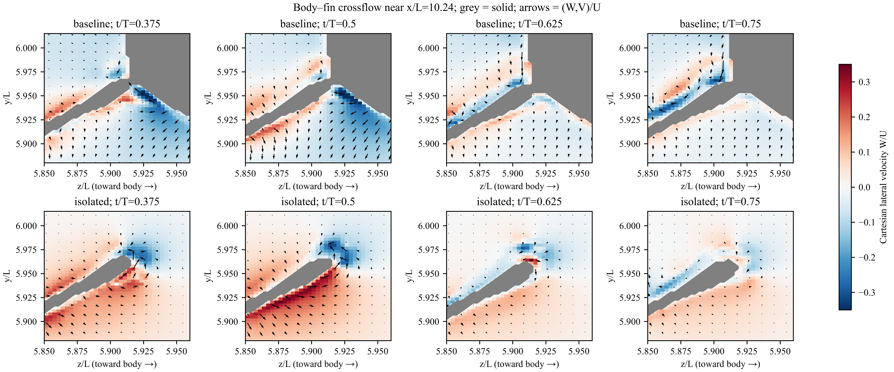
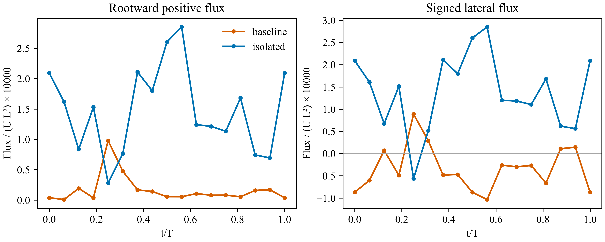
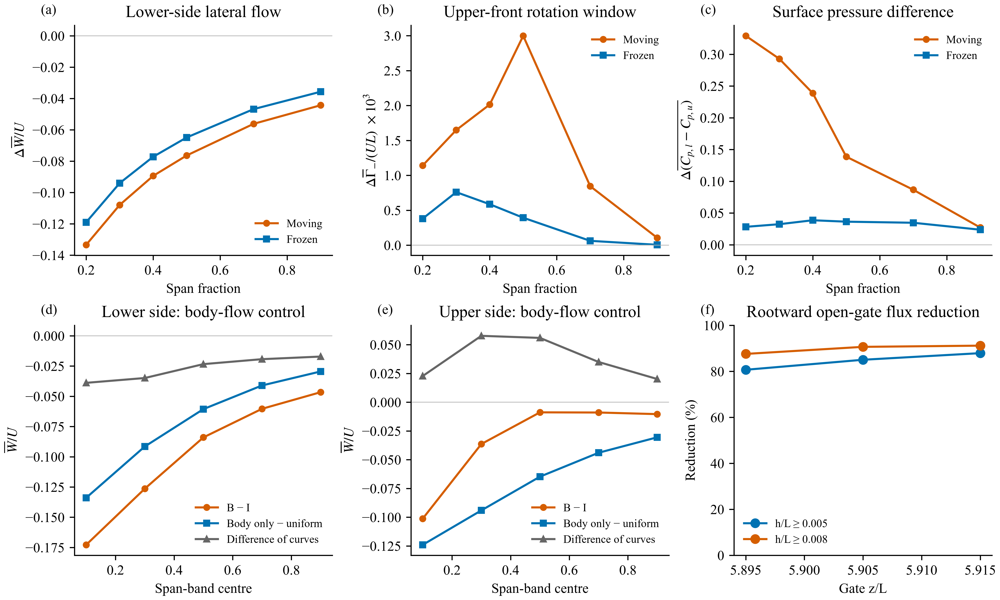

# v22：身体怎样改变鳍根流动，以及这些改变怎样接到增升

2026-10-24。使用已经确认稳定的现有周期。本轮新增五组计算：连续横截面、下侧横向通量、三维前向粒子路径、运动/静止四算例、无鳍身体速度对照；并继续检查上侧涡量方程。原始场与论文全文留本地。

## 机制判断

**现在可以明确指出身体的具体流动影响：身体附近向外、向下的流动，抵消了孤立鳍下侧向根部的横向流动；组合算例中这一局部平均流动甚至反向。运动时，上侧前部的旋转量和内侧鳍面平均压差增量明显扩大，压差积分产生正的平均鳍载荷增量。**

这是一条有算例对照和动量关系支持的机制解释。中间“横向流改变如何定量产生上侧旋转增量”仍须用输运方程辨别，不能把全部增升命名为一个鳍根涡的贡献。静态控制已经排除了“单靠堵住根部通道就解释全部增升”的过强解释。

| 逻辑环节 | 直接证据 | 能支持的结论 |
|---|---|---|
| 身体改变背景流动 | 无鳍身体在相同空间位置产生向外 W 和向下 V；图 26d–e | 身体本身能够产生所需方向的流动扰动 |
| 鳍根下侧流动改变 | 组合/孤立对照的 W 反向；六种开口通量窗口都减小；图 24–26 | 下侧向根部流动受抑制，不能等同于已证明完整绕根泄漏路径 |
| 运动参与上侧响应 | 静态仍有横流变化，但旋转和压差增量远小于运动；图 26a–c | 纯静态几何效应不足，需要考虑运动中的体鳍相互作用 |
| 旋转流动联系压差 | v16 同一配对层的动量预算，v21 平均乘积核算 | 局部旋转相关压力项提供正增量，其他项有抵消，外层压力仍重要 |
| 压差产生载荷 | v13–v15 同范围上下压差的法向投影积分 | 增升来自平均压差改变，主要集中在内侧鳍；不是任意压力零点造成 |

## 1. 身体改变了什么流动？

采用负 z 一侧鳍，正 W 指向身体/鳍根，负 W 指向外侧。图中为实际 Cartesian W、V，不把倾斜局部坐标的“展向速度”误当成纯横向流。

图 24：x/L 最接近 10.24 的原生切面，四个连续相位，灰色为固体，箭头为惯性系 (W,V)/U。两个算例网格不同，切面是各自最近节点；这里用于观察连续流动，定量通量比较另行重采样到相同位置。截面箭头是三维速度的二维投影，不能直接当作三维物质轨迹。

在距下侧表面 h/L=0.02 的已有探针，展向位置 0.2：孤立鳍周期平均 W/U=+0.09706，组合算例为 −0.03628，差为 −0.13334。位置 0.3 的差为 −0.10790。该方向反转在物理坐标中成立。

无鳍身体的独立对照也显示所需方向的速度扰动。在最内侧 0–0.2 展向带下侧材料射线位置，组合减孤立的平均 W/U 为 −0.17280，无鳍身体相对均匀来流的 W/U 为 −0.13394；V/U 分别为 −0.10060 和 −0.06998。这里是区域面积加权值，与上述单探针数值范围不同。

无鳍场只能作背景流动对照。上侧组合减孤立的变化与无鳍场有明显差异，不能把体鳍速度或压力视为身体场与孤立鳍场的线性相加。

## 2. 对向根部流动的影响有多大？

对三个固定 z 门面及两种离壁厚度积分 W 的正部分。各门面的 y 窗口逐相位跟随孤立鳍下侧体素边界；将组合算例的 W 线性插值到孤立算例相同坐标，流体掩码用最近邻判定。所有积分门面在两个算例中都是流体，因此减小不是把固体面积从积分中删除造成的。

六种窗口的周期平均向根通量减少 **80.7%–91.2%**，同时有符号平均通量从孤立鳍的正值转为组合算例的负值。厚度分别为 h/L=0.005–0.020、0.008–0.025，目标 z/L=5.895、5.905、5.915。曾检查 z/L=5.925，但那里没有满足当前定义的孤立鳍下侧体素窗口，未纳入统计；不是把零通量算作效果。

这衡量穿过开口门面的向根流动，**不是闭合质量预算，也不是从下侧完整绕到上侧的流量**。三维前向粒子检验没有给出一致的“组合算例阻断下侧至上侧通行”结果；近壁路径还有提前终止。因此不采用“阻断绕根泄漏已被证明”这一叙述。全部路径及终止原因保存在 JSON 中供复核。

## 3. 为什么还需要运动机制？

图 26a–c：分别比较运动组合减运动孤立、静止组合减静止孤立。上侧旋转指标是共同窗口内负展向涡量的面积积分幅值，**不是闭合 LEV 环量**。静态截面的离壁距离由其实际静态轮廓确定，两个成对几何用双向最近点距离核对，所有窗口共同有效覆盖率为 100%。

| 展向位置 | 运动 ΔW/U（下侧） | 静止 ΔW/U | 运动平均压差增量 | 静止平均压差增量 |
|---|---:|---:|---:|---:|
| 0.2 | −0.13334 | −0.11896 | +0.32911 | +0.02831 |
| 0.3 | −0.10790 | −0.09400 | +0.29297 | +0.03245 |
| 0.4 | −0.08937 | −0.07717 | +0.23876 | +0.03868 |

横向流变化在静止时已经很明显，但运动时内侧压差增量大得多；上侧负涡量窗口积分也增大。图 26b 的峰值位置与图 26c 不同，不能把两者当成一一成比例关系。四算例冻结的是整个体鳍运动，不能单独归因为身体运动或鳍运动。

## 4. 从流动到压力，再到升力

Neumann 条件下各算例可有不同压力常数。本报告只使用每个算例内部下侧减上侧的压力，再比较算例差：

\[
\Delta J=(C_{p,l}-C_{p,u})_B-(C_{p,l}-C_{p,u})_I.
\]

共同面片的压力载荷由这个压差乘以对应面积及竖直投影再积分。此前双鳍共同区域的平均压力载荷增量为 +0.00613943，其中内侧 60% 贡献 84.73%；冻结运动后为 +0.00143994。全系统 B−I−NoFin 的平均总力差为 +0.0058987，包含身体变化和黏性项，不能将双鳍区域值当成整个系统的精确分摊。

在另一组明确的单鳍 1071 个配对面上，平均表面压差载荷增量为 +0.00309374，其中外层配对压力 +0.00186746、解析近壁层 +0.00118306、未解析壁面间隙 +0.00004322。解析层的 Lamb 项 +0.00210339，被动能项 −0.00071082、非定常项 −0.00024558 等部分抵消。预算平均余项约 +0.00003907；瞬时误差更大，不能借平均抵消宣称逐相位精确闭合。

因此，局部旋转确实通过动量方程参与压差增量，但不能省略外层压力，也不能把 Lamb 项直接当作某个涡的全部升力。v21 进一步表明该局部 Lamb 正均值主要来自沿运动射线的平均速度与平均涡量乘积；波动乘积为负。

## 5. 涡量输运检验的实际结果

已计算两个运动算例、15 个内部原生相位、3 个内侧截面，共 90 组。采样位置为同一物理坐标，x/c=0.05–0.5、h/L=0.016–0.04；所有点满足流体差分模板条件。时间导数在固定空间位置取相邻原生场差分，然后才投影至当前截面的展向，避免把移动采样点的导数错当欧拉导数。

检验方程为 ∂tω = −(u·∇)ω + (ω·∇)u − ω∇·u + ν∇²ω。黏性系数仍条件性采用现有输入文件的 1/41379.3，未把输入副本当作已验证的运行归档。

**这个预算未通过定量闭合。** 逐点及逐相位综合的余项 RMS/时间导数 RMS，组合算例为 1.65–1.81，孤立鳍为 2.30–6.08。这些值不是百分比升力误差；它们表明不能可靠地给涡量产生途径排序。采样覆盖率 100% 也不代表差分精度充分。原始目录此次核对的场输出间隔为 30 步，与缓存一致，未发现可直接替换的中间原生场；本轮没有通过时间插值伪造额外 CFD 信息。

这个失败的检验保留在 [upper_vorticity_budget.json](upper_vorticity_budget.json) 和 [validation.json](validation.json)，没有被删去以配合机制叙述。它不否定已直接测量的速度、压差和力差，但限制了对“涡量究竟如何产生”的进一步因果声称。

三维路径按两个算例都有效的同种子比较：t/T=0.375 释放的 10 对中，靠近上侧参考面的数量 B/I=4/2；t/T=0.5 释放的 11 对为 3/4。方向不一致，因此不能支持“身体阻止完整绕根路径”的结论。该邻近判据本身也不是绕根通行事件。

## 6. 与 Dong 组方法的对应及当前边界

采用 Wang 等（2019，[DOI](https://doi.org/10.1088/1748-3190/ab2208)）的分析顺序：力差定位、相位流动、根部速度、涡量/环量指标、上下压差；沿用分析路线，不移植其涡名称或百分比。本项目的流动方向必须由自己的 Cartesian 速度和控制算例判断。

可以写入结果部分的结论是：**身体相关的流动偏转抑制了孤立鳍下侧的向根横流；运动算例进一步表现出更强的上侧旋转及更大的内侧平均压差，后者造成正的鳍压力载荷增量。** 将前后两者之间的传递过程写成唯一、定量闭合的因果链，仍需通过涡量输运和外层压力来源检验。本轮没有把相关性升级为唯一机制证明，也没有把这些结果标成可直接投稿的完整证据。

## 复现与检查

- `run__rootCrossflow.py`：连续切面、Cartesian 速度及局部基底投影审计。
- `run__rootGateFlux.py`：共同坐标门面，三位置×两厚度×17 相位。
- `run__rootForwardPaths.py`：两个释放相位、成对种子、512/1024 步；常速度积分解析检查通过。路径靠近上侧并不等于绕根通过。
- `run__motionRootControls.py`：四算例实际轮廓、压力差、上侧旋转窗口与横流；运动 17 相位、静止 3 相位。
- `run__bodyCrossflowControl.py`：无鳍身体与组合减孤立的同位置速度对照。
- `run__rootMechanismFigures.py`：六面板整合图；600 dpi PNG、可编辑文字的混合 PDF/SVG。
- `run__upperVorticityBudget.py`：上侧共同物理位置的局部涡量方程检查，结果需按有效覆盖率和余项判断。

代码依赖既有本地 CFD 缓存和本地原始读取模块；仓库不包含这些大数据，不能在无数据环境声称全流程可重跑。
