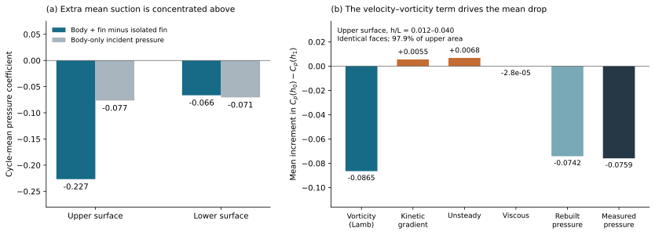

# Orca 上表面吸力来源

> 历史报告；以最新总报告为准。原报告散落附件不随本合集上传。

历史报告快照；部分判断后续已更新。请先阅读最新总报告。原始数据附件保留本地，本合集不包含数据或论文全文。

# Orca：上表面吸力为什么增强？

2026-10-22 · 原始三维流场、同一材料表面与 NoFin 对照 · 本轮新增定量结果

身体运动组织两面的压力波动；上表面另外形成持续的吸力增强。新计算表明，在可可靠解析的近鳍流体层内，这部分平均压力下降主要由速度—涡量耦合项推动，再通过表面压力积分产生增升。下表面的平均压力变化则抵消一部分增升。

## 1. 身体带来的压力场解释波动，但不足以解释上表面的平均吸力

在 NoFin 流场中沿虚拟鳍面取压，与实际“有身体 − 只有鳍”的压力变化逐相位比较。下表面相关系数 r＝0.998，不调整幅值的预测 R²＝0.906；波动回归斜率为 1.43。NoFin 压力还与局部运动加速度反向同步（r＝−0.976）。这支持身体摆动推动水体加速、形成周期压力场，并由鳍的存在放大下表面响应。

| 周期平均 Cp | 实际压力变化 B−I | NoFin 同位置压力 | 两者之差 |
| --- | --- | --- | --- |
| 上表面 | −0.2267 | −0.0765 | −0.1502：额外吸力 |
| 下表面 | −0.0665 | −0.0705 | +0.0041 |

上表面也与身体压力同步（r＝0.981），所以两面的作用不能完全割裂；区别是上表面还出现了明显的负压偏置。表中的差值用于识别相互作用，未把它直接命名为“涡压力”。

图 1｜左：同位置的平均压力对照。右：独立用速度场重建上表面外侧 h/L＝0.012–0.040 流体层的压力差增量；负值表示朝鳍面靠近时吸力增加。右图所有项使用相同材料面片、相同采样路径。

## 2. 涡量如何联系到压力：动量方程给出了可核算的链条

该流体层实测的额外压力下降为 −0.0759，由速度场独立重建为 −0.0742，平均差 2.3%。其中速度—涡量项 −u×ω 贡献 −0.0865；动能梯度与非定常项分别贡献 +0.0055、+0.0068，部分抵消吸力。

再扣除 NoFin 的层间压差，上方额外压力下降仍为 −0.0778，重建为 −0.0762；下方的平均层间压差则几乎被 NoFin 对照重现。这把上表面的额外吸力与身体原有压力场区分开。Lamb 项的精确拆分进一步表明：涡量场变化推动吸力增强，速度场变化部分抵消，不能仅用局部速度幅值普遍放大来解释。

## 3. 压力如何成为升力：给出份额，也写清分母

沿同一路径把压力增量投影回鳍面，该流体层对应 ΔCL＝+0.001481，占同一有效上表面增升 +0.004295 的 34.5%。速度—涡量项单独为 +0.001813（42.2%），其余动量项部分抵消，留下上述净值。34.5% 是指定流体层压力差对应的上表面增升份额，不能写成“涡占全部升力 34.5%”。

原生压力力在这侧共同面片上给出：上表面 +0.004285，下表面 −0.001010，净增升 +0.003276。也就是说，平均增升来自上表面吸力增强，下表面主要改变波动并在平均上抵消约四分之一的上表面收益。全双鳍原始压力升力比仍为 1.596。

本轮计算一侧鳍、一个周期的 17 个相位；动量核算保留上表面 97.9% 面积。未解析的壁面至 h/L＝0.012 段，以及 h/L＝0.040 处的压力，仍有其自身的涡与非涡来源，未强行归类。所有“份额”都是有符号、指定路径的压力账目；相关系数用于描述同相变化，不作为因果百分比。

方法借鉴：[Wang、Dong 等（2019）的身体／翼／组合对照与压力链条](https://doi.org/10.1088/1748-3190/ab2208)；[Prakhar、Seo、Mittal（2025）的涡强度与位置区分](https://doi.org/10.1017/jfm.2025.10681)；[Han、Quinn 等（2024）的先分压力、再积分力](https://doi.org/10.1017/jfm.2023.1004)；[de Kat 与 van Oudheusden（2012）的动量方程压力重建](https://link.springer.com/article/10.1007/s00348-011-1237-5)。

公式、敏感性、关键相位与复现说明 [original local attachment: Orca_压力来源_方法与验证.html] · 压力与力的相位数据 [original local attachment: data/incident_pressure_phases.csv] · 动量项相位数据 [original local attachment: data/paired_pressure_budget_phases.csv] · 主图 PDF [original local attachment: pressure_mechanism.pdf]
