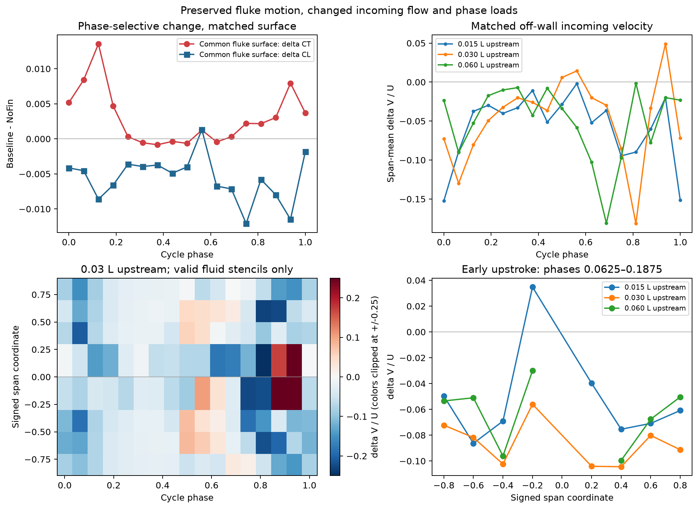
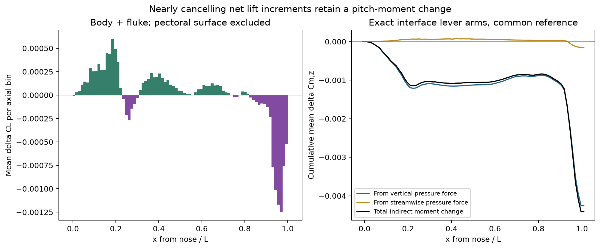

# Baseline–NoFin：两条论文问题的原始数据检验

> 历史报告；以最新总报告为准。原报告散落附件不随本合集上传。

历史报告快照；部分判断后续已更新。请先阅读最新总报告。原始数据附件保留本地，本合集不包含数据或论文全文。

Baseline–NoFin：两条论文问题的原始数据检验

# 胸鳍如何改变尾鳍载荷与前后身体的俯仰力矩？

检验对象：Baseline＝Sweep35，对照 NoFin；相同规定游动运动，t/T＝9–10。差值统一为 Baseline − NoFin。以下分部结果均为压力载荷。

这组数据支持的物理结论：胸鳍存在时，尾鳍上游局部流动、表面压力和各拍动阶段的载荷贡献发生变化，尾鳍推力增益不能用整个周期统一增强解释。同时，胸鳍诱发的躯干与尾鳍升力改变量大部分抵消，却产生同号的间接俯仰力矩变化。因此，只把胸鳍视为额外加在整身体上的一个受力部件，会遗漏重要的身体—尾鳍干扰作用。

## 1．尾鳍变化是阶段性的载荷重分配，而非统一增强

两工况共有的 4,929 个尾鳍三角面上，周期平均 ΔCT＝+0.002836，ΔCL＝−0.005805。它们保留全尾鳍推力、升力差异的 94.9% 和 96.9%，因此主要结果不依赖尾鳍根部分区标签的小差异。共同节点的运动差异在约 10−6L 内。

可证伪的检验：令整个周期 FBaseline(t)≈kFNoFin(t)，对推力—升力平面完整波形拟合一个常数。最优 k＝0.995888，预测平均 ΔCT＝-0.000122，实际为 +0.002836，连符号都不一致。此前幅值／方向分解中约 80% 归入幅值项，只是逐时刻代数分解；幅值变化本身随相位改变，不能据此解释为整体增强。

载荷增量集中在上拍，尤其早期上拍。沿相同运动前缘、同一空间位置取样，在前缘上游 0.03L 处，φ＝0.0625–0.1875 的展向平均 ΔV/U＝−0.0866；推力增量最大相位 φ＝0.125 时为 −0.0803。该阶段实际来流向下，Baseline 更向下，而尾鳍向上运动。上游 0.015L 和 0.06L 处也观察到同号变化。这与该阶段增强的向下压力载荷和正推力增量相容。

相同位置的局部速度差与共同尾鳍表面的载荷差。此处“上游”是相对运动前缘的空间位置，并不预先假定扰动来源。

压力证据：在 φ＝0.125，精确匹配两工况的 8,022 个笛卡尔压力界面；这些界面的坐标、面积及法向相同。直接积分 Δp 得到 ΔCT＝+0.013540、ΔCL＝-0.008610，与载荷差逐项一致。因此，这些共同界面上的差异是压力改变，而非几何投影改变。

| 参考材料表面 | 面积加权 ΔCp | 该相位 ΔCT | 该相位 ΔCL |
| --- | --- | --- | --- |
| upper | +0.04346 | +0.003280 | -0.001550 |
| lower | -0.33477 | +0.010260 | -0.007060 |

下表面的面积加权压力差为 ΔCp＝−0.335，上表面为 +0.043。这一压力差组合增强向下载荷；下表面同时贡献该相位推力增量的约 75.8%。这里描述的是 Baseline 相对 NoFin 的压力变化，不能仅由差值判断任一工况的绝对压力是否低于参考压力。

Cp 使用界面相邻流体单元压力；上、下表面按参考材料法向分组。组内平均 ΔCp 不等价于局部法向力，需要结合每个界面法向和面积积分。

精确匹配的原始压力界面；颜色为 ΔCp，位置映射回参考材料表面。色标截断于绝对值第 98 百分位，仅影响显示，不影响积分。

共同尾鳍表面的完整载荷差显示：φ＝0.125 的推力增量约 75.8% 来自参考下表面；周期平均推力增量约 56.1%、升力减量约 73.1% 来自内半展长。变化有空间和相位选择性，不能概括为整片尾鳍均匀增强。

证据边界：已经识别“局部来流改变—压力改变—阶段性载荷改变”的一致证据；这些同步量尚不能唯一确定是胸鳍尾涡直接到达尾鳍、胸鳍先改变身体尾流，还是包含尾鳍自身诱导响应。不能据此写成已经证明特定涡结构的能量回收。也未证明整体波形发生统一相位提前或滞后。

## 2．净升力掩盖了由前后载荷重分配产生的间接力矩

去掉胸鳍表面自身贡献后，躯干 ΔCL＝+0.006717、尾鳍 ΔCL＝−0.005991，仅剩 +0.000725；按“1−净改变量绝对值／各改变量绝对值之和”衡量，抵消程度为 94.3%。但它们分布在不同纵向位置，对参考点的俯仰力矩改变量同号相加。

逐个原始压力界面使用实际力臂，按 ΔMz＝∫[(x−xr)ΔFy−(y−yr)ΔFx] 分解。运动表面对应逐帧积分后再作工况差，不用分部中心代替真实力臂。

| 部位 | 平均 ΔCL | 竖向力贡献 | 流向力贡献 | 平均 ΔCm,z |
| --- | --- | --- | --- | --- |
| 躯干（含其他非胸鳍、非尾鳍表面） | +0.006717 | -0.000999 | +0.000036 | -0.000963 |
| 双侧胸鳍 | +0.015743 | -0.002711 | +0.000593 | -0.002118 |
| 尾鳍 | -0.005991 | -0.003256 | -0.000194 | -0.003450 |

非胸鳍表面合计 ΔCm,z＝-0.004413，其中 96.4% 来自竖向力的纵向重分布。胸鳍直接贡献为 -0.002118；在此共同参考点，间接贡献约为直接贡献的 2.08 倍。反过来，非胸鳍净升力改变量只有胸鳍直接升力的 4.6%。这正是平均净力会掩盖、力矩分析才能揭示的干扰效应。

沿体长分箱的升力增量及其累计俯仰力矩。胸鳍自身表面已排除；所有分箱之和与完整原始界面力矩严格闭合。

不是任意参考点造成的符号：参考位置在鼻端后 0.25–0.65L、原参考高度上下 0.1L 的几何范围内改变，间接平均 ΔCm,z 始终为负，范围 [-0.004750, -0.004128]。这是接近力偶的重分布效应；因净力差不为零，不能称严格与参考点无关的纯力偶。

主参考点为 Baseline 在 t/T＝9 的封闭几何体积形心 [10.41606572119357, 6.006774537121876, 5.995661606876167]，不是实测质心。坐标 y 向上，正 Mz 为尾部上抬／头部下俯；此处负增量表示相反方向的力矩变化，并不意味着绝对平均力矩已经变为负值。

对第二条问题的回答：已有数据确实支持胸鳍通过躯干与尾鳍干扰改变整身体俯仰载荷平衡；但“更稳定”“配平更优”仍不由这些规定运动计算直接推出。原先整体力矩标准差下降的判断会随参考点改变，不能拿来证明稳定性改善。本次可靠的核心是平均间接力矩的来源与参考点范围内的一致符号。

## 可用于组织文章的结论与验证范围

在当前 Baseline–NoFin 对照中，胸鳍引起的水动力变化具有阶段和空间选择性：尾鳍运动保持一致时，其局部来流与压力分布发生改变，上拍阶段的推力贡献增加；与此同时，躯干增升与尾鳍减升在净力上大部分抵消，却在俯仰力矩上相加，形成强于胸鳍直接贡献的间接平均力矩变化。

这使文章的问题从“加胸鳍是否增加推力”推进到“附属鳍如何通过身体—尾鳍干扰重分配推进载荷与俯仰载荷”。尾鳍局部推力收益同时伴随整身体平均压力推力下降，因此局部增益不能等同整身体推进改善。

归一化 U＝0.29、A＝0.548382、L＝1；压力力保留求解器原生系数约定。流场及分部界面每周期 17 帧（含重复相位端点），周期积分为梯形积分；只解析该输出相位分辨率。404/408 对匹配探针通过有效流体插值检查，4 对排除；0.03L 处全部有效。映射到既有表面载荷与力矩分解均闭合。共同表面、参考点和探针距离检查针对本次解释的具体伪差来源，不代替网格收敛和统计不确定性研究。仅检验当前两工况，不推广为 sweep 参数规律、效率改善或自由游动稳定性结论。

复核数据：完整数值摘要 [original local attachment: mechanism_summary.json] · 匹配来流探针 [original local attachment: matched_inflow_probes.csv] · 沿体长的力和力矩 [original local attachment: nonpectoral_axial_distribution.csv] · 参考点敏感性 [original local attachment: nonpectoral_reference_sensitivity.csv] · 尾鳍区域贡献 [original local attachment: tail_patch_contributions.csv] · 此前载荷统计与整体收支 [original local attachment: ../report.html]
