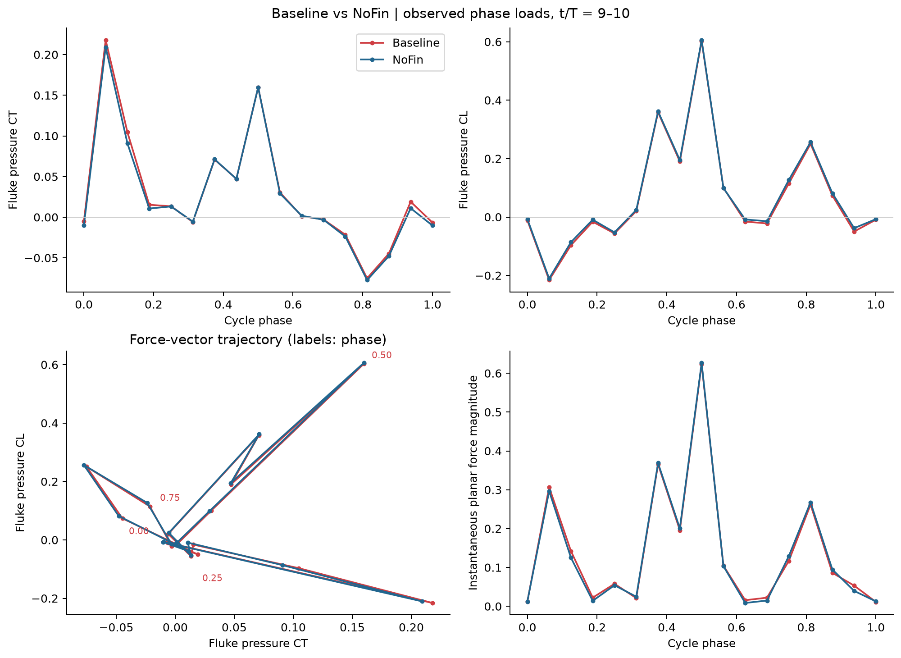
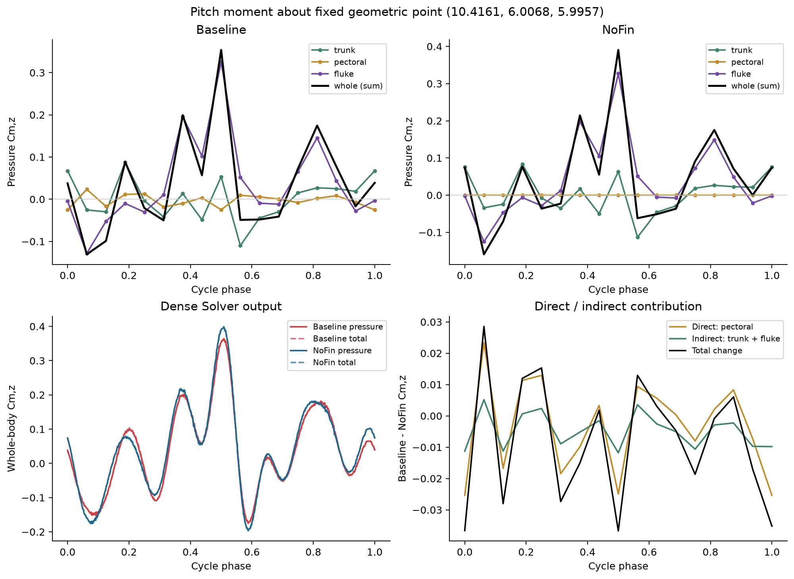
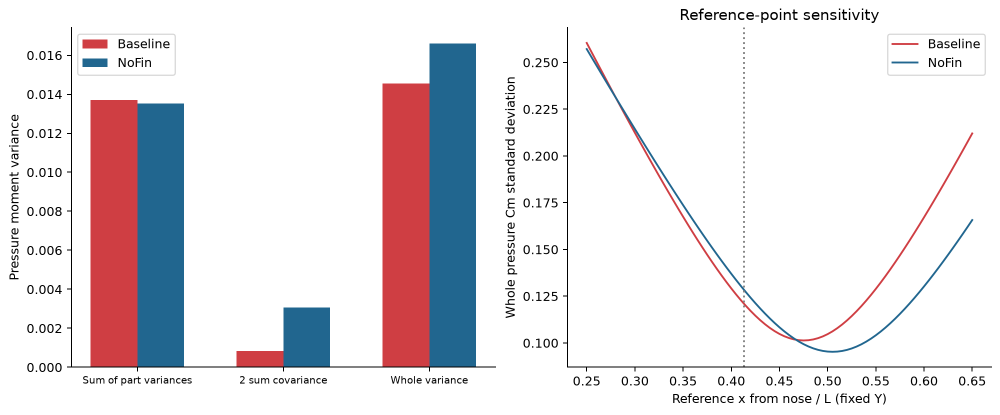

# Baseline 与 NoFin：受力和俯仰力矩实算

> 历史报告；以最新总报告为准。原报告散落附件不随本合集上传。

历史报告快照；部分判断后续已更新。请先阅读最新总报告。原始数据附件保留本地，本合集不包含数据或论文全文。

Baseline 与 NoFin：受力和俯仰力矩实算

# Baseline（Sweep35）与 NoFin：受力和俯仰力矩实算

2026-10-08 · 原始计算输出的定量对比

本页保留基础载荷统计。两条论文问题的进一步检验见 来流、压力与间接俯仰力矩分析 [original local attachment: mechanism/report.html]：幅值分解占比较高不等于整个周期统一增强；整体力矩波动降低也不能证明稳定性改善。新分析检验的是阶段性尾鳍载荷变化，以及净升力中大部分抵消、俯仰力矩中同号相加的间接作用。

## 计算口径

原始目录 Result/Sweep35 与 Result/NoFin。分析 t/T=9–10（steps 4320–4800），分部使用 17 帧含首尾，即 16 个相位间隔；整体求解器使用 481 点。U=0.29，A=0.548382，L=1；CT=−Fx/(U²A)，CL=Fy/(U²A)，Cm=Mz/(U²AL)，原生输出已含 writer 系数 2。

分部是压力力与压力矩；整体同时提供压力和压力＋黏性结果。左右胸鳍按实际面片分别求和，没有将左鳍力矩乘二。力矩按原始 Cartesian 压力界面位置积分，然后统一平移参考点。分部定义：fluke 为已有尾鳍标签，trunk 为除尾鳍与双胸鳍外的全部表面。

共同固定参考点 O=(10.41606572, 6.00677454, 5.99566161)，取自 Baseline 在 t/T=9 的封闭几何体积中心，约在鼻端后 0.41345L；不是质量加权重心。全局 X 顺来流、Y 向上，俯仰分量为 Mz；正 Mz 对应尾部上抬方向。

## 1. 尾鳍力的方向、大小和时机

| 指标 | NoFin | Baseline | 相对变化 |
| --- | --- | --- | --- |
| 平均 CT | 0.029747 | 0.032735 | +10.04% |
| 平均 CL | 0.082766 | 0.076774 | -7.24% |
| 平均矢量的模 | 0.087949 | 0.083462 | -5.10% |
| 瞬时矢量模的周期平均 | 0.148772 | 0.150416 | +1.10% |

平均矢量夹角从 70.231° 降到 66.908°。但瞬时矢量模的周期平均略增，不能把平均矢量模降低解释成尾鳍整体受力减弱。观察相位点上两工况主峰大体对齐，现有时间分辨率不足以断言细微峰时变化。

对 F=R e 使用对称精确恒等式 ΔF=ΔR(e₁+e₀)/2+(R₁+R₀)Δe/2。平均 CT 增量 0.0029875 中，大小项为 0.0023757（79.5%），方向项为 0.0006119（20.5%）。这只是受力变化的数学分账，不是流动因果分解。

按尾鳍材料点中心 Y 位移符号区分上/下拍并积分，上拍贡献约占 CT 增量的 86.0%。阶段划分使用实际相邻帧区间，转向点分辨率受 1/16 周期采样限制。受力幅值加权平均方向差为 0.62°。

## 2. 整体与分部俯仰载荷

| 整体求解器指标（481 点） | NoFin | Baseline | 变化 |
| --- | --- | --- | --- |
| Cm_pressure mean | 0.044876 | 0.038306 | -14.64% |
| Cm_pressure std | 0.128230 | 0.120798 | -5.80% |
| Cm_pressure peak_to_peak | 0.592480 | 0.536099 | -9.52% |
| Cm_total mean | 0.044610 | 0.038309 | -14.12% |
| Cm_total std | 0.129046 | 0.121601 | -5.77% |
| Cm_total peak_to_peak | 0.596963 | 0.540351 | -9.48% |

分部重建得到平均力矩变化 -0.0065304。胸鳍直接贡献 -0.0021177（32.4%）；躯干＋尾鳍的间接贡献 -0.0044126（67.6%）。该比例是指定参考点上的平均矩变化比例，不代表瞬时效应或能耗比例。

| 工况 | 部位 | 平均 CT | 平均 CL | 平均 Cm | Cm 标准差 |
| --- | --- | --- | --- | --- | --- |
| Baseline | trunk | -0.007153 | 0.015950 | -0.001628 | 0.048555 |
| Baseline | pectoral | -0.006573 | 0.015743 | -0.002118 | 0.013863 |
| Baseline | fluke | 0.032735 | 0.076774 | 0.041597 | 0.105614 |
| NoFin | trunk | -0.005822 | 0.009233 | -0.000665 | 0.050151 |
| NoFin | pectoral | 0.000000 | 0.000000 | 0.000000 | 0.000000 |
| NoFin | fluke | 0.029747 | 0.082766 | 0.045047 | 0.104984 |

分部力矩方差之和从 0.0135367 到 0.0137040，略增；两倍协方差之和从 0.0030567 降到 0.0008429。整体方差下降主要来自部件间交叉项减少。Baseline 胸鳍与躯干、尾鳍的协方差均为负，但全部交叉项之和仍为正；应称抵消增强/共同放大减弱，不能称完全反相抵消。

参考点敏感性：在 x/L=0.4 附近 Baseline 波动较小；参考点移至 x/L=0.5 时，Baseline 压力矩标准差约 0.10472，NoFin 约 0.09538，排序反转。因此需要真实质心/运动参考点才能把这项诊断升级为动物俯仰动力学结论。

## 核验与限制

分部合力和整体合力在浮点精度内闭合，分部力矩之和也与已有独立界面积分闭合。平移到共同参考点后，重建压力矩与同相位求解器的 RMSE：Baseline 0.000397，NoFin 0.000401，约为各自力矩波动的 0.3%。最后两个周期的整体力矩均值和标准差变化远小于工况差异。以上是重建与时间重复性核验，不是网格收敛证明，也不能量化区域切分误差。

尾鳍节点匹配核查：初始同坐标节点比例 99.56%；这些节点的全周期位移最大差 9.54e-07。未匹配边界节点不能认定逐点一致；完整诊断见 summary.json。

已有 q 导出缺少求解器内部完整 ghost/方向掩码，压力界面重建仍有离散误差；力闭合不等于所有部位分配精确。没有用 POD 或插值生成额外的分部载荷点。CT_total 表示整体净流向力系数，不等同于尾鳍推力或推进效率。

图 1：尾鳍相位分辨压力载荷；连线仅连接实际采样点。

图 2：分部压力矩、求解器整体压力/总力矩，以及直接与间接贡献。

图 3：力矩方差收支及参考点敏感性。

分部均值 [original local attachment: regional_means.csv] · 原始相位积分 [original local attachment: phase_loads.csv] · 力矩方差收支 [original local attachment: moment_variance_budget.csv] · 参考点敏感性 [original local attachment: reference_sensitivity.csv] · 完整数值与核验 [original local attachment: summary.json]
