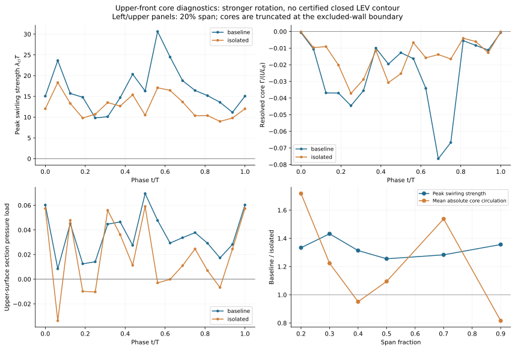
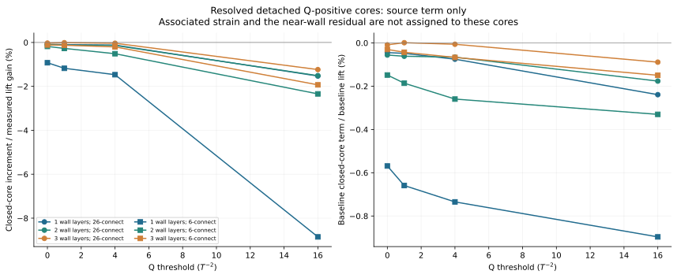
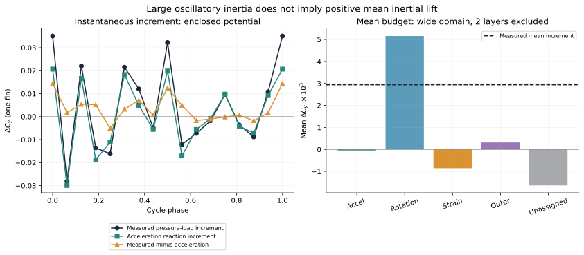
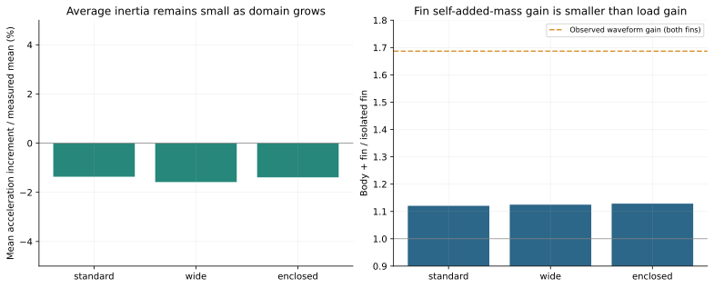
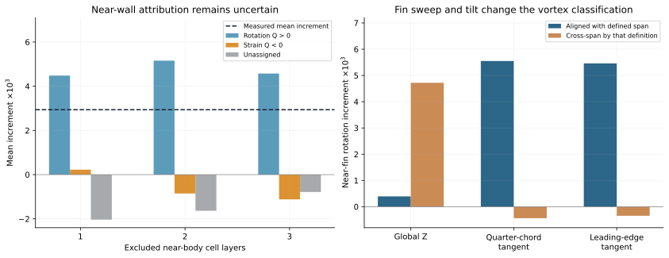
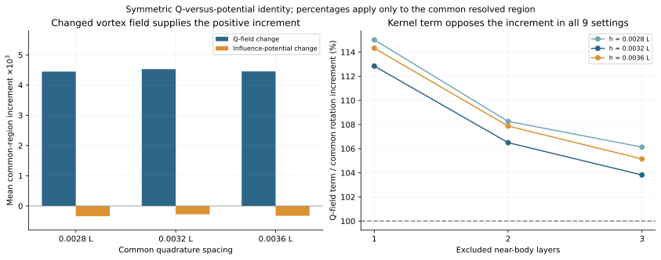
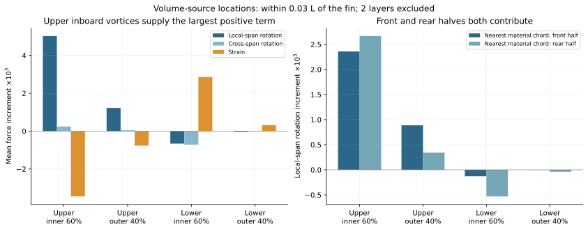
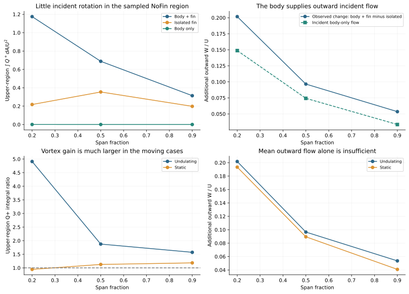

# Orca 胸鳍增升：涡机制、惯性响应与几何放大的定量区分

> 历史报告；以最新总报告为准。原报告散落附件不随本合集上传。

历史报告快照；部分判断后续已更新。请先阅读最新总报告。原始数据附件保留本地，本合集不包含数据或论文全文。

2026-10-22：主报告已更新。按照旋转／涡—压力—升力的证据链组织的研究见 Orca 机制主报告 v5 [original local attachment: ../mechanism_chain_v5/Orca_涡_压力_升力_机制研究.html]。本页保留作为力分解与数值闭合的补充审计；不再以精确涡力百分比作为机制研究完成的前提。

2026-10-22 · 新增涡核环量、三维结构受力和近壁校核；完整涡力占比仍未闭合 · 直接读取原始 CFD 数据，未从既有结果图片提取证据

# Orca 胸鳍增升：与涡有关，还是“放大”占主导？

[查看本轮新增调查：六截面环量／压力、三维独立涡核受力，以及近壁重建和旧重启数据核查。](#followup-v4)

本轮新增定量结果：独立闭合 Q>0 核的直接压力源，在参考设置下占 baseline 平均胸鳍压力升力 -0.066%，其增量占测得增升 -0.138%；24 组识别设置下均未产生正的平均增升贡献。正旋转源增量主要来自与近壁相连的流场。独立闭合核不代表全部涡作用，近壁涡量和相关应变仍需完整核算。

研究状态修订：平均增升及其表面受力位置已量化，当前解析区域的 Q 场变化支持“鳍附近旋转占优流场增强”的机制假说。但是，具体涡结构占总体胸鳍升力的可信百分比仍未求得。当前结果不能作为已经完成归因闭合的研究结论；报告此前使用“最终数据版”的表述不准确。

在共同可解析区域，Q 场变化贡献 106.5% 的平均旋转相关增量，几何影响权重变化贡献 -6.5%；两者相加为 100%。这是该区域的代数分解，不是“涡解释了总升力的 106.5%”。

“放大”至少包含三个不同问题：观测到的载荷波形增益；附加质量／身体加速度耦合；以及同一流场通过不同几何影响函数产生的力变化。本研究分别计算它们，避免把现象和机制混为一谈。

证据边界：近壁输出尚不足以闭合完整的旋转、应变和粘性压力预算。参考设置下，未归属平均增量为 -1.6345 × 10−3，占测得增量的 -55.6%。因此，可以判断哪些解释更有支持，但不能给出可信的全域“vortex 占 X%、added mass 占 Y%”最终百分比。

## 研究审计：到底知道“涡占总体升力多少”吗？

目前不知道可信的最终比例。第 4 节保存了升力增量预算，但它不能替代这个问题。这里必须区分：总体占比 Rtotal = 平均涡相关力／baseline 平均升力，与增量占比 Rgain = 两算例平均涡相关力之差／两算例平均升力之差。此前的 1.76 倍属于第二种分母。两者都还需要一个经验证的涡结构与受力定义。

当前辅助势只针对负 Z 单侧胸鳍的压力升力；不是整个 Orca 的总升力，也没有包含胸鳍摩擦力。“Q>0 的所有体素”是旋转占优区域，不等于已经识别并追踪了 LEV、鳍尖涡、身体涡等具体结构；加上 Q<0 后的体积项，也不能自动命名为这些结构的完整因果作用。

| wide 域近壁排除层数 | baseline 平均压力 CL | 已解析 Q>0 项／总体压力升力 | 已解析全部 Q 项／总体压力升力 |
| --- | --- | --- | --- |
| 1 | 0.007909 | 103.8% | 106.2% |
| 2 | 0.007909 | 110.6% | 83.6% |
| 3 | 0.007909 | 93.3% | 64.0% |

参考设置的全部 Q 体积项为 0.006612，除以 baseline 的 0.007909 得到 83.6%。这只是未验证的截断积分比，不能作为“涡占总升力 83.6%”交付。排除更多层同时删去了真实的物理源区域，因此上表不是 CFD 网格收敛检验；它说明尚未补回的近壁部分对最终比例不可忽略。参考设置中 baseline 自身的未归属量已占其平均压力升力 17.5%。

### 未归属的 56% 究竟在哪里？

用已保存的压力离散源进一步分区后，增量残差可严格写为“保留流体区的压力 Poisson 不一致”与“排除的近壁压力源减去加速度边界项”之和：

| 残差来源，wide 域排除 2 层 | 平均增量 ×10³ |
| --- | --- |
| 保留区域的压力源 − Q 源 | -0.1087 |
| 近壁压力源 − 加速度边界项 | -1.5258 |
| 合计：原未归属项 | -1.6345 |

近壁部分约占该残差的 93.3%。这定位了尚缺的收支，不能把它全部叫作“数值误差”，也不能全部归到涡：其中混合了被排除的真实 Q 源、粘性边界作用和离散处理不一致。仅仅调整 Q 阈值、让预算看起来闭合，不能解决归因问题。

### 与 Dong 组研究思路相比，做到了哪里？

| 文献中的具体分析 | 本研究已有 | 本研究尚缺 |
| --- | --- | --- |
| Liu、Ren、Dong 等，JFM 2017，§4.3–4.4，图 13–17：识别具体涡，以约 10% 峰值涡量等值线包围涡并计算环量，再对应相位压力与平均表面推力。 | 新增两种选核策略、5%–20% 涡量轮廓、六截面 17 相位环量与压力数据；见新增调查。 | 10% 轮廓未通过闭合检验，尚不能标记为完整 LEV；跨相位涡身份仍未验证。 |
| Guo 等，PRF 2023，图 9–11：研究换向期入射涡与 LEV 的相互作用，沿前缘六个截面比较涡核环量，再分析相同相位的压力与推力。 | NoFin 入流诊断、六个真实局部展向截面、新增涡核强度与同相位压力比较。 | 仍未证明涡捕获、合并、稳定化或脱落过程；不能从瞬时最大核自动推断连续涡身份。 |

所以，此前是借鉴了部分分析工具，尚未完整执行这两篇论文的机制证据链。文献中的环量增强与低压／受力对应，本身也不自动给出涡对总力的百分比；求这个比例仍需明确的结构受力分解和足够小的闭合残差。

接下来的研究验收应是：逐结构的环量与相位演化能与同相位压力／受力对应；近壁源和粘性压力项被一致地处理；随后分别给出总体升力占比与增升占比，并同时报告未归属量。当前 attribution_audit_v3.json 与 attribution_denominators_v3.csv 保存了上述审计，未把它们标为已完成的涡结构归因。

## 新增调查：按具体涡结构追查，而不把 Q 增强直接当作升力百分比

本轮新增工作全部来自数值数据：两算例各 17 相位、六个与真实局部展向垂直的截面；三维旋转区域的连通结构及其压力力源积分；四个代表相位的近壁速度重建；历史重启数据的来源核对。原有结果图片未作为证据。

### 1. Dong 路线：涡核、环量、同相位压力

按照 Liu、Ren、Dong 等（JFM 2017，§4.3–4.4）的环量思路，先在 Q>0 且存在旋转强度 λci 的区域选候选核，再寻找同号涡量的 5%、10%、20% 轮廓。另用局部 |ωspan| 最大点重选核，重复 10% 轮廓，避免结论依赖单一选点规则。该程序对解析 Gaussian 涡能得到 10% 轮廓内约 90% 的理论环量，并能正确拒绝被边界截断的轮廓。

结果：10% 涡量轮廓没有通过完整闭合检验。在每算例、每排除层设置的 612 次“相位×截面×侧面×位置”查询中，两种选核方式都没有得到合格闭合轮廓。这里是候选查询次数，不能称为 612 个独立涡。大部分轮廓与被排除的近壁剪切层相连，一部分还到达采样边界；这既不是“涡不存在”的证明，也不能支持已经量得完整 LEV 环量。

| 算例 | 排除近壁层数 | 以局部涡量峰值选核：找到候选／查询数 | 10% 轮廓闭合 |
| --- | --- | --- | --- |
| baseline | 1 | 612/612 | 0 |
| baseline | 2 | 595/612 | 0 |
| isolated | 1 | 612/612 | 0 |
| isolated | 2 | 605/612 | 0 |

因此另外保存较严格的 Q>0、同号展向涡量、λci>0.2λci,seed 连通涡核积分，明确称为“可解析涡核环量”，不冒称完整 LEV 环量。六个截面的 baseline 与 isolated 物理轮廓在全部相位完全吻合；以下压力比较不受截面形状差异影响。

| 展向位置 | 峰值 λci 周期均值之比 B/I | 涡核 /Γ/ 周期均值之比 B/I | 涡核 ∫Q dA 周期均值之比 B/I | 核闭合相位 B/I |
| --- | --- | --- | --- | --- |
| 20% | 1.334 | 1.717 | 2.802 | 0/0（各 17 相位） |
| 30% | 1.432 | 1.224 | 2.187 | 0/0（各 17 相位） |
| 40% | 1.314 | 0.951 | 1.590 | 0/0（各 17 相位） |
| 50% | 1.255 | 1.095 | 2.091 | 0/0（各 17 相位） |
| 70% | 1.283 | 1.538 | 2.124 | 0/0（各 17 相位） |
| 90% | 1.356 | 0.816 | 0.968 | 0/0（各 17 相位） |

这是上侧前半弦、排除一层的参考设置。λci 平均峰值增强约 25%–43%，而 |Γ| 的比值随展向由小于 1 到约 1.72，不符合“所有截面的单一 LEV 环量统一增加 1.6 倍”的简单描述。20%、30% 展向处，Δλci 与同相位上表面截面压力升力差的周期相关系数分别为 0.745、0.635；对应 Δ|Γ| 的相关系数仅为 0.039、0.085。但在 40%、50% 展向处，Δλci 对应的相关系数也仅为 0.015、0.146，所以单一核强度并不足以统一预测受力。这些相关量只描述一个周期，不能作因果百分比或独立样本显著性检验。

新提取的相位数据：上侧前缘附近旋转强度、可解析涡核环量和同一截面上表面压力积分。所有参考前缘核均接触近壁排除边界，不能把 Γ 当成完整 LEV 环量。

### 2. Mittal 路线：哪些三维旋转结构真正进入压力力积分？

对完整周期的三维 Q 场逐相位做连通分区，再对每个分区积分同一个辅助势加权源 −2ρQφ。分为：与近壁排除边界相连的区域、既不接触近壁也不接触裁剪边界的独立闭合区域、仅接触裁剪边界的区域。这里的“闭合”是空间连通性定义，尚不是跨相位追踪的物质涡。26 邻接与仅面相邻的 6 邻接、1–3 层排除、Q 门槛 0/1/4/16 T−2 共 24 组设置全部重算。

新增可定量回答的部分：独立闭合 Q>0 核的有符号压力源项，在 baseline 中为总体胸鳍压力升力的 -0.896% 至 0.001%；其 baseline−isolated 增量为测得增升的 -8.853% 至 -0.011%。该范围来自后处理设置变化，不是统计置信区间。

这不等于“所有涡作用只占这么多”。LEV、附着涡量及与壁面连通的尾迹可以属于另一类；涡周围 Q<0 的应变区也未分配给单个涡。当前小量结论只针对上述独立闭合 Q>0 核。

| 参考设置：26 邻接、排除 2 层、Q>4 T⁻² | 平均压力 Cᵧ 增量 | 占测得平均增升 |
| --- | --- | --- |
| 与近壁排除边界相连的 Q 核 | +0.00518450 | 176.443% |
| 独立闭合 Q 核 | -0.00000406 | -0.138% |
| 仅接触裁剪边界的 Q 区域 | +0.00000079 | 0.027% |
| 0<Q≤4 的剩余旋转区 | -0.00002359 | -0.803% |

参考设置下，与近壁相连的部分占全部已解析旋转项增量的 100.521%。这与前面“压力增升集中在上侧内展向、旋转强度提高”的证据一致，支持继续追查贴近鳍面的旋转／剪切层和周围应变的耦合，而不是用远离鳍面的独立 Q 核直接解释 1.6 倍增升。这里的分母是旋转项增量；旋转项还受到应变等负项抵消，因此不能改写成总增升占比。

三维独立闭合 Q 核的压力源贡献，分别用增升和 baseline 总体压力升力作分母。与近壁连通的区域不在这些曲线内；相关应变和未归属项也不在其中。

### 3. 近壁收支：尝试了什么，为什么没有强行给出完整比例？

已用实际表面运动、无滑移条件和无散约束重建局部二次速度场，且把待预测流体点的原始速度留出，避免用受力或压力拟合闭合。薄鳍两侧邻点被区分。四个相位的速度分量预测 RMS／U 为：

| 算例 | 四相位 RMS/U 范围 | 绝对压力力残差范围 |
| --- | --- | --- |
| baseline | 5.2% 至 8.7% | 0.00096 至 0.01397 |
| isolated | 9.0% 至 18.7% | 0.00094 至 0.00875 |

这些误差不支持把重建梯度和粘性压力项作为定量闭合结果，故该方法本轮被拒绝用于最终归因。粘性计算暂用现存输入的 1/Re，只保存为敏感性诊断；没有把失败的近壁重建填进平均涡力预算。

进一步找到历史 step 3840 重启数据，验证了 Fortran 记录长度、网格 SHA-256、表面坐标及运动。它与当前网格逐字节相同，但同一上游区域 Ux 分别为 0.957 和 0.275；属于不同流动条件。旧文件中的 Re=11881.19 不能替代当前算例的 Re，而且其固体内速度也为零，未补回所需 ghost 速度。旧重启被明确排除，未混入均值。

### 4. 本轮后的机制判断与尚未完成的问题

数据支持：身体存在伴随上表面内展向的旋转增强和压力重分布；已解析旋转源的正增量主要来自与近壁相连的流场。附加质量／加速度反力主要解释大幅周期振荡，其周期平均增量不能解释正的平均增升。独立闭合 Q>0 核在全部识别设置中都未表现为正的平均增升来源；其具体数值对连接规则和阈值敏感。

还不能声称：已经证明某个 LEV 捕获、稳定化或脱落机制；也不能把全域涡结构对总体升力的比例写成 83.6%、106.5% 或本节闭合核的小比例。缺口仍是近壁的完整 Q 与粘性压力收支、与具体结构配套的应变贡献及可靠的结构时间追踪。本轮新增结果将研究范围缩小了，但完整的涡作用百分比仍未求得。

可核查数据：vortex_structures_v4/core_phase_metrics.csv、core_cycle_comparison.csv、contour_validity.csv、omega_seed_contour_audit.json；vortex_connectivity_v4/component_force_means.csv；wall_reconstruction_v4 的相位诊断与 restart_provenance.json。新增 4 项解析检验通过，三维分区之和逐相位与原旋转项核对，不能将这些程序检验视为 CFD 物理收敛。

## 1　先确认研究对象和增升量

| 状态 | 带身体：双胸鳍平均压力 Cy | 孤立双胸鳍 | 比值 | 差值 |
| --- | --- | --- | --- | --- |
| 运动 | 0.015743 | 0.009865 | 1.5958 | 0.005878 |
| 静态 | 0.007577 | 0.006860 | 1.1045 | 0.000717 |

当前数据复现约 1.596 倍，即增加约 59.6%。静态不是严格零：同一压力口径约增加 10.5%，其绝对增量约为动态增量的 12.2%。运动条件下的额外差值约 0.005160，但这个差分不是自动成立的因果分量。

共同几何含 4,855 个完全匹配三角面，覆盖带身体胸鳍面积约 90.8%、孤立鳍约 92.8%；其运动逐相位匹配。共同面升力增量同样存在，非共同面净贡献略为负值。既有压力结论也通过上游参考压力检查，主要增升不是压力零点或多算鳍根面积造成的。

本轮三维辅助势针对 负 Z 一侧胸鳍计算，测得平均增量为 0.002938。所有本轮力预算使用该单鳍口径，不能与双鳍数值直接相加。统一归一化为 Cy = 2Fy/(ρU²S)，U = 0.29，S = 0.548382，ρ = 1，L = 1。这里研究的是压力升力；区域皮肤摩擦力未单独重构。

## 2　用了哪些文献方法，做了哪些必要修改

[Liu、Ren、Dong 等（2017）](https://doi.org/10.1017/jfm.2017.533)提供身体—鳍相互作用、分区压力和涡动力学的分析思路；[Guo、Dong 等（2023）](https://doi.org/10.1103/PhysRevFluids.8.073101)提示必须区分上游输入的涡与鳍自身形成的涡。因此加入现有 NoFin 流场作为入流诊断，而不预设“身体涡增强胸鳍涡”的故事。

[Menon、Kumar、Mittal（2022）](https://doi.org/10.1103/PhysRevFluids.7.114102)用辅助势把 Q 与力相连，并强调涡周围的应变不能忽略；[Prakhar、Seo、Mittal（2025）](https://doi.org/10.1017/jfm.2025.10252)把移动表面的加速度反力与涡、粘性、外边界作用分开。[Han、Zhong、Quinn、Moored 等（2024）](https://doi.org/10.1017/jfm.2023.1004)区分非定常惯性与平均力来源；这里没有直接套用其特定运动下的零平均附加质量结论，而是用 Orca 的 480 个运动记录核算。

胸鳍是连在身体上的开放表面子区域，不能直接把整封闭物体的零外法向通量边界条件搬过来。这里采用局部混合边界辅助问题，保留外边界压力项：

∇²φ = 0；　∂φ/∂n = ny 在目标胸鳍上，其他身体表面为 0；　φ = 0 在外边界。

n 指向流体域外，即在实体表面指向身体内。由 Green 恒等式和压力 Poisson 方程，在连续理想条件下：

Ffin = −ρ∫B φ n·aB dS − 2ρ∫V Qφ dV + μ∫B φ n·∇²u dS − ∫Σ p ∂φ/∂n dS。

这里的外边界项是压力项，与通常全 Neumann FPM 的外边界加速度项形式不同。实现使用原生 Cartesian 网格和流固标记的有限体积近似，求解 Aφ = b。对导出的压力，pᵀb = φᵀAp 是严格的离散恒等式；它验证力泛函和求解器，却不能证明从速度梯度估计的物理分量已经闭合。

每个相位直接从三维 U、V、W 求 ∇u，再算 Q = −½ tr[(∇u)²] 和 ω；没有把二维 Wz 或涡环量当作三维升力。加速度来自 480 点 fort.41，先对运动记录作时间差分；没有用 17 帧位置的二次差分代替真实加速度。

## 3　瞬时放大确实存在，但不能解释平均增升

双鳍载荷波形的经验拟合约为 Cbody+fin(t) = 1.6866 Cisolated(t) − 0.000896，相关系数 0.9991。这是波形关系，不是力的物理分解。

左：加速度反力与测得压力升力增量逐相位对照。右：参考局部域的平均预算；未归属项没有隐藏或重新命名为涡力。

| 辅助势范围 | 平均 ΔCB ×10³ | 占测得平均增量 | ΔCB 波动标准差 | 与增量波形相关 | 鳍自附加质量比 |
| --- | --- | --- | --- | --- | --- |
| standard | -0.0401 | -1.4% | 0.008866 | 0.9672 | 1.1207 |
| wide | -0.0465 | -1.6% | 0.011375 | 0.9680 | 1.1249 |
| enclosed | -0.0409 | -1.4% | 0.014641 | 0.9694 | 1.1285 |

全身范围结果中，加速度反力增量的标准差为 0.014641，测得增量标准差为 0.017669；二者相关系数 0.9694。这支持强非定常惯性响应参与瞬时放大。其平均增量仅为 -0.0409 ×10−3，无法产生约 +2.9383 ×10−3 的正平均增升。

几何辅助势还给出对目标鳍单位均匀竖直加速度的响应。带身体／孤立鳍的比值约 1.129，小于约 1.69 的载荷波形增益。因而“鳍自己的 added mass 变成 1.6 倍”也不是准确解释：还存在身体及其他表面加速度对目标鳍的耦合。

| baseline 中的加速度来源 | 平均 CB ×10³ | 波动标准差 |
| --- | --- | --- |
| 目标胸鳍 | -0.3775 | 0.030019 |
| 对侧胸鳍 | -0.0018 | 0.000360 |
| 非胸鳍表面：身体、背鳍、尾鳍 | -0.0901 | 0.011048 |
| 合计 | -0.4694 | 0.041426 |

这里的来源分区是同一个 baseline 辅助势下的边界项，不是把 NoFin 算例的压力直接加到孤立鳍上。各分量逐时刻可加，但标准差不能直接相加。鳍自附加质量增加与后文 Qφ 几何权重项略为负并不矛盾：前者是单位加速度的边界响应，后者加权的是有空间正负抵消的体积流场。

密集时间核查把 17 个相位的材料面影响权重插值到全部 480 个运动时刻。固定影响权重乘周期加速度的平均值为数值零；随几何变化的权重产生小的非零均值。线性和 Fourier 权重插值仅是时间敏感性检查，不等于独立求解了 480 个辅助势。

| 当前选定辅助势范围的时间核查 | 平均加速度反力增量 ×10³ | 占测得平均增量 |
| --- | --- | --- |
| 17 相位 | -0.0409 | -1.4% |
| 480 时刻，线性插值几何权重 | -0.0870 | -3.0% |
| 480 时刻，Fourier 插值几何权重 | -0.0610 | -2.1% |

三个范围使用各自的辅助势，检查截断身体是否改变平均惯性结论。全身范围仍是有限外边界，外边界效应没有假定为零。

## 4　旋转与应变的平均力预算

| 项 | 平均增量 ×10³ | 与测得净增量的比值（预算口径） |
| --- | --- | --- |
| 表面加速度反力 | -0.0465 | -1.6% |
| 旋转占优区域 Q > 0 | +5.1576 | 175.5% |
| 应变占优区域 Q < 0 | -0.8536 | -29.1% |
| 外边界压力项 | +0.3153 | 10.7% |
| 未归属项（必须保留） | -1.6345 | -55.6% |
| 合计／测得增量 | +2.9383 | 100.0% |

Q > 0 区域给出主要的正解析贡献。在参考设置中，Q < 0 区域合计抵消部分增力。应变并非处处减升：上方应变与下方应变的符号不同，必须带着 φ 的符号积分。参考表的旋转项超过净增量，表示存在相互抵消，不是“贡献率超过物理上限”。

近壁第一层使用单侧速度梯度时散度误差显著增大；全体素 Q、导出 Q/Wz 和排除近壁层的结果差别不可忽略。排除 1、2、3 层时，旋转增力均为正；应变合计和未归属项更敏感。因此本文把“旋转增力的符号与主要位置”作为较可靠结果，把精确全域份额作为未解决问题。

左：近壁排除层数敏感性，不是 CFD 网格收敛。右：按真实鳍展向重新分类后，主要旋转增力沿局部展向。

## 5　不是同一涡场被几何权重放大：Q 场变化占主导

在同一物理位置、两算例都具有有效流体差分模板的区域，采用对称恒等式。令 K = −2ρQφ：

ΔK = −2ρ (QB − QI)(φB + φI)/2 − 2ρ (QB + QI)(φB − φI)/2。

第一项固定平均影响权重，测量流场 Q 的改变；第二项固定平均 Q，测量影响权重的改变。对 Q⁺ = max(Q,0) 单独应用，得到旋转占优部分的分解。它不依赖先改哪一个量的顺序。

| 共同区域、参考设置 | 平均 ΔC ×10³ | 该区域旋转增量中的比值 |
| --- | --- | --- |
| Q 场改变 | +4.5293 | 106.5% |
| 几何影响权重改变 | -0.2764 | -6.5% |
| 两者合计 | +4.2529 | 100% |

使用 0.0028、0.0032、0.0036 L 三种积分点间距，并排除 1–3 层近壁网格，Q 场项比例为 103.8–115.0%；权重项在全部九个设置中均为负。基准共同区域保留的旋转增量约为原生近鳍旋转增量的 83.2%。被排除的非共同区域没有被强行分配给某种机制。

| 辅助势范围，均为参考积分设置 | Q 场项 ×10³ | 权重项 ×10³ | Q 场项／该区域增量 |
| --- | --- | --- | --- |
| wide | +4.5293 | -0.2764 | 106.5% |
| standard | +4.4918 | -0.1829 | 104.2% |

净权重项为负不代表所有位置都为负。在最重要的上方内侧区域，Q 场变化约占该区域旋转增量的 97.3%，几何权重约占 2.7%。这里同样由流场改变主导。

这一结果直接反对“涡基本不变，只是身体把同一涡的力几何放大”的解释。它支持旋转占优流场发生了实质增强／重组。Q 的改变涉及旋转与局部应变的相对强度，不能简单等同于涡量模长增加。φ 的改变也同时包含目标表面定义、身体几何和有限外边界变化，不能单独称为纯身体效应。

百分比仅属于共同可解析区域的旋转相关平均增量。三种间距是后处理积分敏感性，不是重新进行 CFD 网格加密。

## 6　究竟是哪类涡，在哪里产生正增力？

必须随真实鳍几何定义展向。相位 0、20% 展长处的四分之一弦线切向约为 (−0.5166, 0.5160, 0.6833)。一个完全沿真实展向的涡，其 |ωz|/|ω| 约为 0.683，低于常用的 0.75 阈值；若把全局 Z 直接当作展向，会把它错判为 cross-span。

在距鳍表面 0.03 L 内、排除两层近壁点时，按局部四分之一弦线划分，展向旋转增量为 +5.5505 ×10−3，横跨该展向的旋转增量为 -0.4385 ×10−3。改用前缘切向，展向结果为 +5.4593 ×10−3。把方向阈值从 0.5 改到 0.9，展向项仍承担该近鳍净旋转增量的约 91.2–108.6%。

| 流体源区域 | 旋转 Q>0 增量 ×10³ | 局部展向旋转 ×10³ | 应变 Q<0 增量 ×10³ |
| --- | --- | --- | --- |
| 上方，内侧 60% | +5.2701 | +5.0239 | -3.4489 |
| 上方，外侧 40% | +1.2757 | +1.2268 | -0.7665 |
| 下方，内侧 60% | -1.3724 | -0.6596 | +2.8600 |
| 下方，外侧 40% | -0.0614 | -0.0406 | +0.3193 |

正旋转增量最大的是上方内侧 60% 区域，约占上方两个区域正旋转增量之和的 80.5%。前半弦占局部展向净旋转增量约 56.1%，后半弦约 43.9%。所以可以说沿展向的近鳍涡相关吸力重要，但不能把所有增升归给某一个 LEV。

“前／后半弦”按照最近的材料三角面定位，不等于已经识别出 LEV／TEV；被前缘生成后输运到后半弦的同一个涡，也可能跨越这两个区域。本轮没有宣称完成单个涡管的身份跟踪。

### 增强主要是体积变大，还是强度提高？

| 上方流体区域 | Q>0 平均体积比 | 体积时间加权 Q 强度比 | Q⁺ 积分比 | Q 加权距表面／L：带身体、孤立 |
| --- | --- | --- | --- | --- |
| 内侧 60% | 0.923 | 2.366 | 2.184 | 0.01343，0.01357 |
| 外侧 40% | 1.002 | 1.507 | 1.510 | 0.01244，0.01301 |

内侧的旋转占优体积约为孤立鳍的 0.92 倍，体积时间加权强度约 2.37 倍；距表面诊断基本不变，其差异还小于原始网格间距。把邻域宽度改为 0.02–0.04 L、近壁排除改为 1–3 层，内侧体积比为 0.90–1.00，强度比为 2.02–2.57。所以这里更像旋转占优结构变强，而不是仅仅体积扩大或整体更靠近表面。

强度定义为 ∫∫Q⁺dVdt / ∫VQ>0dt，因此“体积比 × 强度比 = Q⁺ 积分比”严格成立。Q>0 占据体积不是单个涡的身份或寿命；距表面采用最近三角面中心近似，不能用亚网格的距离差推断涡移动。

这些是流体体积源对整个目标胸鳍的作用；不是各源点正下方表面压力的局部一对一分配。

辅助诊断还计算了坐标不变的涡伸长产生项 ∫ω·Sω dV。上方内侧区域的基准增量为 4.561（以 U³ 归一化）。这与涡增强相容，但没有包含完整的壁面涡量生成、输运和扩散收支，不能据此宣布伸长是唯一原因。

## 7　NoFin 对照：身体输入的是涡，还是改变了入流？

| 展长位置 | NoFin 的 Q⁺ 积分／baseline | NoFin 的涡量平方积分／baseline | 身体单独产生的向外 W/U | 实测新增向外 W/U |
| --- | --- | --- | --- | --- |
| 20% | 0.016932% | 0.15249% | 0.148784 | 0.201755 |
| 50% | 0% | 4.1691e-07% | 0.074331 | 0.096539 |
| 90% | 0% | 9.4168e-09% | 0.033502 | 0.053559 |

在这里采样的鳍上方共同流体区域，NoFin 的旋转占优结构很弱，鳍根处涡量平方积分约为 baseline 的 0.15%，中外侧更小。这不支持“强身体涡先到达胸鳍，再直接产生增升”是此处主要解释。它不排除身体边界层或未采样区域存在涡。

与此同时，NoFin 已有明显向鳍尖方向的流动。20%、50%、90% 展长处，身体单独的平均展向扰动相当于实际新增展向流的约 74%、77%、63%。这不是力的贡献率，但说明身体能改变胸鳍的入流环境；实际带鳍流场还存在反馈，不能简单线性叠加。

把 NoFin 压力采到虚拟运动鳍上，得到平均压力投影约 0.000472，只有双鳍增升约 8.0% 的量级。该投影没有插入真实胸鳍后的流场反馈，并略去约 0.5% 的无有效流体模板面积；它是诊断量，不能当成可加的 Froude–Krylov 分量。

NoFin 有 9,370 个与 baseline 匹配的节点，整个周期最大坐标差约 1.8×10−6 L；但其表面重新三角化，去鳍后的根部封口不同。到 baseline 非胸鳍表面的距离，约 95.8% 节点小于 0.003 L，最大约 0.024 L，位于鳍根附近。因此它是有用的入流支持证据，不能充当严格同几何的因果干预。

上排采用三算例共同流体点比较。下排采用上一轮各算例原生截面积分；两个采样定义不混为同一个数值。静态也有展向流，但没有同样强的涡增强。

## 8　为什么静态没有同样的增升？

20% 展长处，动态的新增向外 W/U 约 0.202，静态约 0.193，二者接近；但上方 Q⁺ 积分的带身体／孤立鳍比值，动态约 4.91，静态约 0.94。可见平均展向流本身不是充分条件。身体改变的流动环境，需要与运动诱发的鳍附近涡生成、输运及伸长相互作用，才出现这里观测到的强涡增力。

“更大的平均迎角”也不符合鳍根数据：在前缘上游 0.3c，动态 baseline 的平均有效迎角约 5.65°，孤立鳍约 8.32°，而 baseline 升力更高。局部速度平方的提高只有约 12%，且对探针距离敏感，不能单独解释约 60% 的平均升力增加。

表面压力证据把流体机制与实际受力连起来：双鳍上表面平均增量为 +8.3207 ×10−3，下表面为 -2.4432 ×10−3。共同面的内侧 60% 承担约 82.5% 净增量，前半弦承担约 70.0%。体积源位置与表面压力位置不要求逐点一致，因为压力是非局部场。

数据支持的物理链条：身体改变鳍附近的入流和非定常压力耦合 → 运动胸鳍附近的旋转／应变场发生改变，实际展向涡的正作用增强 → 上方内侧区域的平均吸力增大 → 在下方旋转、应变和其他作用的抵消后，得到净平均增升。与此同时，加速度反力让瞬时波形幅值放大。

现有四个主要算例改变的是“身体存在 × 整体是否运动”。它们没有独立区分躯干起伏和胸鳍运动。因此不能进一步断言：必须是躯干本身 undulate，而不是运动胸鳍与静止身体的相互作用，才能产生增升。

## 9　验证、未解决项与下一步的可检验判据

- 新辅助势方法通过线性加速度压力、开放面恒压零点、二次压力 Poisson 源及流体单侧差分四项解析检查；原有旋转、剪切、应变等五项检查保留。目标力匹配的是上一轮原生网格分区压力积分，两者使用同一压力数据和分区定义；机器精度的一致不是与独立导出的胸鳍受力比较，也不是物理精度证明。

- 每相位求解残差记录在 JSON；小域、大域及包住整个身体的域分别检查。三域最后一项只校核惯性与压力泛函，不宣称在全身域完成 Q 或粘性归因。

- 近壁排除 1–3 层、三种共同积分间距、两个真实展向定义、四个方向阈值均已检查。它们属于后处理敏感性，不是 CFD 网格或时间收敛。

- baseline 与 isolated 原生细网格间距不同，约为 0.00295 L 与 0.00304–0.00313 L；没有同网格重新计算。瞬时流场每周期只有 17 帧，输入运动含明显高次谐波，限制涡身份跟踪及输运闭合。

- baseline 与 NoFin 使用 t = 9–10 的流场，isolated 使用 t = 3–4。孤立鳍更后周期的整体压力力均值较稳定，但 baseline 的密集分区鳍力没有导出。17 相位 Q 预算均值尚未证明时间收敛；多个辅助势范围并不增加独立流场时刻数。

- 未导出完整原求解器压力算子、流固界面通量／所有 ghost 和 body ownership 掩码。当前 φ 是体素有限体积近似；紧贴壁面的梯度和粘性压力效应进入未归属项。粘性压力项与表面摩擦力不是同一个量。

- 静态带身体算例的整物体 X 压力重构存在明显异常，因此本研究不据它推导阻力机制；Y 升力检查较好，但不能把整物体峰值相对误差当作平均胸鳍增量的误差上界。

进一步达到发表级因果闭合所需的最小补算：先用相同网格与统一压力／受力导出重做 baseline 和 isolated，输出原求解器压力算子或对应源项与壁面通量；在鳍附近提高相位采样至至少约 80 帧／周期，并保留每步分区力。然后考虑“静止身体＋运动胸鳍”与“运动身体＋相对身体固定胸鳍”对照。必须先定义根部参考系和连接区连续变形；直接把一部分节点速度置零会改变原有鳍运动或制造不连续接缝，不能作为严格对照。具体运行未在本轮发起。

建议的研究验收目标是：未归属平均量小于测得平均增量的 5%，且网格／相位加密后净平均增量变化小于约 2%，机制分量对合理积分域和壁面处理稳定。这些是本研究拟定的检查阈值，不是通用数值标准。若达不到，应继续保留未归属项。

## 10　数据和复现文件

本报告与图均由数值数据生成。summary_v2.json 汇总所有结论；force_histories.csv 保存分域相位曲线；vortex_region_means.csv 保存位置、方向和源项；kernel_split_means.csv 保存 Q／φ 分解。每个相位另有完整 JSON、表面影响权重和辅助势缓存。

原始 CFD、现有 PPT、旧图和原始代码均未修改。新分析源码位于 Fish_Schooling_py 的 python_scripts/postprocessing/orca_body_fin_mechanism。报告数据包包括源码快照、输入清单、数值表格和科学图；大型原始 CFD、辅助势体数据与已安装依赖留在本地分析目录，不重复打包。

结论口径：已完成本报告所列数值分析，机制证据链和全域涡力归因仍不完整。可解析区域的来源区分、相关性和代数分解均不等于完整因果证明。
