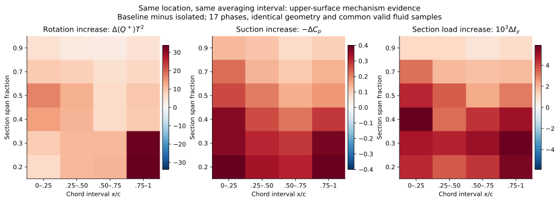
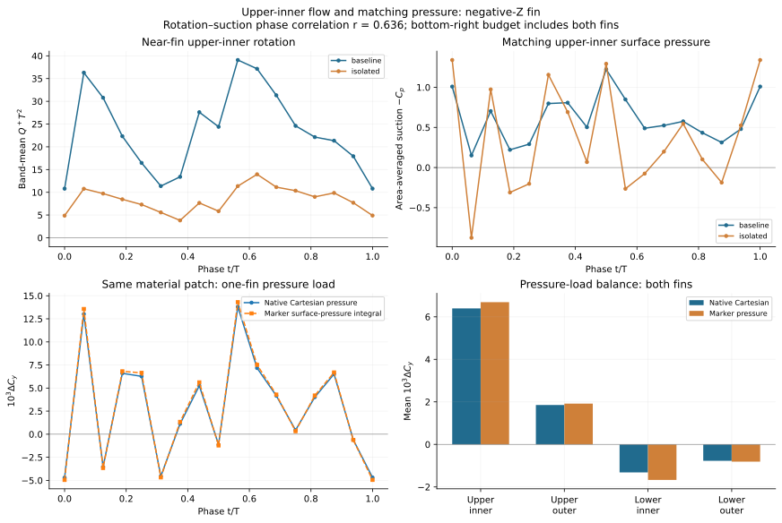
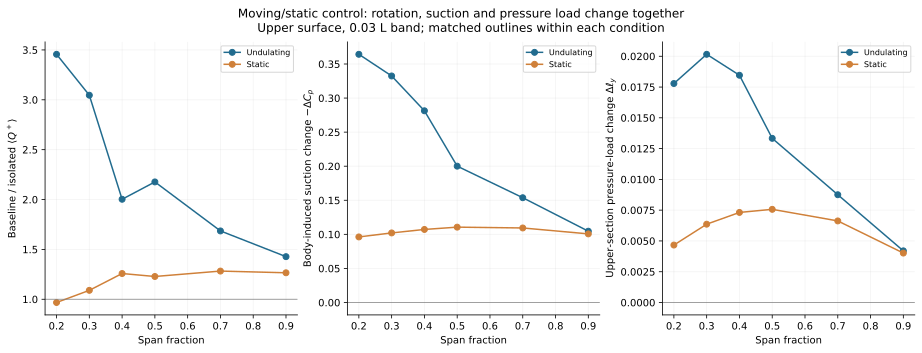

# Orca：涡、压力与胸鳍增升的机制证据

> 历史报告；以最新总报告为准。原报告散落附件不随本合集上传。

历史报告快照；部分判断后续已更新。请先阅读最新总报告。原始数据附件保留本地，本合集不包含数据或论文全文。

完整分析与验证 · 返回精简主报告 [original local attachment: Orca_涡_压力_升力_机制研究.html]

Orca · Sweep35 · 2026-10-22 · v5 机制主报告
直接读取原始压力、速度、运动及表面数据；图表均由数值分析重新生成。

# 身体如何使摆动胸鳍的平均压力升力达到约 1.6 倍？

现有数据支持：身体与摆动胸鳍的相互作用增强了胸鳍上侧、尤其内展向近场的旋转流动；增强区域对应更强的周期平均吸力。上表面吸力增强产生主要正增升，下表面压力降低则抵消其中一部分。

涡／旋转变化内侧上方 Q 正值区的平均强度指标为 isolated 的 2.37 倍。

压力变化同一材料区域平均 ΔCp = -0.270，吸力增强。

载荷变化该区域压力积分 ΔCL,p = +0.006396，是主要正增升区域。

这是一条有配对对照、空间对应、相位对应及压力积分支撑的机制解释。这里的“升力放大”描述响应，“涡／旋转—压力耦合”解释其流场基础；两者可以同时成立。本文不把相关系数或 Q 的倍数换算成涡贡献的升力百分比，也不要求完整的涡力分解作为机制研究完成的前提。

## 1. 按 Dong 组的思路，具体做了什么

Liu、Ren、Dong 等（2017，§4.3–4.4，图 13–17）通过模型对照，把局部涡量／环量的变化与表面压力和载荷分布联系起来。Guo、Han、Dong 等（2023，图 9–11）进一步利用多个展向截面、冲程相位及环量变化，解释鳍间涡相互作用与推进力增强。[1,2] 本文采用这一证据组织方式，但不把这些论文中的尾鳍 LEV 捕获机制直接套到 Orca 胸鳍上。

采用 baseline（带身体）与 isolated（仅胸鳍）的摆动对照，并补充对应静态对照。摆动流场分别取 t/T = 9–10 和 3–4；每周期 17 帧、16 个间隔。相位相关排除重复末端，采用 16 个相位；平均量由含两端点的 17 帧梯形积分得到。两静态流场选取 t/T = 9、9.5、10 三帧，静态整体载荷另有 17 帧及密集历史复核。

将两算例放在相同物理截面、相同相位和共同有效流体采样点上比较，避免把不同网格掩码误当作旋转增强。六个展向截面 η = 0.2、0.3、0.4、0.5、0.7、0.9 均垂直于实际局部四分之一弦线的展向；每个截面分四个弦向区间。另将两侧胸鳍的 4855 个完全匹配材料三角形按上下表面及内／外展向积分，全部相位的匹配坐标误差为 0。

Q = ½(‖Ω‖² − ‖S‖²),　Q⁺ = max(Q, 0)
Cp = (p − pref)/(½ρU²),　CL,p = −∫ Cp ny dS / Sref

Ω 和 S 为完整三维速度梯度的反对称、对称部分。Q 在原生三维网格求导后插值到截面；同时用三维旋转强度 λci² 交叉检查。Q 是旋转占优指标，不能直接等同于单个相干涡的环量或涡力。U = 0.29，L = 1，T = 1，ρ = 1，Sref = 0.548382；图中 Cy 与正文 CL,p 指同一垂向压力力系数。截面线积分 ℓy = −∫Cp ny d(s/L)，不是全鳍 CL,p，也没有再按局部弦长归一化。

## 2. 旋转增强是否对应吸力增强？

周期平均的空间对应是明确的正相关。上表面六个展向 × 四个弦向的 24 个区域中，旋转增量 Δ⟨Q⁺⟩ 与吸力增量 −ΔCp 的空间相关为 r = 0.641。改变近场带宽 0.02、0.03、0.04L，以及排除一层／两层近壁点后，r 仍为 0.539–0.687。用 λci² 替代 Q⁺ 时参考设置的 r = 0.638，因此结论并非只依赖一个旋转判据。

图 1｜同一截面位置的周期平均旋转增量、吸力增量与上侧截面压力载荷增量。η 从根部向鳍尖增加；颜色表示各量的真实增量，三图分别使用自己的色标。行间距是分类显示，不表示均匀展向网格。主要平均增强位于内展向；不要求每个局部峰值完全重合。

三维近场的相位对应也支持内侧上表面的联系。在距鳍面 0.03L 内、排除两层近壁网格的内侧上方区域，Δ(∫Q⁺dV / Vband) 与同一侧胸鳍材料表面的吸力变化在 16 个不同相位位置上的描述性相关为 r = 0.636。此项三维分析及其对应压力仅采用负 Z 侧胸鳍，后文完整压力预算包含两侧胸鳍。三维积分采用相同几何区域定义下的各自原生流体网格；它与上面的截面共同掩码检查相互补充。“16 个相位位置”不代表 16 次独立实验。

该区域的周期平均 ∫Q⁺dV 比值为 2.18，Q > 0 体积比却仅为 0.923；积分量除以正 Q 体积后的强度指标比为 2.37。所以在这一限定区域和阈值下，增强主要表现为已有旋转占优流体的 Q 强度增加，而非其占据体积变大。这不等于涡量幅值直接增加 2.37 倍。

对应关系并非处处、时时都强。把所有上侧“相位 × 小区域”混合后，r = 0.295；同时扣除各区域的平均值和各相位的平均值后，r = 0.232。因此最稳健的表述是“平均空间分布及内侧区域的相位演化相互支持”，而非“每一个局部涡增强都会即时、等比例地产生低压”。

## 3. 对应的低压是否确实形成正增升？

压力到载荷这一环直接采用表面积分。表面 marker 压力按瞬时面积法向积分，并与原生笛卡尔流体—固体界面压力求和、映射到同一材料表面的结果比较；没有调整比例来匹配载荷。后者是压力重建结果，并非求解器每一步单独输出的胸鳍力。

| 完全匹配的材料表面 | 三角形数 | 平均 ΔCp | 笛卡尔压力积分 ΔCL,p | 表面 marker 压力积分 ΔCL,p |
| --- | --- | --- | --- | --- |
| 上表面，内侧 60% | 1206 | -0.2698 | +0.0063955 | +0.0066889 |
| 上表面，外侧 40% | 1096 | -0.1400 | +0.0018528 | +0.0019176 |
| 下表面，内侧 60% | 1421 | -0.0738 | -0.0013180 | -0.0016710 |
| 下表面，外侧 40% | 1132 | -0.0624 | -0.0007720 | -0.0008118 |

内侧上表面的压力下降约为下表面的 3.65 倍，两者平均压差的增量为 0.1959。共同表面的上侧正增量合计 +0.0082483，下侧合计 -0.0020900，净值 +0.0061583。内侧上表面贡献了上侧正增量的 77.5%；下侧压力变化抵消上侧增量的 25.3%。这些是明确区域的压力载荷收支，不是涡力百分比。

共同表面 marker 压力积分给出的净增量为 +0.0061236，与笛卡尔压力积分相差 0.56%。这一净值一致性支持压力—载荷联系，但个别区域仍有差异，例如内侧下表面的两种积分相差约 26.8%；不能把净值的 0.56% 当作所有局部区域的误差上限。

图 2｜负 Z 侧胸鳍内侧上方的三维旋转指标与该侧材料表面的压力相位变化；左下为该侧区域的两种压力积分，右下为双鳍四区域平均收支。旋转—吸力 r 使用两算例差值计算，图中上排为两算例各自曲线。压力产生载荷的符号和法向投影由积分决定；它与旋转—压力的统计对应是两类不同证据。

marker 压力逐相位减去共同上游三个采样点的平均参考压力；笛卡尔重建保留导出压力参考，因此这里是两种积分的一致性比较，而非宣称它们参考处理完全相同。完整鳍面在参考修正前后均保持“上侧增升、下侧抵消”的结果。共同表面覆盖 baseline / isolated 胸鳍面积约 90.8% / 92.8%，其净增量与全鳍数值不同，不混用分母。

## 4. 为什么需要摆动？静态对照给出了什么证据？

| 工况 | baseline 平均 CL,p | isolated 平均 CL,p | baseline / isolated | 平均增量 |
| --- | --- | --- | --- | --- |
| 摆动 | 0.0157425 | 0.0098650 | 1.5958 | 0.0058776 |
| 静态 | 0.0075771 | 0.0068599 | 1.1045 | 0.0007172 |

本次统一口径重现了摆动时约 1.596 倍、即增加 59.6% 的全胸鳍平均压力升力。静态并非严格为零：其增量约为摆动增量的 12.2%。因此可支持的结论是“摆动显著强化了身体—胸鳍相互作用”，而不是“身体在静态没有任何影响”。

| 展向 η | 旋转指标比：摆动 | 旋转指标比：静态 | 吸力增量：摆动 | 吸力增量：静态 |
| --- | --- | --- | --- | --- |
| 0.2 | 3.456 | 0.967 | 0.3643 | 0.0962 |
| 0.3 | 3.046 | 1.089 | 0.3325 | 0.1021 |
| 0.4 | 2.003 | 1.258 | 0.2814 | 0.1072 |
| 0.5 | 2.176 | 1.228 | 0.2001 | 0.1106 |
| 0.7 | 1.685 | 1.282 | 0.1538 | 0.1094 |
| 0.9 | 1.427 | 1.265 | 0.1046 | 0.1007 |

在最靠内的 η = 0.2 截面，带体／孤立的上侧旋转指标比在摆动时为 3.46、静态时为 0.97；对应的平均吸力增强分别为 0.364 与 0.096。越接近鳍尖，两种运动条件下的吸力增量越接近。旋转变化、压力变化和截面载荷变化均呈现这种内侧更强的摆动依赖性，与单纯静态几何增益的解释不一致。

图 3｜摆动和静态对照。每种运动条件内部均使用匹配的带体／孤立轮廓及共同流体掩码；近场带跟随实际截面。静态旋转与压力来自三个保存时刻，不能当作密集相位统计。最后一栏仅为上侧截面压力载荷，并非该截面的净载荷。

## 5. 这背后的机制，应当怎样表述？

对于不可压、恒密度牛顿流体，在常规流体内部，压力满足 ∇²p = 2ρQ。它说明旋转和应变与压力场有动力学联系；压力仍由整个流场及边界条件共同决定，不能把某点 Q 直接代入得到该点压力。[3] 在这里，较强上侧旋转与较强吸力的对应符合这一联系，而直接的表面积分确定吸力对升力的贡献方向。

先前的局部来流检查显示，身体改变了胸鳍附近的三维流向和展向输运；内侧平均有效迎角没有增加。无鳍身体对照也未显示足以直接当作当前近鳍强旋转结构来源的同等旋转强度。因此，现阶段更合适的解释是：身体改变胸鳍所处的三维来流，摆动时强化了鳍附近形成的旋转／涡量结构及压力响应；内侧上表面吸力增强最终表现为平均升力增益。“身体先产生一个涡，再被胸鳍捕获”“LEV 被稳定”或“脱落被延迟”等更具体叙述，仍需要相干涡身份和输运轨迹证据，本文不作这样的命名。

可用于论文的结果表述

在本组配对模拟中，身体的存在使摆动胸鳍的周期平均压力升力达到孤立胸鳍的约 1.60 倍。相同物理截面与材料表面的对照显示，上侧旋转占优流动的增强与平均吸力增强具有一致的空间分布，且内展向近场的旋转增量与对应表面吸力增量呈正相位相关。上表面压力降低通过面积法向积分提供主要正载荷增量，下表面压力降低部分抵消该增量。静态对照中的内侧旋转与吸力增强明显较弱，支持身体—胸鳍相互作用在摆动条件下强化局部旋转流动和上侧吸力，从而促进平均增升的机制解释。

这里已经建立的是经过数值对照的机制证据链。共同运动也可能同时影响旋转与压力，故相关本身不是对唯一因果路径的干预证明；当前四算例也没有独立分离身体运动和胸鳍运动各自的必要性。这不妨碍给出上述有边界的机制结论。

## 6. 结果的适用范围与复核记录

本报告中的 1.60 倍和压力预算均按现有 17 帧计算；baseline 局部胸鳍缺少每一步单独输出的压力及黏性力，因此不能把这些数字称为已收敛的局部总升力。整机 baseline 与 isolated 的 16 间隔积分对比 480 步压力历史，平均差分别为 -0.56% 与 +0.77%。但减到 8／4 个间隔会明显改变胸鳍净增量，说明不能进一步稀疏采样；局部平均值仍有未量化的时间离散误差。

全部相关系数是一个保存周期的描述性结果，不报告独立重复意义上的显著性。带宽与近壁排除检查验证了后处理选择的稳健性，未替代 CFD 网格收敛。解析矩形压力载荷／参考压力不变性及非均匀网格二次压力拉普拉斯两个测试已通过。静态带体轴向压力闭合存在异常，本报告不据此推断阻力机制。

补充：压力源检验与此前涡力分解的地位

直接在保存三维场上比较 ½∇²p 与 Q，远离近壁点后 baseline 的对应改善，但残差仍明显。内侧上方排除四层后，baseline 的相关约 0.796–0.954，相对 L2 残差约 0.602；isolated 相对 L2 残差约 2.553。故不把该导数检验用作精确压力反演或力归因的依据；它也不能将表面压力积分的一致性升级为精确涡力闭合。

此前完整力分解及封闭涡核检查保留在补充审计报告 [original local attachment: ../force_partition_v2/Orca_涡与放大机制_定量研究.html]。该路线回答“特定定义的涡力占多少”，与本文按文献组织的旋转—压力—载荷机制证据不同。未闭合的力预算和单独封闭涡核的占比，都不作为否定近壁涡／旋转流动参与压力增益的依据，也不作为本文完成的前置条件。

## 方法来源与数据

- Liu, Ren, Dong, Akanyeti, Liao & Lauder (2017). [Computational analysis of vortex dynamics and performance enhancement due to body–fin and fin–fin interactions in fish-like locomotion.](https://doi.org/10.1017/jfm.2017.533) JFM 829, 65–88。采用模型对照、涡量／环量与表面压力及载荷的联系。

- Guo, Han, Zhang, Wang, Lauder, Di Santo & Dong (2023). [Vortex dynamics and fin-fin interactions resulting in performance enhancement in fish-like propulsion.](https://doi.org/10.1103/PhysRevFluids.8.073101) PRF 8, 073101。采用多展向截面与相位的涡—压力—推进性能分析。

- Menon, Kumar & Mittal (2022). [PRF 7, 114102.](https://doi.org/10.1103/PhysRevFluids.7.114102) 用于区分旋转、应变与力贡献；Q 指标或其正值部分本身不能直接换算成唯一涡力份额。

- Han, Zhong, Mivehchi, Quinn & Moored (2024). [Revealing the mechanism and scaling laws behind equilibrium altitudes of near-ground pitching hydrofoils.](https://doi.org/10.1017/jfm.2023.1004) JFM 978, A5。用于局部相对来流及平均／瞬时作用的辨析，不照搬近地翼的具体结论。

原始结果来自 Result/Sweep35、Sweep35_OnlyFin、Sweep35_Static、Sweep35_OnlyFin_Static 的压力、速度及 marker 输出。文献正文从指定本地文献目录读取；没有通过旧结果图片判断涡或压力。

本报告所有图已内嵌，可单独打开。逐区域、逐相位数据分别保存在 surface_pressure_force.csv、section_flow_pressure.csv、paired_section_changes.csv、correspondence_sensitivity.csv、moving_static_controls.csv；三维区域结果为 region_flow_pressure.json。完整交付包包含图的 SVG/PNG、汇总数据、校验清单及分析代码快照；原始大体积 CFD 文件仍保留在原目录。
