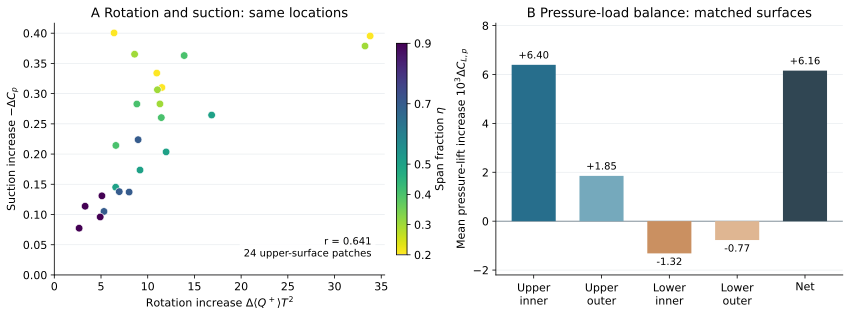

# Orca 胸鳍增升机制｜精简报告

> 历史报告；以最新总报告为准。原报告散落附件不随本合集上传。

历史报告快照；部分判断后续已更新。请先阅读最新总报告。原始数据附件保留本地，本合集不包含数据或论文全文。

Sweep35 · 2026-10-22 · 精简报告

# Orca 胸鳍的增升来自哪里？

数据支持的机制：身体与摆动胸鳍的相互作用强化了内侧上方的旋转流动，对应更强的上表面吸力；该吸力通过压力积分产生主要正增升，下表面压力降低抵消一部分。

全胸鳍平均压力升力：baseline / isolated = 1.596，增加 59.6%；静态比值为 1.105，增益明显较小，但并非严格为零。

图 A：同一截面位置的周期平均旋转增量与吸力增量，颜色表示展向位置。图 B：双鳍完全匹配表面的压力增量收支；内／外侧按 60% 展长划分。B 使用共同表面，面积覆盖约 91%–93%，因此净增量与上文全鳍比值的统计范围不同。

旋转增强对应吸力增强。24 个上侧区域的平均空间相关为 r = 0.641；改变采样带宽和近壁排除层数后仍为 0.539–0.687。对应主要集中于内展向。逐相位、逐小区域的对应较弱（r = 0.295），因此这支持平均机制关联，不代表每一点都即时同步。

上表面吸力提供主要正增升。压力积分给出上侧 +0.008248、下侧 -0.002090，净 ΔCL,p = +0.006158。其中内侧上表面占上侧正增量的 77.5%。这是区域压力载荷收支。

摆动强化了这条联系。在 η = 0.2 截面，旋转指标的 baseline / isolated 比值，摆动时为 3.46，静态为 0.97；对应的平均吸力增量分别为 0.364、0.096。“升力放大”是响应表现，旋转流动与压力的变化提供了机制解释。

分析口径：摆动采用一个保存周期的 17 帧；Q⁺ = max(Q,0) 为旋转占优指标。压力按瞬时表面法向积分。本文结论针对压力升力，局部时间／网格收敛及唯一因果归属尚未建立；静态局部流场取三个保存时刻。

采用 Dong 组的涡—压力—载荷对照思路：[Liu et al., 2017](https://doi.org/10.1017/jfm.2017.533)；[Guo et al., 2023](https://doi.org/10.1103/PhysRevFluids.8.073101)。详细方法、其他图和数值验证见补充材料 [original local attachment: Orca_机制研究_完整分析与验证.html]。

新增：LEV／TEV／鳍根涡的命名与新颖性核查 [original local attachment: ../vortex_identity_v6/Orca_涡命名与新颖性核查.html]（原始流场追踪和文献对照）。
