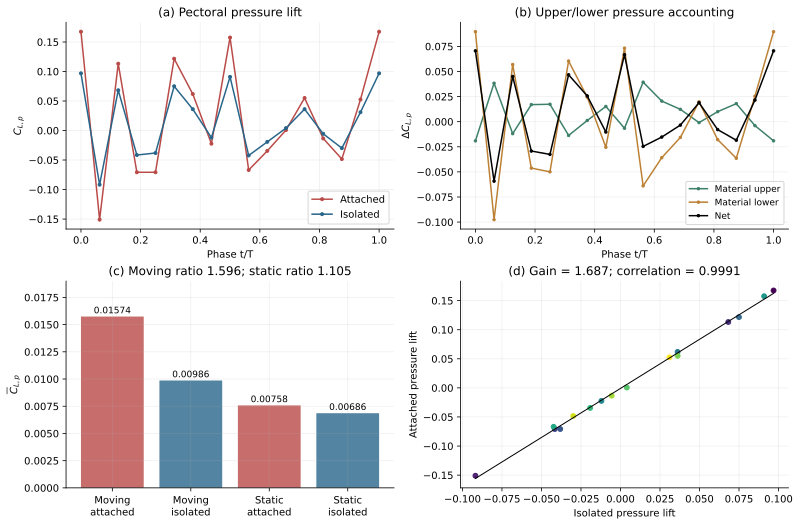
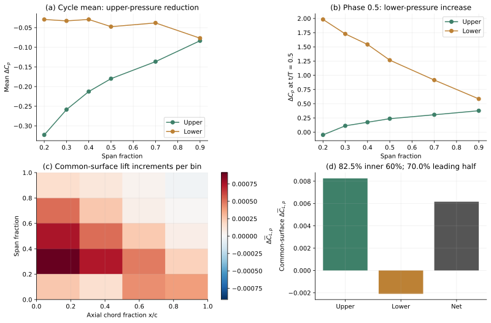
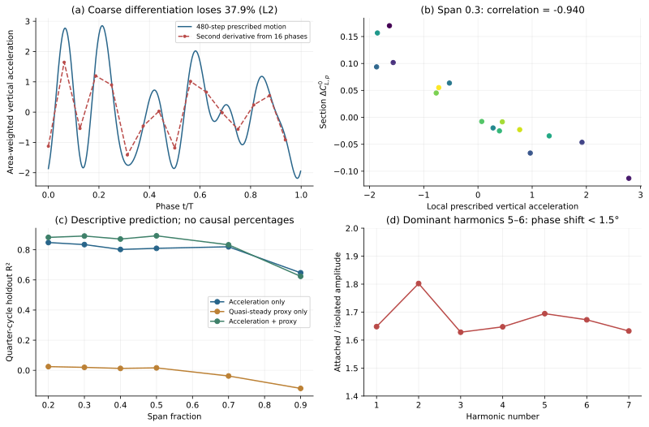
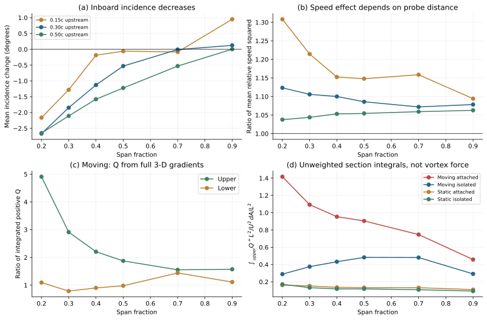
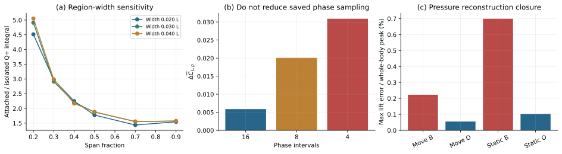

# Orca 胸鳍增升机制：原始数据定量研究

> 历史报告；以最新总报告为准。原报告散落附件不随本合集上传。

历史报告快照；部分判断后续已更新。请先阅读最新总报告。原始数据附件保留本地，本合集不包含数据或论文全文。

2026-10-22 · Sweep35 / Sweep35_OnlyFin · 动态与静态四算例 · 直接读取数值数据

# Orca 胸鳍的约 1.6 倍平均升力来自哪里？

现有数据支持的主线是：身体增强胸鳍原有的非定常压力响应，并在内侧、前半弦形成以上表面压力降低为主的周期平均压差。单截面环量、单一时刻的下表面增压，以及“有效迎角增大”，都不足以解释这个平均增益。

已经定量闭合：动态升力比 1.5958，即增加 59.6%；公共几何上的增量仍为正；约 82.5% 的公共面平均增量位于内侧 60% 展长，约 70.0% 位于前半弦。

尚未完成的因果归因：本研究没有求解完整的三维辅助势函数和 FPM 力预算，因此没有把升力增量分配成“附加质量占多少、哪个涡占多少”。下文的加速度相关性、Q 和涡量积分均不能替代这一计算。

## 1. 数据、对照与文献方法

采用 Sweep35 作为 baseline。动态 baseline 流场和表面为 t/T=9–10，OnlyFin 为 3–4，每个周期含 17 帧（16 个相位间隔，包含两个端点）。两静态算例为 9–10。力时序分别覆盖 10、6、10、10 个周期，每周期 480 步；实际运动从 fort.41 读取 480 步并核对导出的 marker。表面及流场均来自原始 szplt；动态已有保守力缓存在四个原始快照上独立重读复核。没有查看已有结果图片。

已有 PPT 主文件被其他程序独占，读取的是同日保存的 Document/saved/Orca_Fig_saved1022.pptx，只提取了文字。其 “Enhanced TEV”“WBI-Vortex” 作为待检验假设使用，不作为已经成立的因果结论。直接阅读了指定文献库的九篇原始论文，提取全文和页码，未以自动生成的文献摘要代替原文。

- Dong 等：借鉴部件删减对照、公共运动检查、表面压力与区域力积分，以及分辨不同方向涡量的流程。[1,2,3] 本研究没有把单个截面涡量阈值或净环量等同于完整涡管的贡献。

- Mittal 等：以 Q=½(‖Ω‖²−‖S‖²) 同时考虑旋转区和应变区；由 U、V、W 的全部九个空间导数重新计算 Q 和三分量涡量，没有依赖名为 Q/Wz 的不明确导出列。[4,5] 本次完成的是诊断量，不是完整 FPM。

- Quinn 及合作者：把局部相对速度和有效迎角纳入比较，区分附加质量、准定常和尾迹效应的概念，同时检查周期收敛。[6,7] 近地俯仰翼文献中的平均附加质量结论，不能直接外推到此处变形、三维、带身体的几何。

统一参考值 U=0.29、L=1、S=0.548382、ρ=1。全鳍表格采用 CL,p=Fy,p/(½ρU²S)。保存的 native_force 已含求解器输出因子 2，计算时为 native_Fy/(U²S)，不再重复乘 2。Cp=2P/U²。截面力使用单位展长归一化，数值不能直接与全鳍 CL 相加。

## 2. 先核对“1.6 倍”和“static 为零”

| 运动条件 | 带身体胸鳍 CL,p | OnlyFin CL,p | 比值 | 差值 |
| --- | --- | --- | --- | --- |
| 动态 | 0.01574253 | 0.00986496 | 1.5958 | 0.00587757 |
| 静态 | 0.00757706 | 0.00685988 | 1.1045 | 0.00071718 |

动态结果重现了约 1.6 倍，但表中是压力升力。baseline 没有每一步的局部胸鳍黏性力记录，不能据此声称局部总升力已做同等精度的分解。OnlyFin 的密集历史显示黏性力对其周期平均总升力约占 1%，不能将这个比例自动搬到带体胸鳍。

按本次相同口径，static 不是严格为零：增量约 0.000717，约为动态增量的 12.2%。动态减静态的差分为 0.005160，占动态净差约 87.8%。这个数是四算例的代数比较，不能作为严格的因果百分比；尤其 baseline 的细网格与其他三算例不同，静态算例完整运行输入也未保存在对应文件夹中。

4855 个三角面在两动态算例中严格对应，覆盖 baseline / OnlyFin 胸鳍面积约 90.8% / 92.8%；17 帧的公共顶点运动完全一致。公共面平均增量 0.006158，比完整分区的 0.005878 略高，说明不同鳍根与封口几何并不是全部增益的来源。非公共区域合计抵消约 0.000281。static 的公共面也完全重合，但其残余差不能简单按完全闭合独立鳍的升力解释。

图 1：全部力曲线从数值积分得到。实线连接保存的相位，不作时间平滑；上/下表面指固定材料分区，局部面片随运动翻转时不重新换组。

## 3. 平均增量主要来自上表面，强增升瞬间却可由下表面主导

| 压力贡献分区 | 平均 ΔCL,p | 占净增量的代数比例 |
| --- | --- | --- |
| 上表面 | +0.00832074 | 141.6% |
| 下表面 | -0.00244317 | -41.6% |
| 合计 | +0.00587757 | 100% |

上表面正贡献大于净增量，是因为下表面抵消了其中一部分。141.6% 和 −41.6% 是可严格相加的压力分区账目，绝不是某个涡的力占比。分别对两个半周期积分，贡献为 +0.003417 与 +0.002461；正的周期平均来自正负较大的瞬时增量抵消。

在 t/T=0.5，整体升力差约 +0.06668，上表面约 −0.00654，下表面约 +0.07322。这个时刻的“下表面增压”解释成立；它不能代表整个周期。以 η=0.2 截面为例，该相位的下表面 ΔCp≈+1.98，而周期平均下表面 ΔCp≈−0.029，上表面平均 ΔCp≈−0.323。周期平均上下压差增大约 +0.294。后一个压差量不受任意常压基准影响。

| 展向 η | 平均 ΔCp 上表面 | 平均 ΔCp 下表面 | 平均压差增量 Δ(Cp下−Cp上) | corr(Δ截面升力, ay) |
| --- | --- | --- | --- | --- |
| 0.2 | -0.3229 | -0.0292 | +0.2937 | -0.945 |
| 0.3 | -0.2585 | -0.0328 | +0.2258 | -0.940 |
| 0.4 | -0.2126 | -0.0292 | +0.1835 | -0.929 |
| 0.5 | -0.1798 | -0.0475 | +0.1323 | -0.931 |
| 0.7 | -0.1365 | -0.0380 | +0.0985 | -0.936 |
| 0.9 | -0.0834 | -0.0768 | +0.0065 | -0.842 |

全周期的空间积分进一步把问题定位到内侧和前缘附近：公共面内侧 60% 占 82.5%，前半弦占 70.0%，最外侧 20% 只占约 4.3%。因此，下一步的涡追踪或力分解应首先覆盖鳍根附近和前半弦，不应只分析下游 TEV 或单一中展长截面。

平均[Δp(t) Ay(t)] = 平均[Δp] · 平均[Ay] + cov(Δp, Ay)

在公共面上，上式给出 marker 压力积分增量 0.006135；“平均压力乘平均投影面积”为 0.006163，压力与几何投影的协方差为 −0.0000274（约 −0.45%）。所以这里的平均增升主要体现为实际的平均压力场改变，不是仅由相同鳍在不同投影方向上积分而产生的表观差异。这是一个代数分解，仍不等于附加质量/涡力分解。

图 2：上排比较同一数据的周期平均与相位 0.5；下排将共同三角面上的力增量按固定材料位置分箱，分箱总和与公共面净力差闭合。Cp 曲线为 5%–95% 弦向范围的平均，避免端点插值影响。

## 4. 身体主要放大原有非定常响应，瞬时差值具有明显加速度特征

CL,pattached(t) ≈ 1.6866 CL,pisolated(t) − 0.000896

两条曲线相关系数 0.999113；该线性描述的残差 RMS 为 attached 波动标准差的 4.21%。主要的第 5、6 谐波振幅比为 1.695、1.673，相位差约 −0.57°、−1.41°。这说明在保存的周期中，身体主要增强已有运动驱动的压力响应，没有证据表明主要升力差来自一个明显延迟的新波形。相关和相位接近仍不能排除相位锁定的涡作用。

η=0.2–0.7 的截面升力差与局部垂向加速度的相关系数为 −0.929 至 −0.945；η=0.9 为 −0.842。带截距的“加速度＋局部速度/迎角代理量”模型，在连续四分之一周期留出检查中的 R² 约为 0.83–0.89（η=0.2–0.7），优于只用准定常代理量。它支持“非定常加速度响应重要”，但回归系数不是流体附加质量的直接测量，R² 也不是力贡献百分比。

运动输入并非纯单频正弦。面积加权垂向速度的第 5、6 谐波各含约 18.2% 的能量，而仅用 16 相位的坐标二次差分，加速度相对 L2 误差达到 37.9%。本研究因此使用原始 fort.41 的 480 步运动数据。固定系数乘周期平均为零的加速度无法单独生成这里的非零平均增量；是否存在随几何变化的附加质量、身体运动耦合等平均作用，需要完整力分解，而不能只凭回归推断。

图 3：加速度来自高频率运动输入；回归只描述同一个确定性周期，并未将 16 个相位当作独立实验，也没有用显著性 p 值来证明因果。

## 5. “流速更快／迎角更大”解释到什么程度？

在前缘上游 0.15c、0.30c、0.50c 三个位置采样真实流体速度，再扣除局部胸鳍运动速度。弦向为 LE→TE，迎角定义为相对流向角减弦线倾角；静止的抬头翼对应正迎角，已经通过解析符号检查。

η=0.2 处，body 引起的平均有效迎角变化约 −2.16°、−2.67°、−2.65°；η=0.5 处约 −0.06°、−0.53°、−1.22°。内侧的主要趋势是迎角降低。0.30c 处平均相对速度平方比约为 1.12（η=0.2）、1.09（η=0.5）；到 0.50c 时只约 1.04–1.05。更近的 0.15c 处可达 1.31，说明采样点会包含不同程度的翼自身诱导流。

这些是局部描述，不代表可以用平均速度平方直接预测平均升力：速度、迎角和非定常响应之间还存在协方差。但它们已足以排除“身体仅仅增大迎角，所以升力增大”的简单解释。static 也存在局部流向和速度变化，却没有动态算例同等幅度的压力增益。

## 6. 涡结构证据支持哪里，尚不能支持什么？

重新从原生网格计算全部三维速度梯度。差分模板穿过固体或无效 AMR 区域的点被排除；然后在六个实际展向截面上积分，分别保留正负 ωz、正负 Q、跨展向与展向涡量平方。这里是三维梯度构成的截面诊断，不是完整三维涡管体积分。

在表面外 0.03L 的上侧区域，动态 attached / isolated 的正 Q 积分比从 η=0.2 的约 4.91 倍，降至 η=0.5 的 1.87 倍和 η=0.9 的 1.57 倍。下侧对应比值约 1.09、0.98、1.11。内侧上表面同时出现更强负 Q（应变）区域；η=0.2 的跨展向涡量平方积分约增加到 2.28 倍，不能只分析 ωz。

改变区域宽度到 0.02、0.04L 后，η=0.2 的上侧正 Q 比值为 4.51–5.05，趋势保持。为减少两套网格的掩码差异，又把两算例放到相同物理采样点、使用公共有效流体区域，并额外排除一层近固体点：

| 展向 η | 原生网格 Q+上表面比值 | 相同采样点、相同流体掩码 | 再排除一层近固体采样点 |
| --- | --- | --- | --- |
| 0.2 | 4.909 | 5.394 | 5.875 |
| 0.5 | 1.874 | 1.943 | 2.076 |
| 0.9 | 1.572 | 1.586 | 1.769 |

对应 static 的内侧上侧正 Q 并未出现类似倍数增强。因此，“运动条件下身体附近的上侧旋转/应变场增强，并伴随局部平均低压”是与数据一致的机制候选。当前证据尚不能把该结构唯一命名为某个 TEV、LEV 或 WBI 涡，也未证明一个特定涡贡献了多少平均升力。

此前环量数值复核 [original local attachment: sources/prior_circulation_load_audit.json]给出中展长单截面净环量差与全鳍升力差的相关系数仅约 0.035，且随路径改变会变号（来源：PicarGeom/outputs/orca_circulation_audit_20261015；本次读取数值与计算说明 [original local attachment: sources/prior_circulation_notes.txt]，未查看旧图）。本次正 Q 上侧积分与瞬时截面升力差也没有简单正相关。因此，“Q 更大”或“净环量更大”不能直接替代力解释。Mittal 的严格关系需要加权：

FQ,y = −2ρ ∫V Q φy dV，　∇²φy=0

φy 由瞬时几何及边界条件决定；还必须保留运动边界加速度、黏性及外边界项。[4,5] 对连续的身体与胸鳍，若只提取一个开放的胸鳍分区，辅助势边界通量的兼容性和压力基准还需明确处理。不能把整身辅助势的涡力直接冠名为胸鳍的涡力。

图 4：相对来流采样显示内侧迎角降低；Q 增强主要在上侧且受运动状态影响。所有 Q 比值是未乘辅助势的诊断量，图中没有用它们换算升力百分比。

## 7. 可信度、数值限制和未完成的部分

| 核查项目 | 数值／结果 | 解释范围 |
| --- | --- | --- |
| 公共三角面 | 4855 | 两侧鳍合计；保留原始面片身份 |
| 公共面全部相位几何差 | 0.0e+00 | 位置和运动一致 |
| 动态原始 q 重读 | 4 个代表快照逐面力差 = 0 | 验证既有缓存与当前原始数据一致 |
| 公共面压力增量：Cartesian / marker | 0.00615828 / 0.00613532 | 两种独立积分方式相差约 0.37% |
| 统一上游压力参考后的全鳍增量 | 0.00583564 | 保持增升及上下表面贡献符号 |
| 动态整机升力重建最大误差／峰值 | 0.223% | 不等于局部胸鳍平均力误差上限 |
| OnlyFin 升力重建最大误差／峰值 | 0.055% | 全孤立鳍 |
| 静态带体升力重建最大误差／峰值 | 0.699% | 静态残余增益应保持审慎 |
| 静态带体 X 方向压力闭合 | 失败：最大系数差 0.17443 | 本报告不采用该算例的轴向力结论 |
| 480 步 vs 16 相位，整机压力平均值 | -0.563% | 验证整机时间积分，未验证局部胸鳍密集积分 |
| 480 步 vs 16 相位，OnlyFin 压力平均值 | +0.772% | 孤立鳍时间积分误差较小 |
| 由稀疏位置二次差分得到加速度 | 相对 L2 误差 37.9% | 机制拟合使用 fort.41 的 480 步运动数据 |
| 解析流场、迎角与压力闭合测试 | 5 项通过 | 旋转 Q>0、纯剪切 Q=0、纯应变 Q<0、迎角符号、常压闭合轮廓零合力 |

压力参考检查在三处共同上游点 (8,6,6)、(8,5,5)、(8,7,7) 取平均，并逐相位扣除。修正后全鳍 marker 积分增量为 0.005836，上表面 +0.008414、下表面 −0.002578，主要结论保持。共同截面的上下压力差本身不依赖常压参考。

baseline 细网格约 Δx=Δy=0.00295；OnlyFin 与 static 约 Δx=0.003038、Δy=0.003125。相同采样点的 Q 检查只能验证后处理积分稳健性，不能代替 CFD 网格收敛。静态带体算例的 X 压力闭合失败尚未查明，故不使用它判断阻力机制，也不能把静态小残差当作精确的物理零点。

只用 8 或 4 个相位间隔会把动态净增量平均值改变到 0.02006、0.03089。16 相位的整机/OnlyFin 平均值与 480 步求解器记录相差约 −0.56% / +0.77%，说明当前平均数并非完全没有时间分辨率依据；但 baseline 的局部胸鳍没有密集独立记录，不能宣布局部积分已收敛。OnlyFin 的后几周期整体均值已变化很小，仍不能从中证明所有远尾迹统计已经长期收敛。[7]

本次四算例切换的是“身体存在”和“整体模型运动”。它不能独立区分“躯干自身 undulation”与“胸鳍在身体边界附近运动”的作用。另一个边界是：完整 FPM 尚未实现，本研究的结果能定位压力来源、检验若干候选解释，不能给出严格的涡力/附加质量比例。

图 5：区域宽度、时间采样及升力闭合检查。柱状图中的误差按整机峰值归一化，不是局部平均胸鳍力的置信区间。

## 8. 当前可写入论文的结论，与下一步判别实验

在本研究的配对算例中，身体的存在使运动胸鳍的周期平均压力升力增加约 59.6%。几何和运动严格一致的公共表面仍保留该增益，其中主要增量集中于内侧及前半弦，并体现为上表面占优的平均压差增强。瞬时升力响应表现为近乎同相位的幅值放大，并与局部运动加速度密切相关。与此同时，内侧上表面旋转和应变诊断量显著增强。上述结果支持非定常身体—胸鳍水动力耦合，并排除了仅凭平均迎角增大、单一相位下表面增压或单截面净环量来解释整个周期增益的简单图景。

这一表述的“支持”有明确范围。下一步要把机制候选提升为严格因果归因，最有判别力的工作如下，优先级按对结论的影响排列：

- 统一网格并输出区域密集载荷。在相同网格、相同时间步与运行输入下重算四对照；每一步输出真实胸鳍两侧的压力力和黏性力，避免以整机相减代替局部力。对 16/32/64/128 相位进行积分检查，建议以局部平均增量变化低于 2% 为接受标准，并检查多个后期周期。

- 完成具有闭合验证的三维 FPM。针对要测量的闭合表面或经严格定义的区域力泛函求解瞬时 φy；在原生 AMR 上积分 Qφy，同时计算运动边界、黏性和外边界项。先使各项之和重现压力力，再将贡献分到鳍根/前缘/后缘、Q 正负区及涡量方向。建议将力预算残差按“平均增量”而非整机峰值控制在 5% 以下。这些是建议的验证标准，不是本次已通过的结果。

- 对运动来源做专门控制。设计保持胸鳍轨迹和鳍根闭合几何的控制，改变远离连接处的躯干运动，并单独评估过渡带的影响；或采用带完整边界项的力分解直接量化躯干加速度耦合。未经该控制，不能把四算例差分全部归因于躯干自身的波动。

上述新 CFD 和 FPM 计算尚未执行。本次交付的是已经完成的数据分析、复核和可以继续运行的研究工作流，不将未执行的判别实验写成研究结果。

## 9. 可复算文件

本报告包含所有新图的矢量内容，可单独复制或浏览器打印。图件另存 PNG/SVG。主要数值文件：

- load_summary.json [original local attachment: load_summary.json]、load_signals.csv [original local attachment: load_signals.csv]：四算例力预算、周期统计与全部相位曲线。

- section_metrics.csv [original local attachment: section_metrics.csv]：240 条截面记录，包含压力、速度、迎角、加速度、正负 Q、正负 ωz 及三维涡量诊断。

- diagnostics_summary.json [original local attachment: diagnostics_summary.json]：压力恒等式、相关和描述性模型。

- validation.json [original local attachment: validation.json]、pressure_datum_audit.json [original local attachment: pressure_datum_audit.json]、q_common_grid_validation.json [original local attachment: q_common_grid_validation.json]：独立复核和敏感性。

- source_manifest.json [original local attachment: source_manifest.json]：原始数据路径、大小及修改时间。literature_read.json [original local attachment: sources/literature_read.json] 保存阅读论文路径及 SHA-256。

源码位于 Fish_Schooling_py/python_scripts/postprocessing/orca_body_fin_mechanism，遵循读取、统计、绘图与 runner 分离结构。输出目录内的 code 为本次源码快照，复算说明.txt 给出执行顺序。原始算例、已有 PPT 和其他研究结果未修改。

## 参考文献与实际使用的方法

- Liu, Ren, Dong et al. (2017). [Computational analysis of vortex dynamics and performance enhancement due to body–fin and fin–fin interactions in fish-like locomotion.](https://doi.org/10.1017/jfm.2017.533) 本地 PDF 第 17–19 页：按涡分别计算环量、表面压力及空间载荷，而不是只用整条截面的净环量。

- Guo et al. (2023). [Vortex dynamics and fin-fin interactions resulting in performance enhancement in fish-like propulsion.](https://doi.org/10.1103/PhysRevFluids.8.073101) 本地 PDF 第 12–14 页：上游结构、局部涡量重组与下游受力位置的对应。

- Liu, Dong & Li (2016). [Vortex dynamics and new lift enhancement mechanism of wing–body interaction in insect forward flight.](https://doi.org/10.1017/jfm.2016.175) 本地 PDF 第 1 页及方法部分：带体、单体、单翼对照及局部结构；其昆虫结论不直接等同于 Orca。

- Menon, Kumar & Mittal (2022). [Contribution of spanwise and cross-span vortices to the lift generation of low-aspect-ratio wings: Insights from force partitioning.](https://doi.org/10.1103/PhysRevFluids.7.114102) 本地稿第 3–4 页：辅助势、−2Qφ 及边界项；第 9–12 页：应变区与旋转区均影响载荷。

- Prakhar, Seo & Mittal (2025). [Modal force partitioning.](https://doi.org/10.1017/jfm.2025.10252) 本地 PDF 第 6–7 页，式 (2.5)：压力力、运动边界、外边界、Q 与黏性项的完整关系。

- Han, Zhong, Mivehchi, Quinn & Moored. [Revealing the mechanism and scaling laws behind equilibrium altitudes of near-ground pitching hydrofoils.](https://doi.org/10.1017/jfm.2023.1004) 正式卷期 JFM 978 (2024), A5；本地为 2023 预印本，第 2、9–12 页：局部有效来流与平均/瞬时分解。引用时不要把本地文件名中的 2023 当作最终卷期年份。

- Zhong & Quinn (2024). [Predicting the slowly converging dynamics of asymmetric vortex wakes.](https://doi.org/10.1103/PhysRevFluids.9.064702) 本地 PDF 第 1–2 页：局部载荷近周期性并不能保证远尾迹已长期收敛。本研究不把其特定算例的周期数当作 Orca 的通用要求。

所有本研究数值均由配套脚本产生。文献用于选择诊断方法；文献中的力比例、涡类型和参数规律没有被直接移植为本算例结论。
