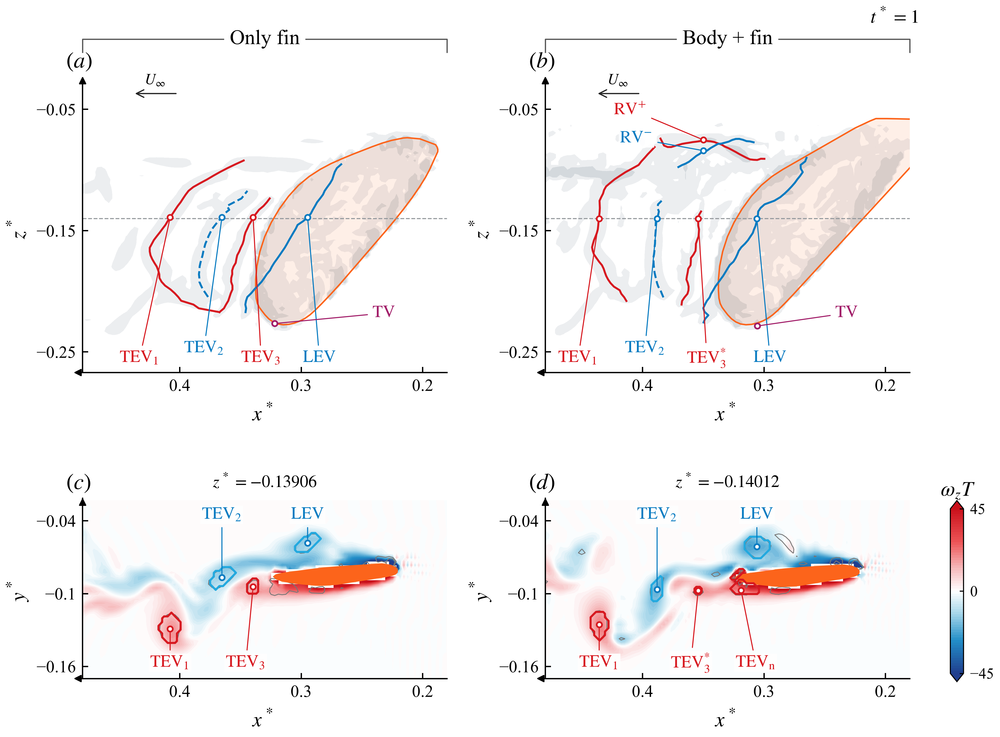
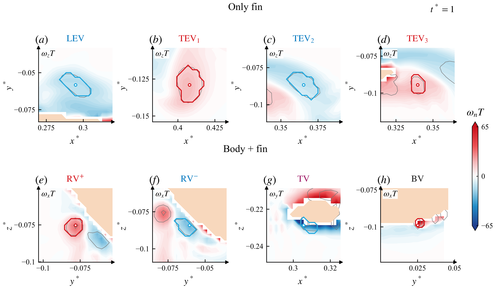
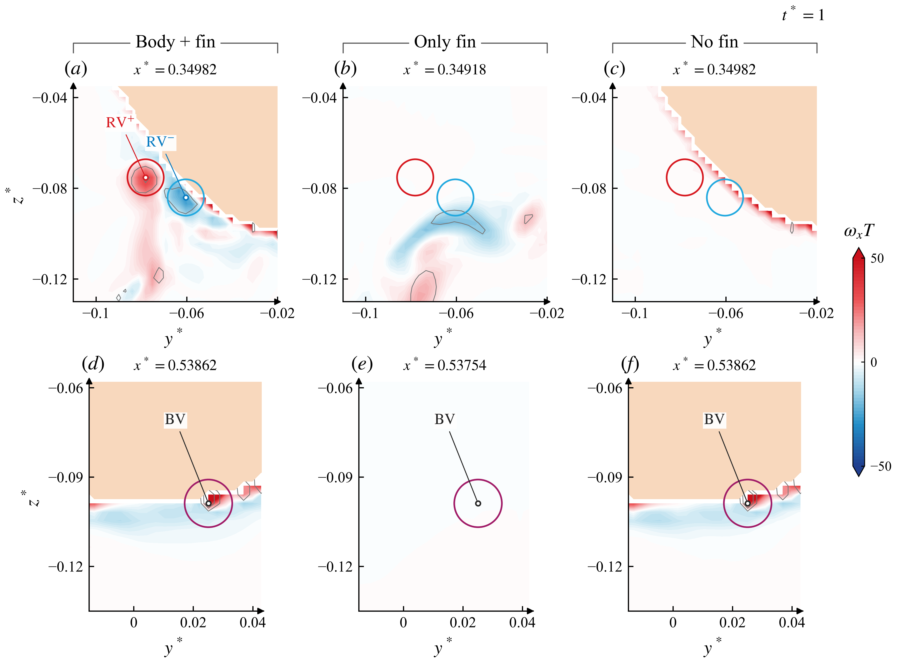

# Orca：主要涡结构逐支分类与对应

> 历史报告；以最新总报告为准。原报告散落附件不随本合集上传。

历史报告快照；部分判断后续已更新。请先阅读最新总报告。原始数据附件保留本地，本合集不包含数据或论文全文。

# Orca：把每一支主要涡分开

2026-10-23 · 对照原图的 LEV、TEV₁–₃、WBI 区 · 原始速度梯度、Q、几何及时序联合定位

现在完成了主要结构的逐支定位、分开展示和对应表。沿用 LEV、TEV₁、TEV₂、TEV₃；鳍尖段 TV、根部流向分支 RV⁺/RV⁻ 和身体涡 BV 单独辨认。此前只追查一个局部候选，未完成这张总分类图。

这里的“分开”是：给每支选定涡核、旋向、时序依据和单独截面数据。没有把整个流场切成互不相连、来源唯一的独立三维涡管。不同名称可能指同一连通涡管的不同部位，不能把表中八项数成八种新涡型。

## 命名与“新”的结论

可以将正向分支作为“本 Orca 工况中新识别的体鳍耦合涡结构”报告。这里的新意应落在形成条件、流向涡量演化和低压核上，不要求创造一种无法归入任何已有概念的基本涡型。此前把“新发现”过度收紧为“全领域首次基本涡型”，不适合作为本研究的判断标准。

RV 的惯例：RV 通常表示 root vortex。Dong 组确实使用这个缩写，但不是看到身体附近有涡就统一叫 RV。[Wang 等（2019）§3.2、图 5–7](https://doi.org/10.1088/1748-3190/ab2208)把无身体算例的根涡称为 RV，有身体算例则按连接与供涡过程辨认 TXV/nTXV。该文还通过一周期中的形成次数及头部剪切层供给区别于既有蝉的结果。[Ren、Dong 等（2016）](https://journals.aps.org/prfluids/pdf/10.1103/PhysRevFluids.1.050511)也用已有的 LEV/TEV/RV 等名称描述新增分支和不同的双涡环组织；沿用常规名词不取消结构或机制的新意。

本图统一使用 RV⁺/RV⁻，表示鳍根区域的流向涡分支；± 表示本坐标下的 ωx 符号。TEV₂ 对应此前的 W2 数据 ID。对证据较完整的正向分支，可在论文中定义“体鳍相互作用诱发的流向涡”（body–fin-interaction-induced streamwise vortex，可简称 BFIV）。这是本文拟用的描述性名称，不声称是 Dong 组已有的专名。负分支 RV⁻ 尚未得到同等完整的来源证据，不一起宣称新机制。

为什么它不只是“换了位置的旧涡”：同相位、同空间闭合路径的环量和低压核有明显差别；更进一步，六组相同起点的完整流体路径在耦合算例中出现 ωx 由负转正，而 Only Fin 保持负向。这支持耦合改变了涡量的三维演化，超出了仅凭形状或 Q 放大来命名的证据。这里只证明流向分量反号，不把它称为整条涡管完全逆转或重联。

| t/T=0.75 对照 | Γx，求解器单位 | Cp,核 − Cp,圆周均值 |
| --- | --- | --- |
| 运动 Body + fin | 0.004961 | -0.2849 |
| 运动 Only Fin | 0.000180 | -0.0005 |
| 运动 No Fin | 0.000042 | -0.0008 |
| 静态 Body + fin，材料位置对齐 | -0.000373 | -0.0098 |

动态算例使用相同全流体圆周，半径 0.008 L；静态算例用材料位置对齐。该表为局部流体结构指标，不是每支涡的升力份额。六条完整路径的末端 ωxT：Baseline +19.95～+35.02；Only Fin −16.83～−15.72。

本轮还核对了证据是否对应图中同一支：t/T=1 时，图中 RV⁺ 锚点与此前定量分析的 C473 段在 Q>25、50、100、200 且 ωx>3 的三维区域内连通；Q>250 时分开。因此可把这组机制证据对应到 RV⁺ 的已分析段，不能据此赋给 RV⁻ 或整块身体涡。连通性核查数据 [original local attachment: positive_branch_connectivity.json]。

large body 的准确范围：当前结果支持“在所研究的 Orca 体鳍几何和 undulation 工况下由耦合诱发”。所用对照改变的是有无身体／鳍以及运动状态，并未单独隔离身体大小这个参数，因此暂不写“由身体尺寸增大导致”或“只有大型身体才会出现”。“共同作用诱发”也不等于已经证明两个壁面都向该涡输入了涡量。

可用于结果段的表述：在所研究的起伏运动 Orca 构型中，我们新识别出一支胸鳍—身体相互作用诱发的流向涡分支。该分支表现出对体鳍耦合的依赖、鳍旁流体流向涡量的反号演化以及局部低压核；相应的单鳍、无鳍身体和静态对照未表现出同样的组合特征。

覆盖范围：这张图是左侧胸鳍附近主要结构的分类，不是整条 Orca 所有涡的完整目录。17 个代表锚点也不是 17 个独立涡或 17 种涡。该范围不妨碍对已验证的具体分支提出上述工况内的新发现。

## 1. 哪一支是什么

| 原图对象 | 本次命名 | 决定性依据 | 判断强度 |
| --- | --- | --- | --- |
| 原 LEV | 保留 LEV：前缘涡 | t/T=0.5625 在前缘附近出现，随后沿鳍面向后发展。Only Fin 与 Baseline 均找到对应的负 ωz 核。 | 来源判断较强 |
| 原 TEV₁ | 保留 TEV₁：较早脱落的后缘涡 | 在当前截面最远下游；与 TEV₃ 同为正 ωz。时序支持不同脱落时刻的后缘涡实例。 | 来源判断较强 |
| 原 TEV₂ | TEV₂：第二支后缘尾迹涡 | 与 TEV₁/₃ 反号。更早的相位在鳍上表面、局部弦长约 0.70–0.92 处已存在卷起结构。保留 TEV₂ 编号；现有证据尚未完全区分上表面卷起后的输运与后缘进一步卷起。 | 涡核明确；精确谱系中等 |
| 原 TEV₃ | 保留 TEV₃：较晚脱落的后缘涡 | Only Fin 中可辨。Baseline 的对应小核在 Q>25、Q>50 可辨，Q>100 不可辨；标为 TEV₃*。旁边紧邻后缘的新生正向核另标 TEVₙ，不与其混淆。 | Only Fin 较强；Baseline 对应中等 |
| 鳍尖连接部位 | TV：鳍尖区域的旋转段 | 用物理鳍尖坐标定位，再找附近的旋转核；不再将整条弯曲涡环全部称为 LEV 或 TEV。该段可与它们相连。 | 位置明确；独立涡管边界未唯一确定 |
| 原 WBI 虚线区的流向分支 | 分别标 RV⁺、RV⁻ | 在 x*≈0.35 的截面分开正、负 ωx 核。No Fin 对应根部尾迹窗口没有 Q>50 核；Only Fin 的同号结构位置不同，不能强行一对一配对。 | 分支及旋向明确；RV 表示鳍根区域涡 |
| 身体表面灰色结构 | BV：身体涡，另作对照 | 选出的代表点在 Baseline 与 No Fin 位于同一网格坐标，方向余弦 0.9996，Q 分别约 573.5、573.9。该对照位于更下游的身体表面，并非把整块 WBI 虚线区直接改名 BV。 | 此代表核的身体来源支持强 |
| t*=0.5 的 Enhanced TEV | 可保留，但限定为对应后缘涡段 | 该相位同一类后缘核的 Baseline/Only Fin Q 峰值比 2.29，Q>50 截面掩膜内环量比 1.26；不是整个 WBI 区统一增强，也不是升力贡献比例。 | 局部增强成立 |

图中轴标签统一为 x*、y*、z*，刻度以固定参考点 (10, 6, 6) 为零点并以 L 归一化；本算例 L=1。沿用原来的观察方向。红／蓝分别表示正／负法向涡量，橙色为鳍截面，浅桃色为固体。正文坐标表与图一致，CSV 同时保留原始坐标。

 [original local attachment: figures/01_major_vortex_atlas.png]

图 1｜上排延续原图的 x*–z* 视向，灰色为 Q 投影，彩线为逐截面局部涡核对应；彩线不代表已证明的完整材料涡管。下排用有符号 ωz 和 Q>50 区域将 LEV、TEV₁、TEV₂、TEV₃ 分开。TEVₙ 指新生实例，不指新涡型。PDF [original local attachment: figures/01_major_vortex_atlas.pdf] · SVG [original local attachment: figures/01_major_vortex_atlas.svg] · PNG [original local attachment: figures/01_major_vortex_atlas.png]

更正一个实际漏检：Baseline 的 TEV₃ 对应核 Q 峰值为 78.9，Q>50 只剩 4 个网格点；距上一帧速度外推位置约 0.0022 L。旧筛选要求至少 5 点，把它漏掉了。本次保留为弱核对应，而不是说它已消失或已与别的涡合并。

## 2. 单独看每一支

 [original local attachment: figures/03_individual_core_sections.png]

图 2｜每格只选一支目标核；彩色轮廓为该截面上 Q>50 且同号的连通区域。LEV、TEV₁、TEV₂、TEV₃ 用 Only Fin 展示，RV⁺/RV⁻、TV、BV 用 Baseline 展示。各格法向分量写在左上角，不能直接把不同分量的颜色当作同一轴旋向。PDF [original local attachment: figures/03_individual_core_sections.pdf] · SVG [original local attachment: figures/03_individual_core_sections.svg] · PNG [original local attachment: figures/03_individual_core_sections.png]

## 3. 根部分支与 body vortex 怎么区别

BV 代表核确实是身体涡；RV⁺/RV⁻ 不能仅因靠近身体也叫成同一类 BV。下图对同一空间位置做三算例对照。BV 在有无鳍的身体表面几乎重合，而根部流向分支在 No Fin 同窗口没有对应旋转核。该结果支持根部结构受鳍及其与身体的耦合影响，但不等于证明所有涡量都在鳍根壁面产生。

 [original local attachment: figures/02_root_and_body_controls.png]

图 3｜上排比较根部尾迹分支，下排比较身体涡代表点。圆只用于标记相同空间邻域，不是这张图中的环量积分边界。Only Fin 采用最邻近的本算例网格截面；截面位置 x* 标于各格上方，浅桃色为固体。PDF [original local attachment: figures/02_root_and_body_controls.pdf] · SVG [original local attachment: figures/02_root_and_body_controls.svg] · PNG [original local attachment: figures/02_root_and_body_controls.png]

对原图最直接的修改：保留 LEV、TEV₁、TEV₂、TEV₃；补 TV；把笼统的 WBI-Vortex 改成具体的 RV⁺/RV⁻ 分支标注。身体表面的 BV 单列。WBI 可以作为“相互作用区域”的说明，不能替代涡的身份。

数据、时序与方法依据

分析范围是已缓存的左侧胸鳍及邻近身体区域（x*≈0.10–0.55、y*≈−0.25–0.045、z*≈−0.27–−0.02），不是整条鲸所有小涡的穷举。三个动态算例各 17 个原生快照、间隔 T/16；识别时排除固体及无效速度梯度。

总图用 t/T=1 与原图 t*=0 的周期相位对应，保留前一周期的形成过程。两端 Q 投影的相对 L2 差为 Baseline 0.18%、Only Fin 5.85%、No Fin 0.055%；因此只称同相位结构对应，不称逐点完全相同。

连续截面显示线使用 Q>50、同号法向涡量、局部方向及最近核匹配。它没有证明涡管重联，也不能替代全流场唯一分区。TV 为物理尖端附近的旋转段；Only Fin 的 Sx⁺/Sx⁻ 是同一 X 截面的流向旋转结构，不强称其与 Baseline RV 分支同源。

| 算例 | 标签 | 截面时序范围 | 原生帧数 | 首末位置 (x*, y*) |
| --- | --- | --- | --- | --- |
| isolated | LEV | 0.5625 → 1 | 8 | (0.21327, -0.06372) → (0.29475, -0.05822) |
| isolated | TEV1 | 0.1875 → 1 | 14 | (0.31651, -0.10411) → (0.40792, -0.12896) |
| isolated | TEV2 | 0.5625 → 1 | 8 | (0.29432, -0.08229) → (0.36530, -0.08664) |
| isolated | TEV3 | 0.75 → 1 | 5 | (0.30774, -0.10289) → (0.33964, -0.09441) |
| baseline | LEV | 0.5625 → 1 | 8 | (0.21341, -0.06335) → (0.30586, -0.06123) |
| baseline | TEV1 | 0.3125 → 1 | 12 | (0.30304, -0.10171) → (0.43568, -0.12559) |
| baseline | TEV2 | 0.3125 → 1 | 12 | (0.27724, -0.07151) → (0.38801, -0.09655) |
| baseline | TEV3 | 0.75 → 0.9375 | 4 | (0.30941, -0.10330) → (0.34109, -0.10084) |

这些是有符号涡核的时序特征对应，不能单靠匹配称为材料涡的完整谱系。来源判断还使用既有的流体路径回溯、局部弦长位置和近壁几何；TEV₂ 的上表面卷起证据保留用于解释其形成过程。

方法参考 [Dong、Bozkurttas、Mittal 等（2010，JFM）](https://engineering.jhu.edu/fsag/wp-content/uploads/2014/06/2010_dong.pdf)把运动、涡结构、表面受力联合分析的路径。本次各标签由 Orca 自身的数据决定，不把该文蓝鳃太阳鱼的涡强行套到这里。已有近十年文献核查见 相关文献依据 [original local attachment: ../vortex_identity_v6/literature/curated_evidence.json]；本报告不新增“已遍历整个领域”的声明。

| 算例 | 标签 | 识别点 (x*, y*, z*) | 点 Q | 点 ωx,ωy,ωz | 截面点数 |
| --- | --- | --- | --- | --- | --- |
| isolated | LEV | 0.294750, -0.058222, -0.139062 | 94.2 | 11.90, -14.88, -13.70 | 21 |
| isolated | TEV1 | 0.407918, -0.128961, -0.139062 | 126.3 | -12.64, 12.73, 17.41 | 33 |
| isolated | TEV2 | 0.365303, -0.086640, -0.139062 | 79.3 | 13.35, -7.80, -12.29 | 24 |
| isolated | TEV3 | 0.339638, -0.094413, -0.139062 | 82.3 | -11.79, 13.62, 14.18 | 11 |
| baseline | LEV | 0.305861, -0.061235, -0.140125 | 119.8 | 7.26, -16.90, -21.48 | 33 |
| baseline | TEV1 | 0.435679, -0.125586, -0.140125 | 107.4 | -2.60, 10.82, 20.65 | 29 |
| baseline | TEV2 | 0.388011, -0.096550, -0.140125 | 105.0 | 2.61, -11.38, -21.41 | 17 |
| baseline | TEV0 | 0.318857, -0.097310, -0.140125 | 115.2 | 1.86, 20.62, 21.96 | 29 |
| baseline | RV+ | 0.349825, -0.078175, -0.075225 | 297.9 | 34.25, 4.48, -7.35 | 13 |
| baseline | RV- | 0.349825, -0.060475, -0.084075 | 146.3 | -29.54, -2.36, 16.53 | 12 |
| baseline | TV | 0.305575, -0.151925, -0.228625 | 914.4 | 50.38, -57.31, -12.06 | 6 |
| isolated | Sx+ | 0.349175, -0.076562, -0.126563 | 88.5 | 16.47, -8.75, -11.95 | 18 |
| isolated | Sx- | 0.349175, -0.067187, -0.095313 | 65.8 | -20.21, 12.84, 7.40 | 12 |
| isolated | TV | 0.321832, -0.157813, -0.226562 | 670.9 | 6.78, -5.52, 57.41 | 3 |
| baseline | BV | 0.538625, 0.025075, -0.098825 | 573.5 | 42.95, -32.74, -1.12 | 4 |
| body_only | BV | 0.538625, 0.025075, -0.098825 | 573.9 | 41.88, -33.84, -0.72 | 4 |
| baseline | TEV3 | 0.354214, -0.097558, -0.140125 | 69.0 | -2.75, 14.26, 16.28 | 4 |

下载标签与坐标表 CSV [original local attachment: vortex_labels.csv] · 完整分类、依据、截面网格索引 JSON [original local attachment: identities.json]。individual_cores 文件夹为每个标签单独保存 NPZ（所选截面的坐标、Q、涡量、速度、压力和显示线）及说明 JSON，均非独立三维体积或单涡受力分解。

t*=0.5 的 Enhanced TEV 定量依据 [original local attachment: ../vortex_source_v8/enhanced_tev_sources.json] · 根部正向分支的前序机制分析 [original local attachment: ../vortex_discovery_v9/Orca_身体涡核查与流向旋转反转.html] · 原始标注图 [original local attachment: ../vortex_identity_v6/figures/user_vortex_figure.png]

分类本身不等于证明全球首次发现，也不直接给出每支涡的升力百分比。本页纠正的是身份、位置及相互对应。
