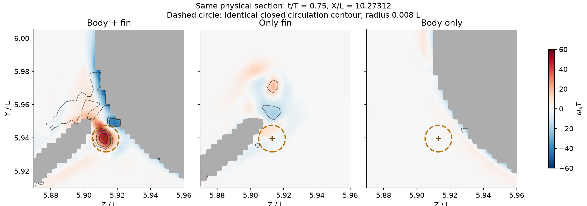
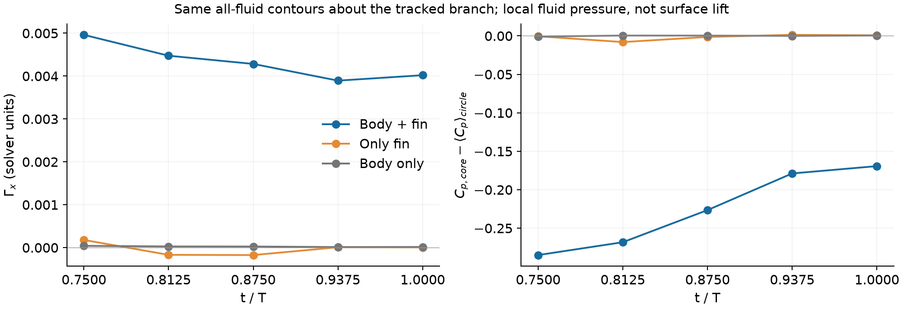
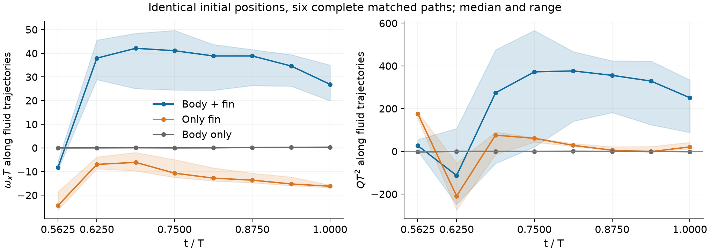

# Orca｜身体涡质疑核查与旋向反转发现

> 历史报告；以最新总报告为准。原报告散落附件不随本合集上传。

历史报告快照；部分判断后续已更新。请先阅读最新总报告。原始数据附件保留本地，本合集不包含数据或论文全文。

最新逐支分类：LEV、TEV₁、W2、TEV₃、TV、RV⁺/RV⁻ 与身体涡的独立定位图 [original local attachment: ../vortex_atlas_v10/Orca_主要涡结构分类与逐支对应.html]。包含每支截面数据，修正 Baseline TEV₃ 的小核漏检。

2026-10-23 · 原始三维数据复核 · 本次新增结果 v9

# 不能把所有贴着身体的涡都算作新涡。
本次确认的是鳍旁流体的流向旋转反转。

明确结论：在图中虚线圈出的鳍根后缘邻近区域，运动的 Body + fin 出现强正向流向旋转核；No Fin 同处几乎没有旋转，Only Fin 的同点输运流体保持负向流向涡量。数据支持鳍体耦合形成了额外的正向流向涡分支，不能把这一支当作“与鳍无关的原有身体涡”。
本次发现的具体机制：同一鳍旁区域的流体在耦合工况下发生 ωx 由负转正并形成低压旋转核。这个结果超出了“Q 变大／涡被放大”的描述。它尚不等于一个已经证明全领域首次出现的基本涡型。

## 1. 先纠正上一轮的对象混淆

Q≈2057 的峰值不是“鳍根前方”，实际为 t/T=0、(x,y,z)/L≈(10.25838,5.96018,5.91297)，局部弦向位置 s/c=1.003，距最近鳍面 0.00317L。Only Fin 在 0.0140L 内有同方向旋转核（方向余弦 0.920）。这处峰值从新增涡证据中剔除；它可由已有鳍后缘涡的强化／偏移解释，不能仅凭强度命名新涡。

下文只分析虚线圈出的另一支流向分支，计算索引 C473。这个索引不是新涡型名称，也不是把三维图中所有身体表面小涡一起算入。它与先前报告的正向鳍根涡系属于同一搜索区域；本次新增的是形成过程与控制实验的证据，不能把同一区域再发现一次计为一个新的涡种类。

## 2. 它是否只是 body vortex？用同一闭合积分路径回答

t/T=0.75，X/L=10.273125，圈心 (Y,Z)/L=(5.939525,5.912975)，半径 0.008L。三工况使用完全相同的流体圆周，计算 Γx=∮u·dl；圆周和圆盘均通过全流体检查。静态工况用相同鳍材料锚点对齐局部坐标后测量。

| 工况 | Γx（求解器单位） | Γx/(U∞L) | 圈心 Q | Cp,核 − Cp,圆周均值 |
| --- | --- | --- | --- | --- |
| Body + fin（运动） | 0.004961 | 0.017108 | 759.29 | -0.2849 |
| Only Fin（运动） | 0.000180 | 0.000619 | 3.44 | -0.0005 |
| No Fin（运动） | 0.000042 | 0.000146 | 0.12 | -0.0008 |
| Body + fin（静态，材料位置对齐） | -0.000373 | -0.001288 | 14.45 | -0.0098 |
| Only Fin（静态，材料位置对齐） | -0.000611 | -0.002106 | 8.26 | -0.0060 |

运动 Baseline 的 Γx 约为同处 Only Fin 的 27.6 倍、No Fin 的 117 倍。这里比值仅描述这个闭合截面的环量，不是升力倍数，也不是该涡占升力的百分比。静态对照的同材料位置为弱负环量，没有同样的强正旋转核。

峰值另经速度梯度核对：λci=27.6，λ2<0，Q≈759，与存储 Q 一致；该处距离最近鳍面约 0.0115L。由速度圆周积分与涡量圆盘积分得到的 Baseline 环量相差 5.5%，这是离散一致性检查，不是总误差的上界。

上述差别连续保持至 t/T=1：Baseline Γx=0.00389–0.00496，而两个运动对照在这些同坐标圆周上接近零。核部相对圆周的 Cp 差为 −0.285 至 −0.169。这是流体中的低压核，尚不是鳍表面的增升量；不能把它直接乘面积当作这支涡的升力。

## 3. 排除“只有位置偏移”：同点释放后，旋向分开了

在 t/T=0.5625 的鳍旁位置 (10.26124,5.94235,5.90745)L 附近，先按三工况的流体／导数有效掩膜选取最近的 7 个共同有效点，再进行前向流体轨迹积分。点的选择不使用后续结果。6 对轨迹在 Baseline 与 Only Fin 中完整到达 t/T=1；另 1 对触及近壁插值边界而停止，未用来证明反转。

| 工况 | 初始 ωxT | 末端 ωxT | 解释 |
| --- | --- | --- | --- |
| Body + fin，6 条完整轨迹 | −9.24 至 −5.57 | +19.95 至 +35.02 | 全部由负转正，并进入正向根部旋转分支 |
| Only Fin，相同 6 个释放点 | −26.20 至 −18.60 | −16.83 至 −15.72 | 保持负向，末端 Q=11.7–42.1 |
| No Fin，同区域 7 点 | −0.0149 至 +0.0058 | +0.158 至 +0.387 | 涡量弱，末端 Q<0，没有相应旋转核 |

Baseline 完整轨迹末端 Q=88.3–334.4。简单的正倍率放大不会把同一流体邻域的 ωx 由负变正；仅平移原有身体涡，也不能解释这组同点释放差异。结果支持身体存在改变了鳍旁涡量的三维转向与组织方式。这里跟踪的是流体粒子及其涡量，不是把粒子路径当作一个涡管的材料身份。反号指固定来流轴上的 ωx 分量，并不等于整个三维涡管的旋转方向反转或发生重联。部分路径经过 Q<0 的应变占优区域后才进入强旋转核，不能把沿途所有位置认作同一个相干涡。

对最终分支中心做 7 点回溯，最后可解析位置全部邻近鳍面；这支持鳍邻近流体参与供给，但不能把近壁停点解释为排他性的壁面涡量来源。因而本报告不写“100% 由鳍生成”或“body vorticity 完全没有参与”。

## 4. 形成机制：转向项失去抵消，随后正向分量被拉伸

对六条完整轨迹上的原始速度梯度，检查 Dωx/Dt 中的拉伸项 ωx∂u/∂x 与转向项 ωy∂u/∂y+ωz∂u/∂z。在 t/T=0.5625，Baseline 平均净转向项约 +118，Only Fin 仅 +7.4；两项相互抵消的程度不同。在 t/T=0.625，Baseline 净转向项约 +341、拉伸项约 +401；Only Fin 分别约 +169 和 −56。Baseline 的正向分量建立后得到正向拉伸，而 Only Fin 仍维持负向分量。

数据支持的形成路径：鳍旁横向涡量 → 耦合改变三维速度梯度及输运路径 → 流向分量反号 → 正向流向旋转分支及其低压核。解析梯度项与这一过程一致；现有时间采样下没有闭合完整涡量预算，不能把这些瞬时项写成“转向贡献百分比”或排除黏性输运的作用。

## 5. 新颖性应落在哪里

本次可以提出的具体研究主张是：undulation 条件下，鳍—身体耦合使鳍根邻近流体发生流向涡量反转，建立同相孤立鳍与无鳍对照中没有对应的正向旋转分支。“有接合涡”“有反旋次级涡”“Q 更大”均不足以作为该主张的新颖性。

只核对与这个生成过程直接相关的文献

| 研究 | 已报告的过程 | 与本次结果的关系 |
| --- | --- | --- |
| Liu et al. (2017), JFM, §4.3.2、Figs. 13–15 | 后体涡与尾鳍 LEV 汇合，增强根部流向涡量；正文区分同半周期／前一半周期供涡。 | 本次候选位于胸鳍根后缘附近；No Fin 同处旋转很弱，同点释放的鳍旁流体在耦合后发生 ωx 反号。该论文的 PBV 捕获过程不能直接作为这条分支的身份结论。 |
| Wang et al. (2019), Bioinspiration & Biomimetics, Figs. 5–7 | 蜂鸟身体与翼根相连的 TXV/nTXV，由头部剪切层供涡；采用 WB、WO、BO 对照。 | 可采用三工况对照方法。本文候选的回溯流体接近鳍表面，未得到“头部剪切层供给”证据，不能照搬 TXV 名称。 |
| He & Breuer (2026), arXiv 预印本，§3.2.1 | 二维刚性板在刚性壁面旁摆动，出现反旋次级涡、壁面反向剪切和角部吸力。 | 说明“存在反旋次级涡”本身不是首次发现。其二维布置不检验本次三维流向分量的同点输运反号。不能据此判定两者相同，也不能据此证明本研究首次。 |
| Ramamurti et al. (2002), JEB, pp. 3002–3003 / Fig. 7 | 胸鳍—身体接合处的涡与随相位变化的再循环已有先例。 | 所以不提出“首次发现接合涡”。本次新增证据集中在控制工况下的旋向差异、形成路径与低压核，身份和首次性需据此逐项比较。 |

此次定向查重没有在核对的相关章节中找到上述“同点释放—耦合导致流向分量反号”的完整对应描述。这支持继续把它作为机制新颖性候选；不构成全领域首次性的证明。此前 Dong 目录有 196 条记录，49 篇本地可用全文做过筛查，其余不能声称逐篇阅读全文。本次也没有宣称穷尽整个领域。

答案的边界：“与鳍无关的原有 body vortex”不足以解释圈出的分支；“耦合改变鳍旁涡量并形成强正向分支”已有定量证据。其是否属于一个新的三维拓扑涡型，及其单独贡献多少升力，仍不能由这些数据诊断直接断言。这里不以旧名称结束调查，也不把一个新的生成过程冒称为首次发现的基本涡型。

可复核的数据、范围与误差

本轮扫描 Baseline、Only Fin、No Fin 各 17 帧，区域 X/L=10.10–10.55、Y/L=5.75–6.045、Z/L=5.73–5.98。峰值记录数依次为 3015、1268、1725；这不是独立涡数，端点相位重复也不作为独立统计样本。搜索范围涵盖被分析侧胸鳍及近尾迹，不等于整个 Orca 域的全部结构。

No Fin 与 Baseline 的 9370 个匹配身体节点全周期最大坐标误差为 1.78×10⁻⁶L。两积分步长 1/512T 与 1/1024T 的同时间轨迹最大差 4.2e-06L；这只检查子步长，不是原始每 T/16 保存一次的时间收敛性。环量还保存了半径 0.004–0.012L、X 法向与局部涡量法向的敏感性检查；穿过固体的圆周未用于主结论。

- 结果及半径敏感性 [original local attachment: report_metrics.json]
- 闭合圆周／圆盘积分与流体有效性 [original local attachment: C473_closed_contour_controls.json]
- 原有身体涡／孤立鳍涡的空间及相位匹配 [original local attachment: body_vortex_alternatives.json]
- 回溯流体路径 [original local attachment: candidate_source_paths.json]
- 同点释放全部路径，包括停止路径 [original local attachment: identical_release_comparison.json]
- 步长检查与速度梯度项 [original local attachment: rotation_reversal_verification.json]
- 材料位置对齐的静态对照 [original local attachment: material_static_branch_controls.json]
- 定向文献查重及检索边界 [original local attachment: targeted_novelty_audit.json]
