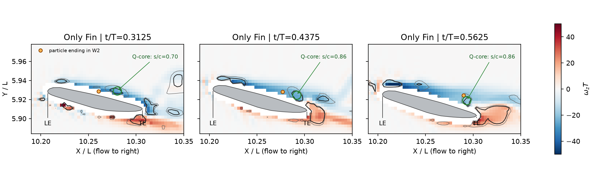
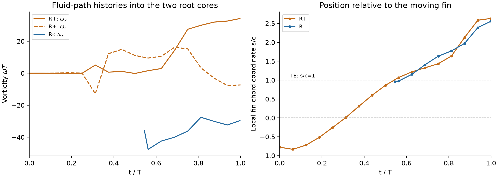
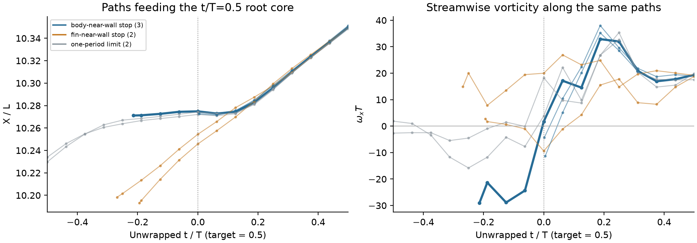

# Orca 涡结构：来源、命名与机制结论

> 历史报告；以最新总报告为准。原报告散落附件不随本合集上传。

历史报告快照；部分判断后续已更新。请先阅读最新总报告。原始数据附件保留本地，本合集不包含数据或论文全文。

最新逐支分类：LEV、TEV₁、W2、TEV₃、TV、RV⁺/RV⁻ 与身体涡的独立定位图 [original local attachment: ../vortex_atlas_v10/Orca_主要涡结构分类与逐支对应.html]。包含每支截面数据，修正 Baseline TEV₃ 的小核漏检。

后续定量核查：身体涡排查与鳍旁流向涡量反号 [original local attachment: ../vortex_discovery_v9/Orca_身体涡核查与流向旋转反转.html]。包含闭合环量、同点释放、材料静态对照；旧报告未包含这组生成机制证据。

# Orca 涡结构：这次可以明确回答什么

2026-10-23 · 依据原始速度、涡量、压力与移动表面数据 · 本文替代 v7 的候选式结论

你图中标出的主要结构，可以归入前缘涡、表面剪切层卷起的尾涡，以及非定常身体—鳍根接合涡系。本次查清的重点是：WBI 区域在不同相位包含不同的流体供给路径和流向涡分支；TEV₂ 不能仅按“在后缘后方”来解释其来源；Enhanced TEV 则确有 Only Fin 对应结构。新研究结果应落在身体波动怎样改变这些结构及压力上，而不是把“有根部回流”本身命名成首次发现的新基本涡型。

关于“有没有未被充分讨论的结构”：在已核查的最接近文献中，没有找到对本 Orca 工况中这组相位相关供给路径、三维转向和同运动 body/no-body 压力增量的完整定量说明。这是本研究可贡献的具体内容。但接合涡、反旋次级涡、根部回流都有明确先例，不能称为无人发现过的涡种类。

## 1. 原图各个名字应怎样使用

| 原标注 | 本次判定与建议标注 | 直接依据 |
| --- | --- | --- |
| LEV | 保留 LEV；下游阶段写“对流后的 LEV”。 | 同号核可由 t*=0.5625 的前缘附近连续对应到周期末；不能因后期靠近后缘而否定其前缘来源。 |
| TEV₁、TEV₃ | 可作为不同次尾涡的编号；更精确为正 ωz 的下侧/后缘尾迹分支。 | 尾迹位置、涡量符号与近鳍下侧路径一致。编号表示不同结构/事件，不是三种新涡型；符号不同也不自动否定 TEV。 |
| TEV₂ | 改为“上表面剪切层卷起的尾涡 W₂”，避免“仅在后缘新生”的含义。 | t*=0.4375、0.5、0.5625、0.625 的对应负涡量核位于局部 s/c≈0.86、0.89、0.86、0.92，仍在后缘之前。七条进入末态 W₂ 的路径回到上表面 s/c=0.32–0.52 附近。 |
| Enhanced TEV | “增强的后缘尾迹涡”成立。须注明所比相位、截面和指标。 | t*=0.5、Z/L=5.86，B/I 对应正涡量核中心仅差 0.0039L；Q峰值比 2.29，Q>50 掩膜内涡量积分比 1.26。两工况都有对应后缘路径，属于增强，非独有新涡。 |
| WBI-Vortex | 改为“身体—鳍根接合涡系（junction/root vortex system）”。各相位再标分支。 | WBI 是相互作用名称，不能唯一指定涡的来源。t*=0 的反旋分支与 t*=0.5 的身体近壁相关分支，不能用一个“新涡”标签代替。 |

s/c 用各时刻、各展向位置的实际鳍截面计算，前缘为 0，后缘为 1。W₂ 的 Q 核对应是结构识别，粒子回溯是流体路径，两者是互补证据；没有把粒子轨迹冒充涡核轨迹，也没有证明 W₂ 必须是某条旧 LEV 的同一根涡管。

图 1｜W₂ 的形成区域已在鳍上表面、后缘之前出现。灰线为 Q=25/50；绿圈标对应的后半弦旋转结构，橙点是最终进入 W₂ 的流体粒子。该图直接来自数值场，不是对原始截图描线。

## 2. 根部区域查出了什么机制

周期起点：两条反旋、以流向涡量为主的根部尾迹分支。在 X/L≈10.35 的截面，R⁺ 与 R⁻ 的峰值 ωxT 约 +34.25 和 −29.54，核间距约 0.0183L。R⁻ 的七条邻近流体路径均回到鳍根后缘附近，s/c=0.96–1.04。R⁺ 的代表路径先经过鳍下侧，再离开后缘；t*=0.625→1，ωxT 从 2.92 增至 34.25，涡量向量与 X 轴夹角从 76.1° 减至 14.1°。这支持鳍附近涡量在根部尾迹中转向、拉伸，形成流向分支的解释。

图 2｜t*=1 对应下一周期 t*=0。R⁺ 在越过后缘后流向涡量明显增长；R⁻ 的可追踪路径始于后缘附近。展示原生 1/16 周期间隔的场采样；这不是独立涡的力预算。

半周期：身体近壁滞留与鳍面路径共同进入根部涡附近。t*=0.5 的代表根部核（X,Y,Z）/L≈(10.350,5.960,5.892)，ωxT≈19.36。代表粒子在 t*=0→0.125 的 X/L 约维持 10.27，随后才向下游输运；对应 Q 从 −175 到约 +115，之后 t*=0.25 达 +322。说明这里有从剪切占优到旋转占优的演化，不能把不同相位的可见形状都视作同一根固定尾涡的等比例放大。

在显式周期延拓下回溯七个相距 0.0015L 的种子：3 条在身体近壁区达到有效数据边界，2 条回到鳍面附近，2 条达到一个周期的追踪时限。这把半周期接合区识别为具有身体近壁关联和鳍面关联的复杂根部涡系；并不意味着“3/7 的涡量来自身体”。近壁路径来源也不等同于黏性涡量生成位置。

图 3｜半周期根部区的路径对细小起点扰动敏感，不能归为单一的纯身体来源涡。负时间来自保存周期的延拓，正时间来自该保存周期。蓝/橙分别是身体/鳍面近壁停止，灰色是时限停止；粗线为中心种子。

静态对照：已按相同材料鳍面锚点对齐工况，消除了动态/静态鳍位置不同的偏差。在指定根部尾迹体积、排除两层近壁网格后，两种静态工况均未识别到满足 Q>25、流向涡量占优且至少 8 个单元的分支，而两种动态工况都有。身体改变了动态涡系的强度与排列；不能说“Only Fin 完全没有根部涡”。在相同的双鳍压力升力统计下，静态有身体/仅鳍之比约 1.105，也不能继续写成增升严格为零。

## 3. 文献为什么支持这个分类；新意具体在哪里

新找到的直接先例是 Ramamurti 等（2002）的 Fig. 7。作者已经讨论胸鳍—身体接合回流及后缘接合涡随相位出现。因此“发现一个 junction vortex”“出现反旋涡”本身都不是足够的新颖性。我们的贡献应表述为：在真实 Orca 形态及身体波动下，把根部不同相位的路径、涡量三维转向和 body/no-body 的压力响应定量分开。下面逐项列出最接近的先例，不以“长得不像”判断新涡。

| 直接文献 | 已有的解释 | 与本结果的边界 |
| --- | --- | --- |
| Ramamurti et al. (2002)pp. 3002–3003, Fig. 7 and accompanying text | 胸鳍—身体接合处回流、后缘接合处小回流、随冲程重新形成，以及旧尾迹沿身体的作用均有直接描述。 | 未在本文中给出本 Orca 的同运动 body/no-body 对照、根部路径分类或这组压力增量预算。 |
| Dong et al. (2010)Fig. 5; vortex dynamics discussion; DOI checked on primary PDF p.1 | 胸鳍形成前缘、尖部及多个尾迹结构；相互诱导导致涡丝拉伸和转向。 | 说明多条弯曲涡丝不是自动的新涡型；几何与运动不同。 |
| Cheng et al. (2014)Abstract and vorticity transport results | 后缘剪切层可卷成根涡，随后发生转向和拉伸。 | 支持根部尾迹分支的机制分类；不包含 Orca 的摆动身体。 |
| Liu, Dong & Li (2016)Local full text W2338466152 | 身体涡和翼根/翼面涡存在相互作用，结合表面低压及力解释增升。 | 身体涡的存在与增升链条已有先例；不能因形似而给 Orca 套用 TXV/PBV 名称。 |
| Wang et al. (2019)Local full text W2944837325, sections 3.2–3.3, Figs. 5–9 | 用 WB/WO/BO 对照、剪切层供给、涡量切面及压力解释相互作用；TXV 与 nTXV 的形成相位不同。 | 方法可借鉴；本文对象的头部剪切层—胸部—翼根连接不能直接等同于 Orca 的鳍根后缘/近壁路径。 |
| He & Breuer (2026)PREPRINT v1, section 3.2.1 | 二维鳍—壁模型已有反旋次级涡、壁面反向剪切和角区吸力讨论。 | 属于近似二维、刚性身体模型；没有本工况的三维流向根部枝和身体波动。预印本，非已核实期刊论文。 |

可用于论文的结论定位：本工况表现为身体调制的非定常鳍根接合涡系，伴随表面剪切层卷起、根部尾迹涡量转向及相位不同的近壁供给路径。身体作用同时改变局部压力，形成上表面平均吸力增益。该发现扩展的是特定三维身体—鳍相互作用机制；不把已知接合涡重新命名为一种新的基本涡型。

## 4. 与 1.6 倍升力的联系：哪些已经算清

全双鳍原始压力升力比为 1.596。这与“某一根涡贡献 59.6%”不同。已经核算的物理链是：身体波动改变局部速度/涡量场，速度—涡量耦合推动上表面额外吸力，表面压力积分给出增升。显眼的根部尾涡是涡系的一部分，不能将全部增升直接归给它。

| 共同上表面外侧 h/L=0.012–0.040 | 周期平均 ΔCp |
| --- | --- |
| 实测层间额外压力下降 | −0.07588 |
| 速度场重建 | −0.07416（均值差 2.3%） |
| 速度—涡量项 | −0.08646 |
| 动能梯度与非定常项 | +0.00554、+0.00679，部分抵消 |

该层压力差投影回鳍面对应 ΔCL=+0.001481，占同一有效上表面增升的 34.5%；速度—涡量项单独对应 +0.001813（42.2%），其他项抵消一部分。分母并非总升力，也不是整条根部涡的贡献。这一压力账目比用 Q 体积或相关系数估计“涡的升力百分比”更直接。完整定义见压力来源报告 [original local attachment: ../pressure_origin_v7/Orca_压力来源_精简报告.html]。

撤回 v7 中一项推断：此前用有限 Q 截止涡线的展向延伸范围差异支持“涡管断开/重组”。本次取消 Q 截止、改变近壁排除并扩展到身体两侧后，部分涡线继续延伸；原证据受追踪条件影响，不能证明物理重联。反旋涡核及以上来源/压力结果不依赖该推断。

数值依据与结论适用范围

本轮新增读取 B/I 各 17 个原生三维场，四工况末相位的跨身体两侧体积；结合既有 B/I/NoFin 的 51 个场与切面。速度导数只采用流体网格，核验 Q、涡量符号、局部旋转指标；使用实际移动三角面定义前后缘及最近表面。静态对照另外核验材料面编号相同。

采用两档轨迹积分步长（1/512 与 1/1024 周期）。完整周期目标的同时间位置最大差 1.29e-05L，低于网格间距约 0.003L；这是积分收敛检验，不是 17 帧时间采样误差的上界。半周期长路径依赖已声明的周期延拓；B 的起末 Q 投影相对 L2 差约 0.00179。对种子改变 ±0.0015L 的敏感性逐条保留，未把单一代表轨迹推广成全涡管。

R⁺ 在 0.625→1 的解析涡量输运积分：拉伸 +9.31，转向 +19.77，条件黏性项 -10.28；实测 ΔωxT=31.33。闭合残差约 43.3%，故未将其写成“转向占多少、拉伸占多少”的定量归因。R⁻ 的近壁预算更不可靠，亦未用于份额结论。该未闭合的涡量预算与第 4 节均值差 2.3% 的压力预算是两项不同核算。

Q>50 内的涡量积分依赖阈值，不能当成闭合轮廓总环量。静态的“无分支”只适用于所写 ROI、阈值与有效网格；不等于静态全域无涡。图中灰/蓝原 Q 等值面表示不同阈值，并非旋转正负。

文献覆盖：Dong 2016–2026 目录 196 条记录，49 篇有可提取全文并进行了关键词筛查，其余 147 条未获本地全文；关键机制论文精读并与领域直接先例比对。本轮补上 2002 年胸鳍接合流先例，说明只检索近十年不足以排除旧机制。本文没有宣称全文精读全部目录或证明全球文献不存在同类描述。

可复核数据：结论数值 [original local attachment: ../vortex_source_v8/verdict_metrics.json] · 鳍面相对位置与步长检验 [original local attachment: ../vortex_source_v8/material_source_locations.json] · Enhanced TEV 对照 [original local attachment: ../vortex_source_v8/enhanced_tev_sources.json] · 半周期路径分类 [original local attachment: ../vortex_source_v8/half_cycle_feeding_summary.json] · 材料对齐静态对照 [original local attachment: ../vortex_source_v8/static_material_control.json] · 含残差的涡量预算 [original local attachment: ../vortex_source_v8/resolved_vorticity_transport.json] · 文献定位 [original local attachment: ../vortex_source_v8/literature_verdict.json]。

原始数据保留在各 case/marker_q；科学图和路径计算可复现。报告与依据打包 [original local attachment: ../Orca_涡命名核查_报告与依据.zip] · 早期方法与文献索引（带更正说明） [original local attachment: Orca_涡命名核查_方法与文献.html]
