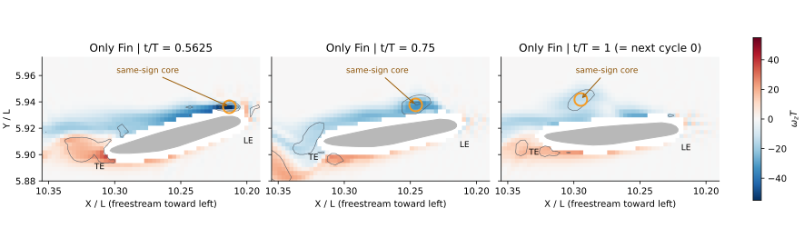
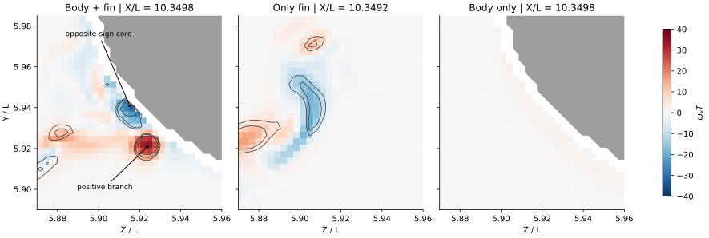

# Orca 涡命名与新颖性核查

> 历史报告；以最新总报告为准。原报告散落附件不随本合集上传。

历史报告快照；部分判断后续已更新。请先阅读最新总报告。原始数据附件保留本地，本合集不包含数据或论文全文。

Orca · Sweep35 · 2026-10-22 · 命名与新颖性核查

# 哪些是已有涡，哪些变化由身体引起？

目前证据最支持：身体增强并重组了原有胸鳍涡系，鳍根附近还出现了更明显的反旋分支。有值得研究的结构变化，但尚不能确认一个独立新生、且领域内未描述过的“新涡型”。图中 LEV 有来源追踪支持；把三条尾迹都叫 TEV，以及把 WBI 当作涡型名称，则需要修改。

| 当前标注 | 建议标注 | 判断依据 |
| --- | --- | --- |
| LEV | Convected LEV（中等置信） | 位置虽靠近后缘，三处截面的同旋向特征追踪支持其从前缘附近向下游移动。可以保留 LEV 假说，但建议加 convected，并标生成相位；尚非整个涡管的材料追踪。 |
| TEV₁、TEV₂、TEV₃ | Shed vortices W₁–W₃ | 代表截面与三维连通分量含交替旋向。W₁／W₃ 有后缘侧来源的迹象；W₂ 不能仅凭当前位于后缘下游就叫 TEV。编号先表示图中从远到近的实例，不声称已知年龄。 |
| Enhanced TEV | Intensified fin vortex / 强化的鳍上涡 | “增强”有整体与局部数据支持，但尚未证明红虚线整条结构都是同一个 TEV。需先把对应涡的来源与身份锁定。 |
| WBI-Vortex | Body–fin junction-associated vortex branch（暂定） | WBI 表示相互作用，不是唯一涡型。该位置有强流向旋转与反旋分支；尚不能等同 TXV、PBV、经典马蹄涡或独立新涡。 |

先明确图例：来流沿 +X，在原图中由右向左。灰色与蓝色分别是 Q = 50 和 250，不是旋向。流场内名为 Q/Wz 的变量已用完整速度梯度核验，确实为 Q。

图 1｜Only Fin 的同一负 ωz 涡核，从前缘附近移动到后缘附近：Z/L ≈ 5.86，X/L 从 10.213 移到 10.295。橙圈为同旋向特征匹配；灰色为实际鳍截面，黑线为 Q 等值线。0.5625–1.0 的 8 帧连续匹配在 Q = 25、50 及两种匹配距离下保持；另外两处展向截面也有相似输运。因此不能因涡已到后缘便否定它起源于前缘。

鳍根的变化是真实流场变化。下图在 X/L ≈ 10.35、t/T = 0 比较带符号流向涡量。baseline 在身体旁出现紧凑的正 ωx 核及其相邻反旋核；Only Fin 有较弱、位置不同的根部／尾迹结构；No Fin 在此没有同等强度的涡核。固定鳍根尾迹区的周期平均 ∫Q>50Q dV 为 isolated 的 4.07 倍。这个数是阈值限定区域的旋转指标，不能称作该涡的升力占比；阈值敏感性见附录。

图 2｜身体附近的流向旋转与反旋分支。颜色为 ωx 的符号和大小，黑线为 Q = 25、50、100、250，灰色为身体。显示使用同一物理尺度；三算例原网格不同，截面 X 坐标相差约 0.00065L。该对照证明身体相关的重组与增强，并不单独证明涡量从身体壁面新生。

“新增结构”与“新涡型”是两回事。Dong 组已在 [2016 蝉翼身研究](https://doi.org/10.1017/jfm.2016.175)和 [2019 蜂鸟研究](https://doi.org/10.1088/1748-3190/ab2208)描述身体涡与翼根连接；[2024 壁面背鳍研究](https://arxiv.org/html/2409.04147v1)已有半马蹄、arch 与 hairpin；[He & Breuer 2026 预印本](https://arxiv.org/abs/2604.21054)又直接讨论了近身体摆动胸鳍的反旋次级涡、角区吸力和身体剪切。这些工作限制了“首次发现桥形／次级涡”的主张，但并不排除 Orca 的具体三维耦合机制具有新意。

与增升的联系应这样写：现有匹配表面数据支持“身体相互作用 → 内侧上方旋转增强与吸力增强相对应 → 压力积分产生净增升”，全胸鳍平均压力升力比为 1.596。此次尚未把某一条鳍根涡单独与增升闭合对应；它在 t/T = 0 的局部环带比较中也未表现出平均低压核。因此不能把全部 59.6% 增升归给图中橙色涡支。

更有依据的潜在创新点：在真实 Orca 几何和 undulation 下，身体如何改变前缘来源涡的输运、鳍根反旋分支和后缘脱落的时序，并使压力增益集中到胸鳍内侧上表面。这是“已知涡结构之间的新耦合与载荷作用”的候选，不是已经成立的新涡分类。

本地 Dong 作者目录筛查：2016–2026 年共 196 条记录，其中 49 篇可提取全文；其余 147 条未取得本地全文。对直接相关论文补做公开原始文献检索并精读相关章节。此覆盖不等于穷尽全领域，也不把所有目录记录算作独立期刊论文。

方法、数值限制、逐篇检索清单与文献对照 [original local attachment: Orca_涡命名核查_方法与文献.html] · 已有涡—压力—升力精简报告 [original local attachment: ../mechanism_chain_v5/Orca_涡_压力_升力_机制研究.html] · 命名对照表 [original local attachment: naming_recommendations.csv]
