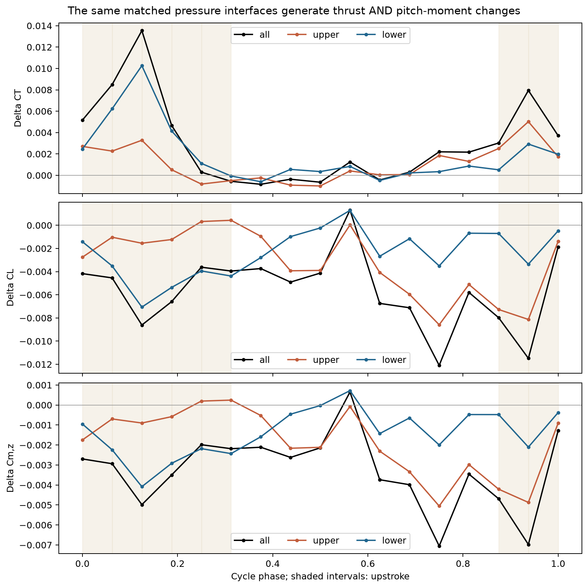
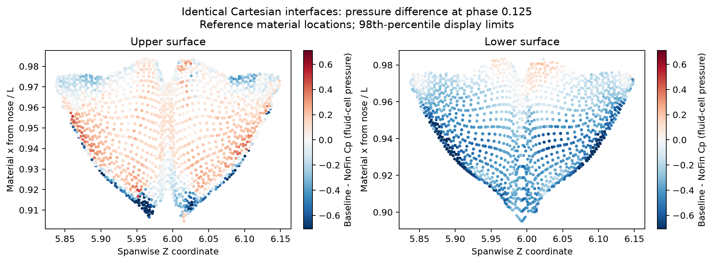
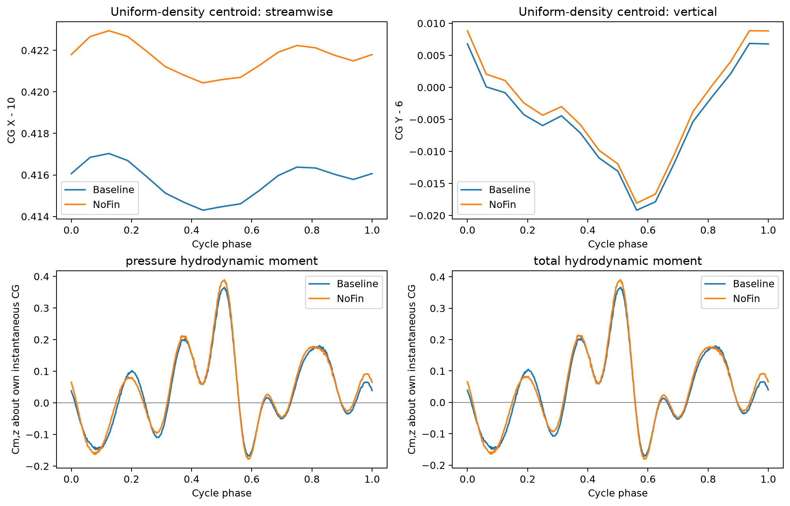

# 胸鳍引起的推进与俯仰载荷重分配

> 历史报告；以最新总报告为准。原报告散落附件不随本合集上传。

历史报告快照；部分判断后续已更新。请先阅读最新总报告。原始数据附件保留本地，本合集不包含数据或论文全文。

胸鳍引起的推进与俯仰载荷重分配

# 胸鳍引起的推进与俯仰载荷重分配

基于 Baseline 与 NoFin 原始数据及相关 JFM 研究的综合分析

研究日期：2026 年 10 月 9 日。研究对象为现有 Orca 三维规定运动计算，Baseline 对应 Sweep35；NoFin 为去胸鳍对照。本报告把原先的四个问题收敛为一个问题：在主体和尾鳍运动基本一致时，胸鳍改变的压力载荷如何同时作用于尾鳍推进、整身体俯仰载荷和流向代价？已完成的数值检验、从文献得到的机制解释及尚待实施的验证分别标明。

核心判断：现有数据支持胸鳍引起的空间与相位载荷重分配。尾鳍局部推力增加，前后身体的升力改变量在净力上抵消、在俯仰力矩上相加；均匀密度假设下，质心处的平均总俯仰水动力矩降低约 13%，波动标准差降低约 3%。但局部推力增益没有抵消胸鳍和躯干的流向代价，整身体净流向力反而下降。这个组合构成一条完整的研究主线：多鳍干扰改变推进与俯仰载荷之间的分配，而不是产生一种对所有指标都有效的“增强”。

本次进一步把同一批尾鳍压力界面的推力、升力和俯仰力矩一起积分。严格匹配界面上的推力增量约 89% 来自上拍，而尾鳍平均俯仰力矩变化的上拍与下拍贡献约为 48% 和 52%。这将前两个问题联系起来：同一非定常压力变化，通过不同的表面方向、力臂和相位权重，形成不同的系统响应。它也否定了用单个上拍瞬间解释全周期力矩效应的做法。

## 1 从原始问题到可检验的统一假设

原始思路包含尾鳍力的方向与时机、整身体俯仰载荷平衡、局部收益与整体代价，以及 sweep 的投影和安装环境效应。它们不宜写成四项并列发现。更连贯的组织方式是：先识别胸鳍引起的分布压力变化，再解释它怎样改变尾鳍各拍动阶段的受力，随后沿真实力臂累计到整身体力矩，最后核算这种载荷分配的流向或功率代价。sweep 用来检验和改变这条关系，而不是另起一条参数扫描故事。

统一工作假设 H：在相同规定游动运动下，胸鳍通过改变身体及尾鳍附近的流动环境，诱发有空间和相位选择性的压力变化。该变化不等价于在原游动体上简单叠加胸鳍自身受力，而会重分配尾鳍推进载荷与前后身体的俯仰载荷；因此局部推进收益、净力变化和俯仰载荷缓和可以同时出现，也可以彼此不一致。

| 可检验命题 | 当前判断 | 应保留的限定 |
| --- | --- | --- |
| H1 尾鳍载荷不只是全周期统一放大 | 支持阶段性重分配 | 平均矢量偏转不等于瞬时方向转动占主导，也未证明统一移相 |
| H2 间接作用在净力中小，在力矩中重要 | 共同参考点下有直接积分证据 | “重要”指已算出的贡献；不能由力与力矩的百分比直接推断生物主要功能 |
| H3 局部尾鳍收益与整身体收益不一致 | 压力及总流向力收支均支持 | 当前是规定速度和运动的载荷比较，不是效率或自主游速比较 |
| H4 sweep 通过流动环境而非仅投影改变上述作用 | 尚未完成参数因果检验 | Baseline–NoFin 只能识别胸鳍存在的总效应，不能建立 sweep 规律 |

这组假设容许被推翻。例如，如果统一尺度因子足以解释尾鳍波形，H1 就不成立；如果重建到物理质心后间接力矩消失，H2 的系统意义就弱；如果有利载荷变化小于离散误差，不能把它写为稳健优势。先给出这些反证条件，才能避免为了论点而选择数据。

## 2 相关 JFM 论文怎样约束我们的解释

多鳍干扰已不是空白。 Liu et al.（2017，JFM 829）用不同身体与鳍组合，把表面受力、后部身体涡和尾鳍前缘涡联系起来；Zhong et al.（2019，JFM 878）则报告上游背鳍诱导的三维横流能够改变尾鳍来流、促进展向流动并稳定前缘涡。[1,2] 对本研究而言，仅证明“上游鳍能改变下游推力”不足以形成明确的新贡献；真正需要解释的是这种干扰怎样改变非轴向载荷及其力矩后果。前者核对了摘要与公开结论，后者核对了出版方摘要，未把无法访问的全文细节作为已读事实。

推进取决于流动与运动的配合。 Zhou, Seo & Mittal（2025，JFM 1014）的前缘涡模型把相对来流、有效攻角和尾鳍姿态联系到推力，并以不同层级的直接计算检验模型；其讨论还区分平均来流偏置和周期扰动，并检查身体存在的影响。[3] 我们借鉴的是这种可检验的建模顺序，不把该鱼群模型直接当成 Orca 的已验证模型。关键是局部流动在尾鳍运动周期中何时、何处改变载荷，而不仅是涡量大不大。

力矩不能由力的大小代替。 Zhu & Breuer（2023，JFM 977）在后掠翼流致俯仰问题中发现，力的变化可以较小，而力矩随流动结构位置和作用方式改变；他们结合三维 PIV、动力学响应和力矩分解建立解释。[4] 这与我们“净升力变化小，却有明显间接俯仰力矩”的问题最接近。本文应借鉴其区分载荷与动力学响应的方法，但不能把翼的后掠几何和虎鲸胸鳍安装转角当成同一个控制变量。

涡图与力矩之间要有定量联系。 Li et al.（2020，JFM 891）的涡力矩图方法通过辅助势把流场联系到俯仰力矩，并用独立 CFD 力矩进行验证。[5] 它说明涡的位置及其作用权重比单纯涡强更重要。其示例对启动后的附加质量和黏性贡献有特定处理，不能不加修改地搬到周期变形 Orca 上。我们目前完成的是表面压力载荷分解，不是已经完成体积涡力矩归因。

局部有利相互作用不保证系统最优。 Handy-Cardenas, Zhu & Breuer（2025，JFM 1012）把尾迹结构、升力、力矩和功率按相位并置，说明相遇时机能改变后翼收益，而且阵列最优并不等于单翼最优。[6] Lagopoulos et al.（2020，JFM 903）则展示尾翼干扰可以改变尾迹偏转和平均侧向力，推力结果随尾迹状态不同而变化。[7] 这些论文支持我们的研究问题，但前者研究能量采集、后者是二维串列翼，其具体性能数字不能用来替代 Orca 结果。

生物学动机来自另一条证据线：Fish, Peacock & Rohr（2003）观察鲸豚身体各部位的相位运动，讨论抑制头部反冲的可能机制；Guo et al.（2023）指出海豚式上下拍的推进不对称伴随净升力。[8,9] 两者共同说明推进与竖向载荷不能分开理解。我们的规定运动对照能够检验水动力载荷来源，但头部摆幅本身已被输入固定，不能再用它证明实际运动稳定性。

据此，本研究的潜在贡献应定位为：把上游附属鳍诱发的阶段性尾鳍载荷变化，与前后身体的间接俯仰力矩和整体流向代价定量连接。这是一项由已核对文献和当前数据提出的定位判断，不是“全球首次”的文献穷尽结论。

## 3 数据与比较口径

主对照为 Result/Sweep35 与 Result/NoFin。分析 t/T＝9–10，整体求解器每周期 481 点，分部压力和流场每周期 17 帧，含首尾端点。统一 U＝0.29、A＝0.548382、L＝1。正推力方向为 −x，升力方向为 +y，俯仰使用 Mz；正 Mz 对应尾部上抬、头部下俯。区域 trunk 指除双侧胸鳍和尾鳍之外的表面，不应在论文中误写为完全不含其他附属鳍的裸躯干。

保留原始求解器写出约定：原生力含因子 2，系数按原生力除以 U²A，力矩再除以 L。分部是重建的笛卡尔压力界面载荷；整体同时保留压力、黏性和总力。不同离散积分之间的剩余偏差单独报告，没有人为把误差摊给各部位。

尾鳍参考节点约 99.56% 可逐点匹配，匹配节点全周期位移最大差约 9.54×10−7L。进一步取 4,929 个共同材料三角面，并在各相位匹配相同位置、面积和方向的压力界面。共同面结果保留完整尾鳍推力差约 94.9%、升力差约 96.9%。这排除了主要差异由尾鳍根部分区标签造成的解释，但不代替所有几何、网格和运动输入的一致性审计。

为拆分作用来源，使用一个共同固定参考点；为讨论物理载荷，再分别使用各自瞬时质心。均匀密度是用户指定的质量模型，此时质心等于封闭几何体积形心。17 帧实际形心之间只对质心位置插值，整体力矩仍使用求解器 481 点。共同参考点上的间接作用比例，与各自质心处总力矩改善比例回答不同问题，不能拼成同一个分母。

## 4 同一压力变化怎样产生不同的推进与力矩响应

先看完整尾鳍的周期结果：平均压力推力系数从 0.029747 增至 0.032735，平均升力从 0.082766 降至 0.076774；平均力矢量的模下降约 5.1%，而瞬时矢量模的周期平均仅增加约 1.1%。因此，净推力增益并不是一个“整个周期受力普遍更强”的简单结果。

必须同时纠正另一种过度解释。平均矢量夹角约从 70.23° 变为 66.91°，但逐相位的幅值／方向对称分解把约 79.5% 的平均推力增量归入幅值项、20.5% 归入方向项，受力幅值加权的平均瞬时方向差约为 0.62°。所以“瞬时力主要靠转向实现增推”没有得到支持。幅值项随相位正负变化，也不等于全周期统一放大；统一比例拟合 k＝0.99589 对平均推力变化的预测为 −0.000122，与共同面实际 +0.002836 符号相反。

最符合当前数据的描述是：各相位的局部压力载荷发生不均匀变化，周期积分后改变了推进和升力的分配。“产生时机改变”应落实为阶段贡献重分配，不能写成已经测得整体峰值提前或滞后。

为了把这个结论连接到俯仰载荷，本次对严格匹配的压力界面同时积分三个量。令 n 为身体指向流体的外法向、Δp 为 Baseline − NoFin 的压力差，在几何相同的界面上：

Δtp = −Δp n；　ΔT = ∫ Δp nx dS；　ΔL = −∫ Δp ny dS

ΔMz = −∫ Δp [(x − xr)ny − (y − yr)nx] dS

这三个量来自同一压力差，但积分权重不同。推进分量取决于随尾鳍姿态变化的法向投影；俯仰力矩还取决于位置。尾鳍位于参考点后方，向下载荷增量在上、下拍都能产生负俯仰力矩增量，而它在推进方向的贡献可以随姿态和压力分布改变。该关系是下面数值结果的力学基础，不依赖预先指定某一条涡管必须是原因。

| 严格匹配尾鳍界面 | 上拍贡献 | 下拍贡献 | 周期合计 |
| --- | --- | --- | --- |
| 平均 ΔCT 的分阶段贡献 | +0.002538 | +0.000303 | +0.002841 |
| 平均 ΔCL 的分阶段贡献 | −0.002739 | −0.003072 | −0.005812 |
| 平均 ΔCm 的分阶段贡献 | −0.001613 | −0.001743 | −0.003356 |

这里的分阶段贡献是该阶段冲量除以完整周期，因而可直接相加；不是各阶段自己的时间平均。约 89.3% 的推力增量来自上拍，但力矩变化仅 48.1% 来自上拍。完整尾鳍分区得到的上拍推力份额约 86%，与严格匹配子集存在少量边界贡献差别；正文必须标明所用表面，不能把 86% 和 89% 当成矛盾或任意择优。

图 1 同一批严格匹配压力界面的推力、升力和俯仰力矩差。浅色背景为按实际材料点运动划分的上拍区间。推进增量集中在上拍；负升力和负力矩增量贯穿周期的更多阶段。

空间贡献也不是一一对应的：严格匹配界面上，参考下表面贡献约 64.7% 的周期平均推力增量，但参考上表面贡献约 57.2% 的平均俯仰力矩变化。上、下表面是参考材料分组，不随某一时刻的姿态重新命名。这个结果进一步说明，不能仅凭推力增量最强的那块表面就认定它主导全部俯仰效应。

在推力增量最大相位 φ＝0.125，8,022 个对应压力界面完全匹配，直接积分压力差得到 ΔCT＝+0.013540、ΔCL＝−0.008610。下表面面积加权 ΔCp＝−0.335，上表面为 +0.043；下表面贡献约 75.8% 的该相位推力增量。这是局部压力变化与载荷变化的直接对应，但不能由 ΔCp 的符号推断任一工况的绝对压力是否低于环境参考压力。

图 2 推力增量最大相位的压力差。所有点来自位置、面积和方向相同的原始压力界面；图中位置映回参考材料表面。色标只在显示时截断至绝对值第 98 百分位，积分使用全部数值。

## 5 流动机制已经识别到哪里

在两工况相同空间位置、相同运动前缘轨迹前方取样，可以确认局部流动环境发生改变。前缘上游 0.03L 处，早期上拍 φ＝0.0625–0.1875 的展向平均 ΔV/U＝−0.0866；推力增量最大相位为 −0.0803。该阶段原本的流动向下，Baseline 更向下，而尾鳍向上运动。0.015L 和 0.06L 距离也得到同号的早期变化。这与增强向下压力载荷的观察相容。

图 3 尾鳍载荷变化与匹配探针速度差。探针只保留有效流体插值模板。404/408 对有效，0.03L 处全部有效；图示是局部流动差，尚不是从胸鳍到尾鳍的涡传播轨迹。

但“向下来流增强”尚不等于“有效攻角必然显著增大”。有效攻角还需要局部弦向、法向和材料速度。在采用 17 帧有限差分材料速度的平面来流方向诊断中，早期平均方向差约 −1.06°，峰值增推相位约 −0.19°；这只是相对流向角，不是经过验证的三维有效攻角。该诊断提醒我们：尾鳍自身速度可能占主导，局部速度变化可以通过相对速度大小、分离和压力响应起作用，不能凭 ΔV 一项就指定攻角机制。

此外，沿运动轨迹采到的周期平均 ΔV/U＝−0.0455，属于“沿轨迹平均”，并非固定空间位置的欧拉平均尾迹偏转。直接拿它作为稳定下洗场的证据是不严谨的。这一点决定了如何使用 Zhou et al. 的平均流／周期扰动思路：下一步应先在固定剖面建立平均场，再沿尾鳍轨迹采样其均值部分和扰动部分，不能把两种平均混在一起。[3]

当前证据的因果层级：配对几何对照支持胸鳍存在改变了尾鳍的受力环境；匹配界面支持压力差产生对应载荷差；但胸鳍尾涡直接对流、胸鳍改变身体尾流、整体压力场调整及尾鳍自诱导响应仍可能共同贡献。不可压流动的压力作用也不必等待某个涡团实际抵达。要辨别传递路径，必须引入空间传播证据或受控流场对照，单一相关系数、时滞或 Q 等值面连通性都不够。

| 竞争解释 | 现有结果的约束 | 下一项能区分它的证据 |
| --- | --- | --- |
| 尾鳍几何投影改变 | 共同界面法向相同，不能解释该子集差异 | 继续报告共同表面覆盖与几何误差 |
| 全周期统一增力 | 常数比例模型对平均增推预测错号 | 相位和区域压力预算已完成 |
| 局部来流与非定常分离改变 | 已有局部速度与压力对应，因果路径未唯一确定 | 固定剖面场、局部弦向、压力峰与分离结构同步 |
| 胸鳍涡直接被尾鳍捕获 | 当前没有独立证明 | 涡结构跨周期追踪及去除尾鳍反馈的配对来流对照 |

## 6 前后受力重分布怎样改变整身体俯仰载荷

尾鳍减升只是系统的一半。共同参考点的分部结果同时显示躯干增升。二者的净升力差很小，却因为纵向位置不同而产生同号的平均力矩变化。因此，H1 的非轴向载荷变化正是 H2 的输入，而不是与 H2 平行的一项附加发现。

| 区域 | 平均 ΔCL | 平均 ΔCm | 其物理作用 |
| --- | --- | --- | --- |
| 躯干 | +0.006717 | −0.000963 | 前部与中部竖向载荷重分布 |
| 尾鳍 | −0.005991 | −0.003450 | 后部升力下降产生负力矩增量 |
| 非胸鳍合计 | +0.000725 | −0.004413 | 净升力大部分抵消，力矩相加 |
| 双侧胸鳍直接贡献 | +0.015743 | −0.002118 | 附属鳍自身的压力力矩 |

按 1−|净改变量|／各改变量绝对值之和定义，躯干与尾鳍升力变化的抵消程度为 94.3%。这不是说尾鳍抵消了躯干增升的 94.3%，后一个比例约为 89.2%。间接力矩变化的 96.4% 来自竖向力的纵向力臂项；在该共同参考点，间接平均力矩贡献约为胸鳍直接贡献的 2.08 倍。它支持“仅叠加胸鳍自身受力会漏掉重要作用”，但不单凭这个比值给胸鳍指定主要生物功能。

图 4 非胸鳍表面的沿体长升力差与累计俯仰力矩。逐压力界面使用真实位置，不把部件合力放在假定作用点。净力的抵消没有消除由前后分布产生的力矩。

把共同参考点移到鼻端后 0.25–0.65L、原高度上下 0.1L，间接平均 ΔCm 始终为负，范围约 −0.00475 至 −0.00413。可称它具有接近力偶的特征；因为净力差仍不为零，不能称严格参考点无关的纯力偶。

均匀密度模型回答了其物理质心意义。按两工况各自瞬时封闭体积积分，周期平均质心分别在各自参考鼻端后 0.4131L 和 0.4190L。转换到各自随动质心的整体总水动力矩得到下表。

| 质心处总俯仰力矩系数 | NoFin | Baseline | 相对变化 |
| --- | --- | --- | --- |
| 周期平均值 | 0.04459 | 0.03877 | −13.0% |
| 波动标准差 | 0.12532 | 0.12146 | −3.1% |
| 含均值的均方根 | 0.13301 | 0.12750 | −4.1% |
| 峰峰值 | 0.57210 | 0.53804 | −6.0% |

图 5 各自均匀密度质心随相位的位置及该点的俯仰水动力矩。整体曲线使用求解器 481 点；图中压力与总力矩分别展示。波动缓和存在，但幅度不大，不能称大幅稳定化。

平均总力矩差可进一步精确拆分：都使用 Baseline 随动质心时，水动力变化贡献 −0.006366；转为各自质心带来 +0.000550 的位置修正；净差为 −0.005816。质心移动抵消了一部分有利变化，而不是制造出这个有利变化。固定在各自周期平均质心以及只用 17 个实际几何相位，平均与波动变化方向也一致；峰峰值仍应采用密集载荷输出。

波动为什么下降？各部位压力矩的独立方差之和由 0.013069 增至 0.013781，而两倍协方差之和由 0.002564 降至 0.000753。整体方差因后者的下降而减小。Baseline 中胸鳍分别与躯干、尾鳍的协方差为负，说明其载荷在周期上部分抵消其他部位；但所有交叉项之和仍为正，不能称整个系统完全反相。这一分解使用分部 17 帧压力载荷，不能冒充密集总水动力矩的独立动态验证。

Var(Mwhole) = Σ Var(Mi) + 2Σi<j Cov(Mi, Mj)

因此，在指定质量模型和当前运动下，“平均俯仰水动力偏置较小、周期波动适度缓和”得到支持。若目标是零平均水动力矩，需要额外补偿的平均量相应减少。均匀密度并没有自动给出稳定性：扰动后的恢复力矩、阻尼、自由运动响应仍未计算。对周期变形游动体，还应使用总角动量平衡，不能直接把 M/I 当成完整俯仰角加速度，忽略变形角动量与流体反馈。Zhu & Breuer 的研究正是通过实际动力学响应建立稳定性结论，而非单凭未扰动周期的力矩标准差。[4]

## 7 局部收益为何没有成为整体推进收益

现在可以把俯仰结果放回整身体收支，而不把“尾鳍增推”和“胸鳍减矩”当成两个互不相干的优点。分部压力推力差如下：胸鳍自身带来较大的流向代价，躯干也增加流向代价，二者超过尾鳍增推。

ΔCTpressure ≈ +0.002988 − 0.006573 − 0.001331 = −0.004917

式中依次为尾鳍、胸鳍和躯干的 17 帧分部贡献。整体求解器 481 点给出的压力推力差为 −0.004693；二者相差 −0.000224，包含稀疏相位积分和界面重建差异，约为该压力差的 4.8%。这个差额必须显式保留，不能宣称分部周期均值与密集求解器均值严格相等。黏性部分再贡献约 −0.003097，使总净流向力系数变化为 −0.007790。

| 整身体周期均值 | NoFin | Baseline | Baseline − NoFin |
| --- | --- | --- | --- |
| 压力 CT | 0.023792 | 0.019099 | −0.004693 |
| 总 CT | 0.010034 | 0.002243 | −0.007790 |
| 压力 CL | 0.092961 | 0.108859 | +0.015898 |
| 总 CL | 0.092578 | 0.108366 | +0.015788 |

这里可以说的是：在这一配对计算中，较小的质心俯仰水动力矩和较大的整身体平均升力，伴随较差的净流向力表现。不能把这种共存写成动物有意“牺牲推力换稳定”的适应性证明，也不能把胸鳍去掉后净力较大当作更优设计，因为两者提供的竖向与俯仰功能不同。报告绝对系数比强调接近零净力的百分比下降更稳妥。

功率问题尚未闭合。已有文件有总功率输出，但本次没有完成生成源、参考系、符号、压力／黏性以及刚体／变形功的统一审计；原始界面缓存也没有可直接作为求解器真值的局部界面速度。不能用尾鳍 CT 或整身体 CT 除以未经核验的 CPW 得到“节能结论”。Maertens et al. 对柔性自推进体效率定义的讨论正说明比较任务和参照功率的重要性。[10] 胸鳍随身体运动，即便没有独立拍动指令，也不能假定零机械功。

## 8 如何把当前结果推进成完整的机制研究

现有 Baseline–NoFin 已经足以形成一个完整的数值案例论证，但尚不足以支持所有姿态的一般规律或唯一涡机制。下面的工作围绕已经识别的缺口展开，而不是再增加一串不相关指标。优先顺序是检验压力效应的稳健性、识别传递路径，再研究姿态如何改变它；是否追加自由俯仰取决于文章是否坚持动态稳定性主张。

第一步，围绕决定结论的差值做数值验证。主要量是尾鳍 ΔCT、非胸鳍 ΔCm、质心处平均和波动 ΔCm，而不是仅看每个工况自身曲线是否平滑。对关键对照使用一致的网格／时间加密，分别报告差值变化；优先增加分部与流场输出相位数，检查 86%–89% 的上拍贡献及 48%–52% 的力矩分配是否稳定。现有整体最后两周期接近，只能说明时间重复性，不能给出网格误差。17 帧也不是 17 个独立统计重复，不应据此构造显著性检验。

第二步，把“相同运动、不同局部流动”做成可预测的机制检验。在胸鳍后方、身体中后部、尾柄及尾鳍前方设置固定空间剖面，比较 Δu、Δv、Δw、压力和三维涡结构；随后把均值与周期扰动沿尾鳍实际材料轨迹采样。尾鳍表面则使用局部弦向和法向，把相对速度分解为切向与法向量，同时展示对应区域的压力差与积分贡献。

urel = usample − vmaterial；　un = urel·n；　uc = urel·c

可测试一个受 Zhou et al. 启发、但须为当前几何校准的低阶关系：局部法向载荷与 |u_rel|u_n 的变化有关，再通过已知方向和力臂同时预测推力与力矩变化。[3] 校准应只使用 NoFin 或部分相位，再检验 Baseline 和保留相位；不能把每个相位分别拟合后称为预测。如果只解释推力却解释不了升力、压力位置或力矩，应保留非定常分离、展向输运和附加质量等遗漏项，而不是事后调整到全部吻合。近尾鳍探针本身包含尾鳍自诱导，此模型首先是诊断，不能直接用作独立上游输入。

第三步，用最少受控对照分离传递路径。若主张“胸鳍尾迹经身体传到尾鳍”，最有鉴别力的是一对具有相同身体运动、但移除尾鳍的上游场计算：保留胸鳍和去胸鳍各一例。它们可减少尾鳍自诱导污染；再把两个上游场分别用于相同尾鳍运动的受控入流试验，检验相位推力和力矩是否重现。截断边界和尾柄处理本身会改变流动，所以必须将该对照视为机制干预，并检查与完整身体的差别。

匹配运动的孤立胸鳍对照回答的是另一件事：胸鳍安装在身体上以后，自身载荷怎样变化。它不能单独证明扰动怎样到达尾鳍。若 OnlyFin 文件没有匹配的真实材料运动、来流与归一化，不可仅因目录名相似就代入 Full − NoFin − OnlyFin。若仍需辨认某一涡区的力矩贡献，可采用三维力／力矩分解，但必须保留变形边界的加速度反应、黏性和外边界项，并与直接表面积分闭合；不能只积分一个 Q>0 区域。[4,5]

第四步，让 sweep 成为对统一假设的验证变量。先统一现有 Sweep10、20、35、50 的输入和后处理口径，再比较尾鳍阶段贡献、非胸鳍间接力矩与流向代价是否同向或出现排序变化。针对压力机制最不同的姿态做详细对照，而不是默认选择角度两端。当前目录检查显示 Sweep10 有较多 marker 帧及标签，但没有本流程表面缓存；Sweep20、50 各有 17 帧，却缺本流程所用标签和缓存。已有结果可继续处理，但尚不能冒充本报告已经完成的共同口径参数证据。

安装转角同时改变投影、根部环境、真实材料速度及尾迹位置。先在胸鳍局部坐标中检查单纯投影模型，剩余差异再联系局部相对流动。孤立鳍“几何后掠影响较弱”的结论针对的是另一种几何控制，不能用我们的安装姿态扫描去宣称推翻它。[11] 如果只保留 Baseline–NoFin，文章题目和结论应写胸鳍存在引起的作用；只有多姿态机制验证后，才升级为胸鳍姿态调节规律。

第五步，仅在需要稳定性主张时追加动力学验证。以已形成的周期状态为基准，施加小幅正、负俯仰扰动或释放一个俯仰自由度，保持同样的游动驱动和质量模型，比较扰动包络是衰减还是增长。瞬时导数的符号可以作局部诊断，但周期系统不能只靠一个静态斜率宣布稳定，应看周期到周期的响应或相应线性化周期系统。若不做这一步，文章仍可围绕载荷分配、配平水动力偏置和代价完成，不必把“稳定性”作为必须成立的标题。

## 9 文章应当怎样形成一条连续论证

建议的暂定中文题目为“胸鳍干扰引起的推进与俯仰载荷重分配”；英文可用 Pectoral-fin-induced redistribution of propulsive and pitching loads in prescribed cetacean-like swimming。在尚未验证多 sweep 规律前，不使用 optimisation、stability enhancement 或 energy recovery 作为题目中的已证实结果。

引言从鲸豚推进与反冲的共同来源进入：尾鳍不仅产生推进力，也产生竖向载荷和俯仰力矩；胸鳍可能通过自身受力和流动干扰同时改变两者。随后指出，多鳍文献已经解释了推力增强和流动耦合，但单看局部推力或净力，不能描述前后身体载荷的空间与相位组合。最后提出上述统一问题及保持运动一致的配对对照。

结果部分首先给出“尾鳍增推、整身体净流向力下降、俯仰载荷减小”的共同事实，使读者明白需要解释的矛盾。随后以尾鳍阶段载荷为入口，展示同一压力界面如何对推力和力矩产生不同相位权重；再把尾鳍减升与躯干增升合并，解释净力隐藏的间接力矩。均匀密度质心结果放在这条链的系统端，回答这种重新分配是否缓和了实际质量模型的水动力载荷。最后才讨论流向代价及姿态参数怎样改变这种分配。

| 建议主图 | 所服务的论证 | 当前状态 |
| --- | --- | --- |
| 1 几何、运动及差值验证 | 明确干预变量、参考点和比较可信度 | 已有运动匹配；完整网格差值收敛仍需补 |
| 2 尾鳍与整身体的联合收支 | 建立局部收益与系统代价并存的问题 | 数据已有，统一图可由本报告数值制作 |
| 3 同一压力场的相位力和力矩 | 连接 H1 与 H2，展示权重不同 | 本次完成图 1 的联合积分 |
| 4 来流、压力和空间贡献 | 定位流动机制与反证竞争解释 | 局部探针与压力已有，传递路径未闭合 |
| 5 沿体长分布及质心力矩 | 解释间接作用与条件性载荷缓和 | 已完成 |
| 6 姿态规律或受控机制对照 | 把个案推进到可迁移规律 | 本次未完成，优先按机制选择对照 |

这样组织后，第一条假设解释尾鳍改变了什么，第二条解释这项改变对全身意味着什么，第三条检验收益的系统代价，第四条检验规律能否被姿态调节。它们是同一论证的先后环节。若后续网格验证或受控来流试验否定局部流动解释，就应修改机制段落；不应靠追加更多涡图保持预定故事。

当前可以写入结论的完整表述：在相同规定游动运动的 Baseline–NoFin 对照中，胸鳍引起了尾鳍表面压力载荷的阶段性重分配。相同界面上的推力增益主要来自上拍，而俯仰力矩变化在上、下拍均有明显贡献。躯干增升和尾鳍减升在净力上大部分抵消，但通过不同纵向力臂产生同号的间接力矩变化；均匀密度模型下，各自质心处平均总俯仰水动力矩与波动均下降。尾鳍局部增推未抵消胸鳍及躯干的流向代价，表明推进与俯仰载荷指标不能由单一局部性能排序。具体扰动传递路径、跨姿态普适性及自由运动稳定性仍需针对性验证。

## 10 可信度与可复核材料

本报告没有把后处理闭合等同于数值收敛。重建压力力与求解器峰值相比的偏差约 0.12%–0.39%；质心处压力矩重建 RMSE 约 0.000395。这些量说明重建与原始输出较接近，但不是分部微小差值的完整误差条。尤其标准差约 3.1% 的缓和幅度需要网格、时间和输出采样验证后再判断稳健程度。

严格匹配压力界面与共同材料面并不完全相同：前者额外去除两工况流体／固体邻接不一致的少量界面，所以其周期 ΔCT＝0.0028415 与共同材料面 0.0028357 有微小差别；均小于完整尾鳍 0.0029875。详细逐相位覆盖数和积分均已保存，不以这三种表面口径混算百分比。上、下拍边界受 1/16 周期采样限制，当前只能声称阶段偏重，不能声称精确峰时。

均匀密度几何在合并约 10−6L 量级的导出接缝重复节点后闭合，质心修正小于 6.3×10−9L；此接缝处理不影响质心结论。封闭体积周期峰峰变化约 0.51%–0.54%，几何并非严格等体积。因此报告使用瞬时均匀密度形心，而没有把这种体积变化转换成动物质量随时间变化的模型。

还有一项发表前必须补齐的来源问题：本地既有审计核实了一份求解器可执行文件的输出结构，但原始结果对应的完整运行输入与该可执行文件的逐案身份尚未完全认证，部分旧输入的网格与步数不一致。因此，本报告未从不可信副本编造各工况的 Reynolds 数或网格收敛信息。正式 Methods 需要锁定实际运行输入、求解器版本、网格、时间步和运动定义。这不改变已导出数据内的代数比较，但限制了结果的独立复现和跨论文参数比较。

本次新增可复核文件：integrated_findings.json；paired_patch_phase_force_moment.csv；paired_interface_coverage.csv。前序报告的 summary.json、mechanism/mechanism_summary.json 和 uniform_density/summary.json 分别对应基础载荷、压力／来流机制及各自质心统计。配套程序只读取已有结果并新增后处理文件，没有生成新的 CFD 工况，也没有将任何规划中的控制试验标记为已经完成。

## 参考文献与核对范围

[1] Liu, G., Ren, Y., Dong, H., Akanyeti, O., Liao, J. C. & Lauder, G. V. (2017). Computational analysis of vortex dynamics and performance enhancement due to body–fin and fin–fin interactions in fish-like locomotion. JFM 829, 65–88. [https://doi.org/10.1017/jfm.2017.533](https://doi.org/10.1017/jfm.2017.533)
核对出版方摘要及作者机构公开稿结论；全文访问不完整。

[2] Zhong, Q., Dong, H. & Quinn, D. B. (2019). How dorsal fin sharpness affects swimming speed and economy. JFM 878, 370–385. [https://doi.org/10.1017/jfm.2019.612](https://doi.org/10.1017/jfm.2019.612)
核对出版方摘要；未声称阅读全文。

[3] Zhou, J., Seo, J.-H. & Mittal, R. (2025). Hydrodynamically beneficial school configurations in carangiform swimmers: insights from a flow-physics informed model. JFM 1014, A32. [https://doi.org/10.1017/jfm.2025.10303](https://doi.org/10.1017/jfm.2025.10303)
核对公开全文的方法 2.1–2.2、模型验证、3.2.4 及结论；重点为来流、姿态配合与模型边界。

[4] Zhu, Y. & Breuer, K. (2023). Flow-induced oscillations of pitching swept wings: stability boundary, vortex dynamics and force partitioning. JFM 977, A1. [https://doi.org/10.1017/jfm.2023.925](https://doi.org/10.1017/jfm.2023.925)
核对公开全文的稳定性响应、三维涡结构、力矩分解和结论。

[5] Li, J., Wang, Y., Graham, M. & Zhao, X. (2020). Vortex moment map for unsteady incompressible viscous flows. JFM 891, A13. [https://doi.org/10.1017/jfm.2020.145](https://doi.org/10.1017/jfm.2020.145)
核对 Warwick 作者接受稿的方法推导、4.3 及结论；明确二维启动示例的假设。

[6] Handy-Cardenas, E. E., Zhu, Y. & Breuer, K. S. (2025). Optimal kinematics for energy harvesting using favourable wake–foil interactions in tandem oscillating hydrofoils. JFM 1012, A23. [https://doi.org/10.1017/jfm.2025.10198](https://doi.org/10.1017/jfm.2025.10198)
核对公开全文实验方法、图 11 对应讨论与系统结论。

[7] Lagopoulos, N. S., Weymouth, G. D. & Ganapathisubramani, B. (2020). Deflected wake interaction of tandem flapping foils. JFM 903, A9. [https://doi.org/10.1017/jfm.2020.640](https://doi.org/10.1017/jfm.2020.640)
核对出版方摘要；作为侧向力与尾迹干扰的背景。

[8] Fish, F. E., Peacock, J. E. & Rohr, J. J. (2003). Stabilization mechanism in swimming odontocete cetaceans by phased movements. Marine Mammal Science 19, 515–528. [https://doi.org/10.1111/j.1748-7692.2003.tb01318.x](https://doi.org/10.1111/j.1748-7692.2003.tb01318.x)
核对出版方摘要与书目信息；用于运动学动机，不作为 Orca 分布力矩证据。

[9] Guo, J., Zhang, W., Han, P., Fish, F. E. & Dong, H. (2023). Thrust generation and propulsive efficiency in dolphin-like swimming propulsion. Bioinspiration & Biomimetics 18(5). [https://doi.org/10.1088/1748-3190/ace50b](https://doi.org/10.1088/1748-3190/ace50b)
核对 PubMed 收录的原文摘要；用于上下拍不对称与升力背景。

[10] Maertens, A. P., Triantafyllou, M. S. & Yue, D. K. P. (2015). Efficiency of fish propulsion. Bioinspiration & Biomimetics 10, 046013. [https://doi.org/10.1088/1748-3190/10/4/046013](https://doi.org/10.1088/1748-3190/10/4/046013)
核对原文摘要；用于效率定义及比较任务约束。

[11] Zurman-Nasution, A. N., Ganapathisubramani, B. & Weymouth, G. D. (2021). Fin sweep angle does not determine flapping propulsive performance. Journal of the Royal Society Interface. [https://pmc.ncbi.nlm.nih.gov/articles/PMC8157821/](https://pmc.ncbi.nlm.nih.gov/articles/PMC8157821/)
核对开放原文的研究范围与结论；几何后掠不能等同于安装姿态。

下载完整 PDF [original local attachment: Orca_integrated_research.pdf] · 新增数值摘要 [original local attachment: integrated_findings.json] · 相位力与力矩数据 [original local attachment: paired_patch_phase_force_moment.csv] · 共同界面覆盖 [original local attachment: paired_interface_coverage.csv]
