# Orca 分部 POD 与稀疏重建研究

> 历史报告；以最新总报告为准。原报告散落附件不随本合集上传。

历史报告快照；部分判断后续已更新。请先阅读最新总报告。原始数据附件保留本地，本合集不包含数据或论文全文。

Orca 分部 POD 与稀疏重建研究

ORCA BASELINE · SWEEP35 · 2026-10-08

# 三个部位的 POD 与稀疏受力重建

胸鳍与躯干的主导升力变化相似；尾鳍有不同的时间结构。分部建模没有带来稳定的整体重建增益。密集力矩观测能显著改善整体重建，但不能据此断言各部位也被准确恢复。

## 先回答“谁更好”

同一周期内，把 17 个表面受力时刻作为校准集，剩余 464 个原始求解器时刻作为检验集。所有主要分数都对压力项计算，不平滑真值。误差定义为 100 × RMSE(prediction − truth) / RMS(truth − mean(truth))，保留均值偏差；数字越小越好，不是“准确率”。

| 方法 | 使用的信息 | CT 误差 % | CL 误差 % |
| --- | --- | --- | --- |
| 周期三角插值（16 自由度） | 仅 17 帧 + 周期假设 | 18.81 | 22.05 |
| 周期三次样条 | 仅 17 帧 + 周期假设 | 21.91 | 24.74 |
| 自然三次样条 | 仅 17 帧 | 25.02 | 30.03 |
| 普通三次样条（not-a-knot） | 仅 17 帧 | 30.70 | 42.74 |
| 整体 PCHIP | 仅 17 帧 | 34.28 | 41.63 |
| 分部 PCHIP 后求和 | 仅 17 帧 | 33.50 | 40.91 |
| 力矩观测 OPOD：直接整体 | 17 帧 + 密集三向压力力矩 | 3.54 | 0.26 |
| 力矩观测 OPOD：分部后求和 | 17 帧 + 密集三向压力力矩 | 5.24 | 0.26 |

在本次测试的纯稀疏方法中，16 自由度周期三角插值的整体误差最小，但这只是本周期的事后比较，不是独立周期验证后的通用最优方案。其基底由采样网格决定：常数 + 1–7 阶 sin/cos + 第 8 阶 cos，第 8 阶 sin 无法观测。

加入密集力矩后，整体 OPOD 更好，CT 为 3.54%，CL 为 0.26%。它使用了比时间拟合更多的观测。当前目录没有找到独立密集测压数据，因此这里是“压力力矩作为观测的 OPOD 代理实验”，不能称作已验证的测压驱动 OPOD。

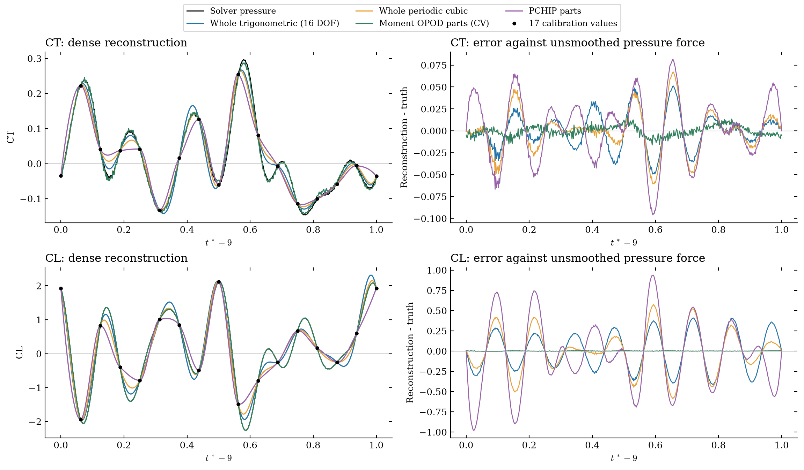

图 1｜整体重建与未平滑真值。低误差绿色曲线使用密集力矩；蓝、橙、紫曲线只使用稀疏受力。 · 矢量 PDF [original local attachment: 05_reconstruction.pdf]

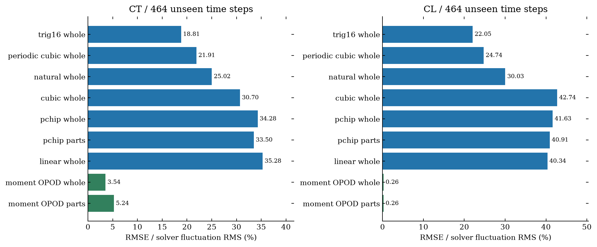

图 2｜相同的 464 个未校准时间点。绿色方法有额外观测信息，不应与蓝色方法混作同等信息预算。 · 矢量 PDF [original local attachment: 06_dense_scores.pdf]

## 数据与口径核查

算例为 Result/Sweep35，solver steps 4320:30:4800，t*=9–10；17 个真实记录时刻，16 个不同周期相位。求解器每周期 480 步；含两端的真值窗口共 481 点。原来的三条曲线来自 test/solver_groundtruth_20261003/Sweep35/body_parts.npz。新表面缓存包含 32,384 个面片的 17 帧压力力。

统一采用 U=0.29、A=0.548382、CT=−Fx/(U²A)、CL=Fy/(U²A)，继承原文件 native writer 尺度，不另外重复乘 2。求解器第 2/5 列（从 1 起数）是压力 Fx/Fy，第 4/7 列是总力；力矩输入为第 11/14/17 列。按照 solver step 精确映射，没有靠最近时间猜测。样本点整体压力映射的脉动归一化误差为 CT 0.303%、CL 0.168%。

原分部口径是胸鳍=2×左鳍、trunk=whole−胸鳍−fluke；空间 POD 使用实际左、右两侧面片积分。右侧标签由原来的镜像几何检查确定，只镜像分区，不复制力。全身和原三条曲线闭合到机器精度。两种分部定义的胸鳍差异约为 CT 1.26%、CL 0.78%（以实际胸鳍脉动 RMS 归一化），不足以解释重建方法之间的大差别。分部数据仍受既有网格压力到三角面的归属近似影响，整体守恒本身不能证明局部分配精确。

如果误把压力重建直接与总力比较，CT 会额外出现约 0.01686 的平均偏差；此差来自黏性贡献。局部黏性力没有导出，所以不能用本实验确认分部总力重建。

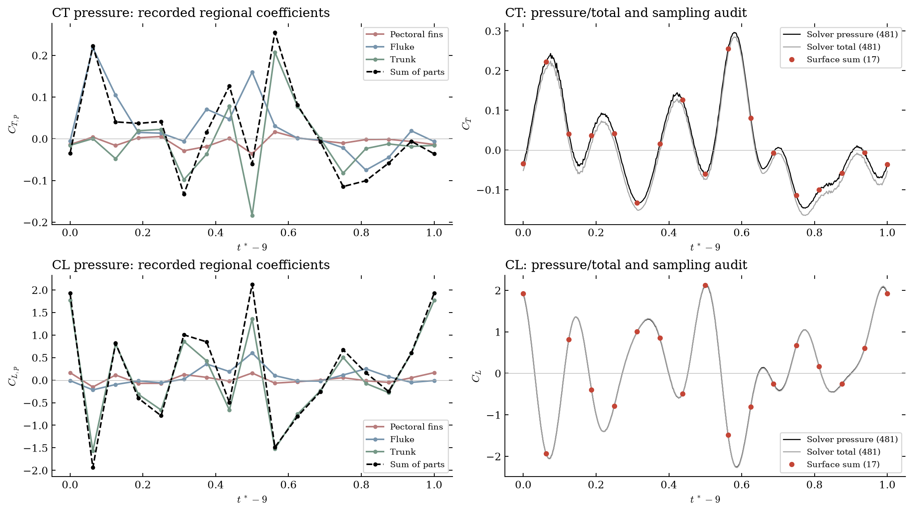

图 3｜原三部分、稀疏整体、密集压力力与密集总力。横轴为实际记录时间减 9。 · 矢量 PDF [original local attachment: 01_data_audit.pdf]

## POD 到底分解了什么

一条标量时间曲线直接做普通快照 POD，中心化矩阵是 1×17，只有一个非零模态。“第一模态能量 100%”是矩阵秩的事实，没有辨认流动物理的能力。本实验因此补做两种有明确定义的分解。

空间分布 POD：分别将胸鳍、尾鳍、躯干沿参考姿态 x 方向分成 20 个等宽材料分箱，积分每箱的压力贡献，得到每部位 17×20 的矩阵。CT、CL 分开中心化；时间采用梯形权重，两端各半权重。空间内积为等宽分箱系数的欧氏内积；这是净压力力分布的方差，不是流体动能，也不是全三维面片场的能量。各部位空间范围不同，不把空间模态直接一一做 MAC 配对。

| 部位 | CT：前 1 模态 | CT：前 2 模态 | CL：前 1 模态 | CL：前 2 模态 |
| --- | --- | --- | --- | --- |
| 胸鳍（双侧） | 87.06% | 96.54% | 97.66% | 99.70% |
| 尾鳍 fluke | 89.91% | 96.96% | 97.56% | 99.43% |
| 躯干 trunk | 79.48% | 89.46% | 94.66% | 98.84% |

CL 的第一模态占 94.66%–97.66%，说明各部位沿体长的净升力分布在这 17 帧内接近“固定形状 × 时间系数”。CT 更复杂，尤其 trunk，前两模态仅 89.46%。改用 10/40 个分箱后，CL 前两模态仍在约 98.8%–99.8%，结论稳定；CT 的数值更依赖分箱，需要保留这种差别。

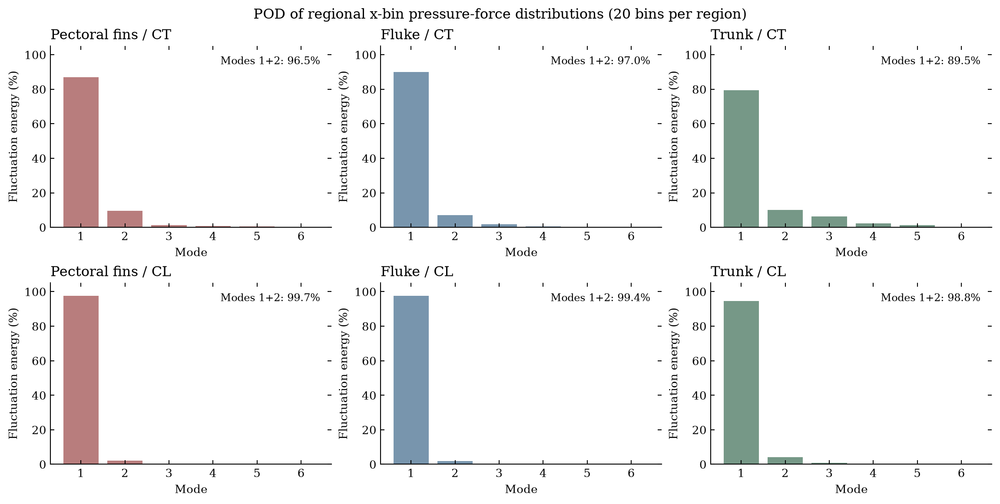

图 4｜三个部位独立的空间分布 POD；不能把低空间秩解释为低时间频率。 · 矢量 PDF [original local attachment: 02_spatial_pod_energy.pdf]

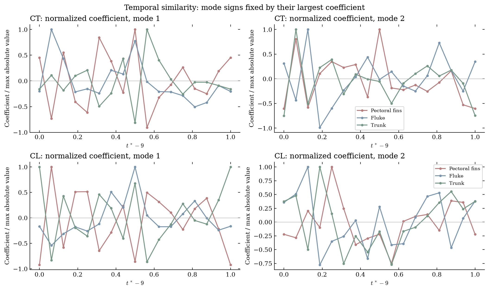

图 5｜时间系数比较。符号按各系数绝对值最大点为正固定，仅便于比较。 · 矢量 PDF [original local attachment: 03_temporal_modes.pdf]

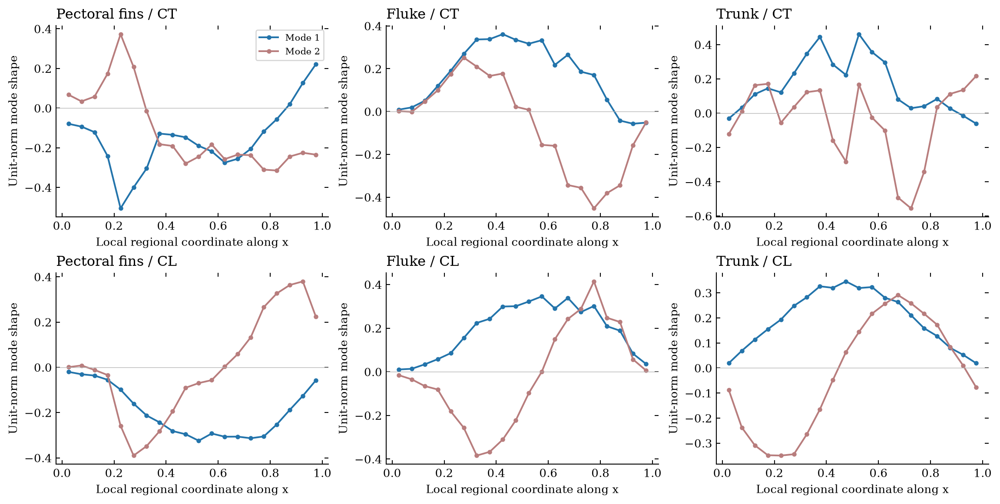

补图 A｜各部位的前两阶空间模态。每个横轴都按该部位自己的 x 范围归一化，不能把相同横坐标当作同源解剖位置。 · 矢量 PDF [original local attachment: 10_spatial_modes.pdf]

标量延迟 POD / SSA：同时对原三条标量曲线建立非周期 Hankel 矩阵，窗口长度 5 与 8；先减原序列均值，不用插值制造更多观测。窗口 8 时前两模态能量：CT 胸鳍 51.92%、尾鳍 55.66%、躯干 40.41%；CL 分别 60.53%、49.58%、50.84%。窗口 5 的结果又不同。这说明单条曲线包含多种时间变化，不能把空间 POD 的 99% 误读为“两个正弦波已足够”。由于只有一个周期，延迟 POD 仅作描述，不作频率机制或泛化证据。完整能谱见 delay_pod_energy.csv [original local attachment: delay_pod_energy.csv]。

## 三个部位有哪些相似性

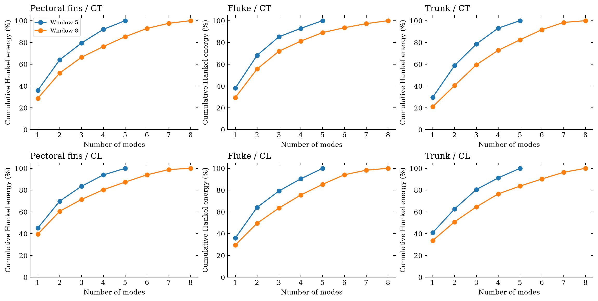

补图 B｜直接来自三条标量时间曲线的延迟 POD。窗口敏感性表明不能把该分解当成唯一的物理模态。 · 矢量 PDF [original local attachment: 11_delay_pod.pdf]

| 力方向 | 部位对 | 17 点零延迟相关 | 16 相位搜索后最大 /相关/ | 对应移位 / 周期 |
| --- | --- | --- | --- | --- |
| CT | 胸鳍（双侧） / 尾鳍 fluke | -0.188 | 0.509 | -0.5000 |
| CT | 胸鳍（双侧） / 躯干 trunk | 0.876 | 0.881 | 0.0000 |
| CT | 尾鳍 fluke / 躯干 trunk | -0.182 | 0.651 | -0.5000 |
| CL | 胸鳍（双侧） / 尾鳍 fluke | 0.336 | 0.409 | 0.0000 |
| CL | 胸鳍（双侧） / 躯干 trunk | 0.955 | 0.948 | 0.0000 |
| CL | 尾鳍 fluke / 躯干 trunk | 0.268 | 0.517 | -0.5000 |

最清楚的是胸鳍与躯干：CT 零延迟相关 0.876，CL 0.955。CL 前两维时间子空间有一个主夹角仅 3.81°，但第二个达 74.64°；这支持“共享一个很强的主导时间方向”，不支持“两套模态完全相同”。尾鳍与另外两部位的零延迟相关较弱，不能把它当成等比例副本。表中的循环移位搜索是描述性最大值，并非独立检验；只有 16 相位，移位分辨率是 1/16 周期。

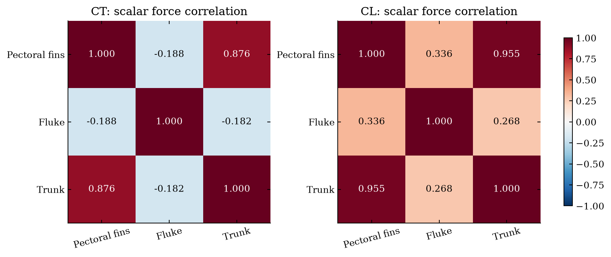

图 6｜原分部标量力的零延迟相关；相似性不构成力产生机制的因果证明。 · 矢量 PDF [original local attachment: 04_similarity.pdf]

## 为什么只有 17 帧很难恢复真实波形

用密集真值做事后频谱诊断，CT 的第 2/6 谐波分别占 44.21%/32.31%；CL 的第 6/5/8 谐波分别占 39.44%/19.89%/13.68%。这不是近似单一基频的曲线。频谱仅用于解释，未参与选模态或拟合系数。

在采样相位 t=j/16，sin(16πt)=0。因此给任意符合这些采样点的曲线加上 c·sin(16πt)，17 个点完全不变，点间波形却可改变。这是可辨识性的限制，任何只看这 17 点的算法都不能在没有额外假设时恢复这个系数。本次真实第 8 阶正弦项分别占 CT 1.74%、CL 4.47% 的脉动能量；其单项 RMS 已分别相当于总脉动 RMS 的 13.19%、21.13%。这不是普适算法误差下界，但解释了当前插值残差的重要来源。

只用稀疏交叉验证选择 Fourier 阶数，整体选到 CT 的 H=2、CL 的 H=1，密集误差却达 71.83%/101.03%。这项负结果已保留：接近采样分辨率极限时，少拿走一个点都可能破坏高频估计，稀疏 CV 本身不足以识别正确频带。因此报告同时保留预先定义的插值基准，未只展示低阶 Fourier 来夸大 OPOD 的优势。周期三角插值和周期样条是在第一轮频谱诊断后补充的标准对照；它们的排名应视作本轮探索性结果。

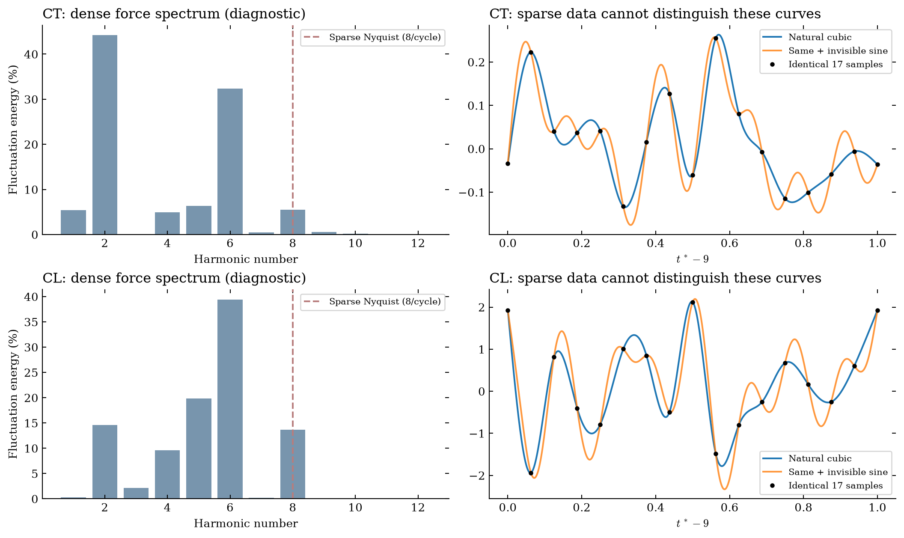

图 7｜密集频谱及两条通过同样 17 点的不同曲线。 · 矢量 PDF [original local attachment: 09_sampling_limit.pdf]

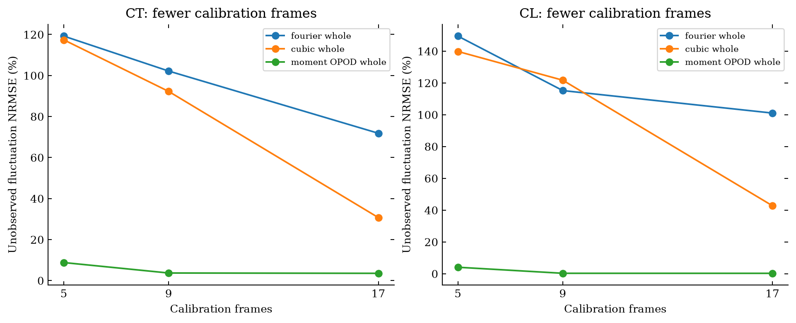

图 8｜5/9/17 帧敏感性，各自评价未校准时刻；不同横坐标的评价集合略有不同。力矩输入仍始终密集。 · 矢量 PDF [original local attachment: 07_sample_sensitivity.pdf]

## OPOD 的高分怎样解释，怎样不能解释

原 OPOD 流程是观测信号中心化 SVD → 时间系数 → 稀疏时刻重新求伪逆 → 目标回归。本实验保持这一结构，显式拟合截距；所有观测均值、POD 和回归参数在训练折内计算。输入是三向压力力矩，目标是三部位 CT/CL。全周期密集压力力没有作为预测模型输入。专门的真值污染测试确认：任意改变密集压力真值，所有非 oracle 预测及选参均保持不变。

力矩前三个 POD 模态能量为 99.859%、0.1399%、0.00111%；第三模态能量很小，却仍使整体 CT 误差从两模态的 5.12% 降到三模态的 3.54%。所以不能只按 99% 能量阈值决定观测模态数。三模态条件数约 300，真实传感器噪声下的稳健性尚未验证。三模态 OPOD 与直接三向力矩仿射回归数值相同，已实际核对；这里的优势来自观测中含有的信息，不是 POD 这个坐标变换凭空产生了预测能力。

力矩和合力本身通过力臂关系相关，且本实验两者来自同一求解器输出。因此这是很有用的观测映射可行性测试，但不能据此声称少数表面测压点也能达到这个误差。

另做了“密集整体力作为输入”的诊断：CT 约 0.211%、CL 约 0.155%。它把待评价答案作为输入，是 circular/oracle 对照，只说明公式闭合和映射残差，明确排除于预测排名。

### 整体准，分部却未必准

下面只列力矩 OPOD 的嵌套验证：外层留出某相位（两端作为同组）或连续 4–5 帧块，内层重新选秩。比较对象是实际被留出的分部数据，而不是拟合用的点。连续块含端部时也包含时间外推，不能与单点插值难度混同。

| 部位 | CT 单相位留出 % | CT 连续块留出 % | CL 单相位留出 % | CL 连续块留出 % |
| --- | --- | --- | --- | --- |
| 胸鳍（双侧） | 69.07 | 81.82 | 28.94 | 35.17 |
| 尾鳍 fluke | 113.60 | 146.19 | 57.11 | 70.25 |
| 躯干 trunk | 107.24 | 119.74 | 13.19 | 16.28 |
| 整体 | 5.09 | 5.64 | 0.31 | 0.34 |

整体 CT/CL 很准，胸鳍、尾鳍、躯干的分部误差却大得多，尤其 CT。全身力矩约束了合力，未充分约束内部归属；不同部位的错误可以相互抵消。只有整体密集真值，不能验证分部点间曲线。下面的两种曲线展示这种不确定性，不能把其中任一条当作真实分部曲线。

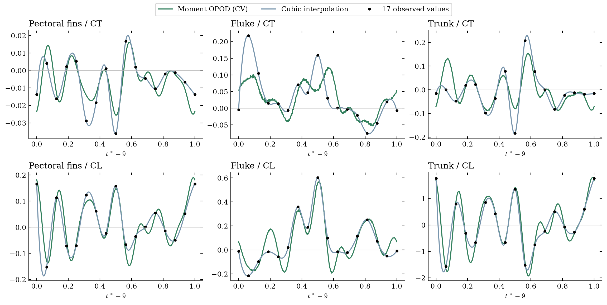

图 9｜分部曲线的两种模型。点间没有独立的分部密集真值；绿线也未被证明正确。 · 矢量 PDF [original local attachment: 08_regional_reconstruction.pdf]

## 分部后相加，为什么没有天然优势

对任何固定的共同线性时间算子 L，都有 L(Fpectoral)+L(Ffluke)+L(Ftrunk)=L(Fwhole)。本轮线性插值、两种非周期三次样条、同阶 Fourier、同秩 OPOD 的最大差异均小于 3×10⁻¹⁵，已数值核对。分部是否有用，取决于是否提供额外约束、不同的可验证先验或额外观测。

允许各部位单独选 OPOD 秩后，CT 选择 1/2/2 阶，求和误差 5.24%，反而高于直接整体三阶的 3.54%；CL 三个部位都选 3 阶，两条路线自然相同。PCHIP 因为是对数据非线性的插值算子，分部求和有一点改善，但仍在 CT 33.50%、CL 40.91% 的水平。没有证据支持“先分部一定比直接整体好”。

## 本轮结论与下一步

- 用于整体曲线：在仅有 17 帧时，周期三角插值/周期样条是有竞争力的展示与估计基准，但不能保证遗漏的点间峰值。若有密集力矩观测，本周期内直接整体 OPOD 比分部后求和更简单且不差。

- 用于部位物理：胸鳍与躯干共享强主导升力时间变化，尾鳍需要单独描述；该发现是同一周期的相关结构，不能据此断言同一生成机制。空间低秩和时间低频是两回事。

- 用于真正测压 OPOD：需要该 baseline 同步密集 probe 压力、真实 solver steps，以及最好至少另一个周期。冻结传感器位置、模态数与训练周期，再评价独立周期。当前未完成这一类验证，不能沿用力矩成绩代替。

- 最值得追加的数据：保持现有 16 个独立相位，再导出各间隔中点，得到 32 个独立相位（含周期端点共 33 帧），可解除第 8 阶正弦在当前网格上的盲区；仍需检验更高频和周期变化。为了验证分部而非只验证总和，需要这些时刻的独立分部积分。这里是基于已发现混叠问题的下一次实验建议，没有声称 33 帧已足够。

## 可复现记录

代码位于 [local path omitted]。入口为 run__orca_force.py，报告入口 run__report.py。读数据、数学、绘图分开；复用既有表面缓存读取、分区与压力守恒检查，并按原 OPOD 公式实现无额外大型依赖的回归。未修改旧原始数据或既有研究脚本。

输出包括 audit.json [original local attachment: audit.json]（输入 SHA256、尺度、选参和数值闭合）、dense_metrics.csv [original local attachment: dense_metrics.csv]、sparse_nested_cv.csv [original local attachment: sparse_nested_cv.csv]、pod_energy.csv [original local attachment: pod_energy.csv]、regional_samples.csv [original local attachment: regional_samples.csv]、moment_rank_scores.csv [original local attachment: moment_rank_scores.csv]、输入/预测/模态 NPZ 以及每张图的 PNG/PDF。4 项科学不变量测试通过：仿射映射恢复与守恒求和、密集目标真值隔离、Nyquist 不可观测性、标量 POD 秩。

范围：同工况单周期离线插补；不是实时因果预测，不是独立周期/跨工况泛化，不是局部黏性力重建。探索过程中增加了周期插值对照；所有候选结果保留。原数据拟合和最终评分的信息边界保持分开。

方法背景：[Holmes 等：POD](https://www.cambridge.org/core/books/abs/turbulence-coherent-structures-dynamical-systems-and-symmetry/proper-orthogonal-decomposition/A6135C9B104D4FD32A02363B5EE1406B)；[Frame 与 Towne：Space-time POD and the Hankel matrix](https://arxiv.org/abs/2206.08995)。本报告数字全部来自本轮本地实际计算，外部文献只用于方法术语与分解定义。

研究日期 2026-10-08 · 原始求解器数据未平滑 · 所有误差不是准确率
